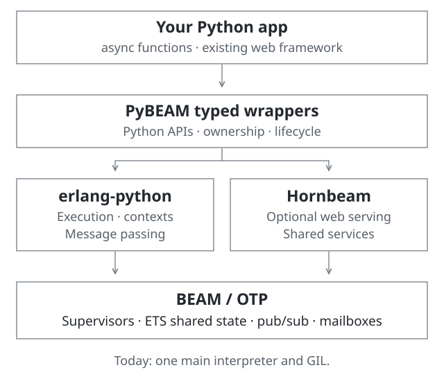

# PyBEAM

Run async Python on BEAM with supervised actors and shared messages.

Keep async Python and your existing web framework.
Give state an actor owner, or use atomic shared counters without an actor.
Notify readers with pub/sub; let OTP replace failed actors with fresh state.
PyBEAM owns runtime startup and shutdown, not your storage policy.

See [Why PyBEAM](docs/guide/why.md) for the architecture, a shared-state scenario, and the limits.

Read [Get started](docs/guide/index.md), then try [actors](docs/guide/actors.md) or [shared state](docs/guide/state.md).
