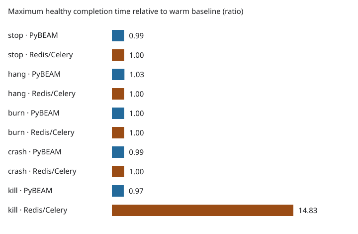
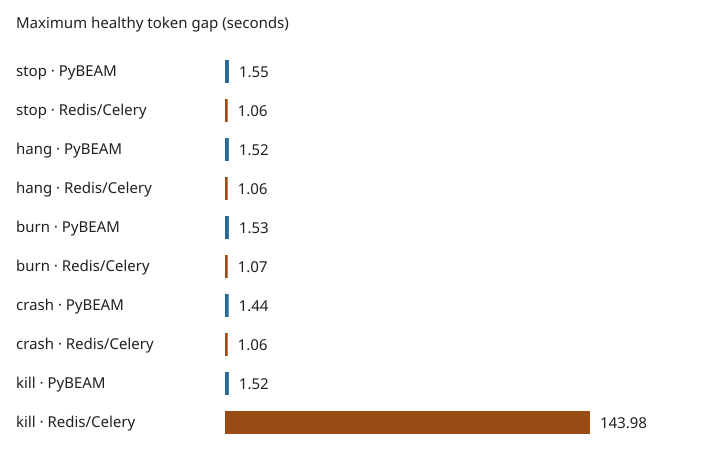
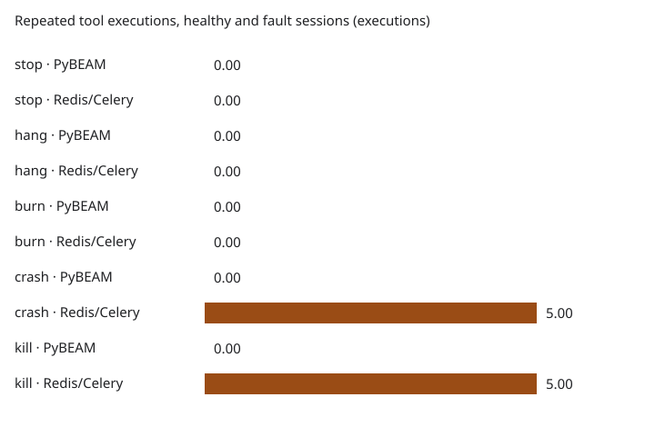

# Agent sessions comparison

Run the same deterministic Pydantic AI agent on PyBEAM and Redis/Celery under
Stop, hang, CPU burn, tool crash and node loss. The model needs no API key.
These are same-host observations, not production capacity or latency guarantees.

## Recorded results







The [JSON results](results/agents/comparison.json) contain individual completion
times, median and maximum baseline ratios, separate healthy/fault repeat counts,
fault states, Stop and recovery timings, execution counts and resource samples.
Fault states are recorded before cleanup; the runner stops sessions that remain
active.

## Reproduce

With the [agent demo prerequisites](../examples/agents/README.md#run-both-apps)
available and the interactive demo stopped, run from the repository root:

```sh
mise run example:agents-compare
```

The runner starts both stacks itself and replaces `results/agents/comparison.json`
and `assets/agents-{completion,gaps,repeats}.svg`, relative to this page.
It uses the default conventional Python interpreter and isolated PyBEAM tools.

## Measurement method

Each case uses fresh stacks. On each stack, 12 normal sessions warm the workers,
followed by a 12-session no-fault baseline and 12 healthy sessions beside one
fault. Both baseline and fault batches are warm. Stacks run sequentially on the
same host, with the other stack idle. The kill case interrupts a burn after its
first lookup; its completion deadline is 600 seconds.

Completion, Stop and recovery timings use HTTP observations with a target 50 ms
polling interval. Token gaps use server timestamps, include intentional lookup
pauses and exclude waiting for the first token. Memory is a sampled sum of
process RSS initiated after healthy-batch submission, not a peak; shared pages
are counted more than once. Docker's memory samples are also retained.

PyBEAM starts a fresh isolated process for each tool call; token gaps include
process startup, imports and replicated state writes. Celery runs tools inline
in existing prefork workers. The comparison retains these isolation semantics.

Redis visibility is an eligibility threshold, not a delivery timer. This Celery
transport checks every 10 seconds and scans expired deliveries every tenth
check, about 100 seconds apart. Queueing and the restarted 30-second burn add
to recovery time.

## Limits

PyBEAM reports an interrupted tool without a committed result instead of
re-running it. This is at-most-once execution, not a guarantee of no external
side effect. Redis/Celery redelivers the whole turn and can repeat tools.

Recovery covers same-host SIGKILL, not network partitions, whole-cluster restart
or loss of the machine. PyBEAM needs three replicas for initialization. The
[demo boundaries](../examples/agents/README.md#boundaries) describe storage-seed,
snapshot overflow and session-discovery limits.

## Appendix: environment

The recorded data uses Linux x86-64 with 8 CPUs and CPython 3.14.10t for PyBEAM;
it is not a measurement of the conventional-Python rerun configuration.
