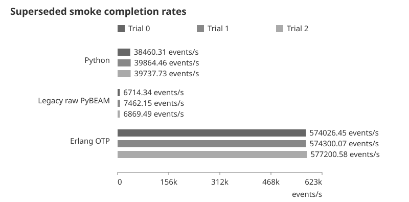
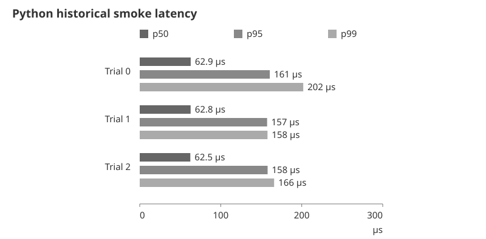
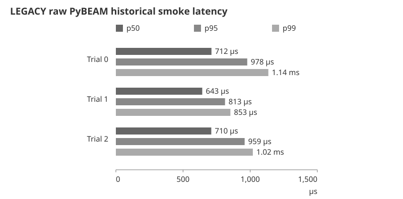
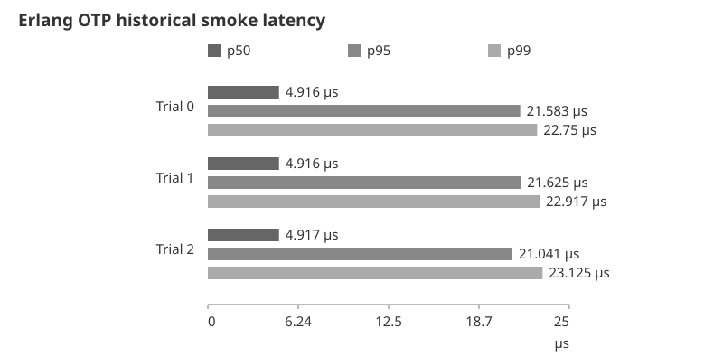

# Historical serial reference smoke, superseded

Nine historical serial trials completed, but their receipt identities did not prove which handler ran. These records are superseded by [the corrected smoke](CORRECTED_COMPARISON.md) and are not evidence for the new `@actor` API.

These are uncontrolled smoke observations, not a controlled performance comparison or a production capacity claim.

## What the records establish

Nine serial trials each completed 100 events with reported terminal counts of 50/50, two deletions, and confirmed cleanup without survivors or forced cleanup. Python and legacy raw PyBEAM receipts used producer request labels, so balanced misrouting or duplicate delivered IDs could pass; strict parsing did not establish handler identity.

## Diagnostic observations









Only 100 events were timed per trial, with fixed backend order and other builders active. Native VM startup and entity creation/deletion are outside throughput; PyBEAM deletion alone took about 207–210 ms.

## Interpretation

The common request was two rooms, 17 warmup events, scalar increment 1, seed 1 and four admitted requests. Python also bounded destination queues; native mailboxes remained unbounded.

No transport performed per-event JSON or Pydantic parsing. Native calls retained their real transport/reply overhead, while Python read shared state directly; this is not a comparison of identical instruction streams.

Latency uses each producer's own monotonic clock. RSS is sampled summed resident memory, not PSS, and CPU is an observed lifetime lower bound; short peaks can fall between samples.

The [contract](CONTRACT.md) defines the controls and unsupported families. These superseded records cannot establish corrected correctness acceptance.

## Appendix: environment and provenance

### Additional recorded method

All three configurations request uniform `rooms.local`, two rooms, 17 warmup events, 100 measured events, seed 1, window 4, queue capacity 4, and `queue_bound_scope="client_admission_only"`. The payload fixture is scalar increment 1. Delivery is exactly once without retries. Budgets remain 15 seconds, 512 MiB observed process tree RSS, eight processes, 32 threads, and 16 MiB artifacts per trial.

Fixtures are prepared before entity creation. Warmup drains before the same entities are reset. Warmup duration includes snapshot and reset work. Terminal snapshots occur after measurement and before deletion. Every producer timestamps before waiting for client admission. No producer creates an unbounded backlog of tasks. All measured inflight peaks were four.

The mean diagnostic rates and sample standard deviations were 39,354.17 and 776.69 for Python, 7,015.33 and 394.66 for LEGACY raw PyBEAM, and 575,175.70 and 1,758.92 for Erlang. These numbers do not establish which backend performs best under controlled conditions.

Creation, warmup, and deletion durations are preserved separately in every `adapter.json` and `summary.json`. PyBEAM deletion took about 207 to 210 ms and is not hidden in measurement throughput. Native VM startup is outside the entity phases and is recorded separately for PyBEAM. Resource samples cover the whole owned process lifetime. Sampled CPU is a lower bound on lifetime CPU, not exact measured-phase CPU. RSS may count shared pages more than once. Very short peaks can occur between 20 ms samples.

Negative controls cover missing or duplicate acknowledgments, wrong terminal state, missing deletion or cleanup, missing BEAM/source evidence, false backend identity, missing PyBEAM native revision or NIF, mismatched native revision, changed NIF hash, and changed executable/BEAM/source bytes. The raw PyBEAM producer also rejects a bad applied-count reply instead of recording a completion.

### Validation and remaining limits

These observations from `d3efc78` are provisional and superseded by `CORRECTED_COMPARISON.md`. Independent review `6a164` found a correctness proof blind spot. Python and LEGACY raw PyBEAM fabricated receipt identities from producer request labels. Balanced cyclic misrouting and duplicate delivered IDs could therefore pass despite terminal counts `[50, 50]`. The earlier exact-route claim was invalid. Do not use these records as corrected correctness acceptance or as evidence for the new `@actor` API.

The original raw records under `results/serial-*-4a2219c` remain unchanged. Their measured rates and repeat statistics are actual historical observations; the defect was in the completion proof. Nine trials were originally accepted at source commit `4a2219c38ec461a9971bad7992ed1bd5ef247bc4`. Each completed 100 events with the reported terminal totals, entity deletion totals, confirmed process cleanup, zero forced cleanup, and zero surviving owned processes. Strict receipt parsing alone did not establish actual handler identity.

The guardian follow-up from `1f5c767` is included privately. Its independent review was still pending when this report was written. Passing these trials does not constitute release approval.

Python and embedded PyBEAM used conventional GIL CPython 3.14.10. Python reported one interpreter and one event-loop worker. PyBEAM reported one interpreter, three active native worker contexts, and two native actor PIDs. Contexts returned from three to the baseline one after deletion. Actor PIDs disappeared and Python room state was collected. Three worker contexts do not mean three interpreters or CPU cores.

Both native runtimes reported OTP 29.1.2, ERTS 17.1.1, and one online scheduler. Erlang reported two room workers and null Python interpreter/GIL fields. This macOS host did not enforce CPU affinity. One requested core and one OTP scheduler do not prove exclusive CPU use.

The actual native executable was `/opt/homebrew/Cellar/erlang/29.1.2/lib/erlang/erts-17.1.1/bin/beam.smp`, SHA256 `abf718ce38d03646bbd57239d8ee1d0c91a7d7359e7aba7d4a0861ed8d4248cf`. The Python executable SHA256 was `5504147b44ff4544bb4f1039d2b4a7bed66aac3cfa4534471e32ef559687f28d`.

PyBEAM used the existing private native build at `../native-bench-pybeam`, pinned to `9baab2f4c16e37fab0c98dd3417c61f0d8f4a4d3`. Its actual `priv/py_nif.so` SHA256 was `6492f8ad58938c36f2480ca18bad52a0f713873eab646c666068b59515a7009b`. No native source or production runtime was changed. The build manifest and all declared assets were reverified after the trials. Erlang's two adapter BEAM files were built inside this integration worktree. Its build manifest contains actual compiler, source, and asset paths and hashes. It does not invent an unused NIF revision.

This PyBEAM result is LEGACY raw actor prototype evidence only. It says nothing about the new `@actor` safe-data frontend, which is a separate API pending review.

Run from `/Users/robby/projects/worktrees/pybeam/benchmark-integration`. These commands ran sequentially, never in parallel. Each runner acquired the global nonblocking exclusive load lock. A busy lock would fail visibly without retry. Choose new output names when repeating them.

Each directory retains strict adapter results, raw typed receipts, resource samples, provenance, ownership journals, outcomes, and repeat summaries. The native directories also retain actual build manifests and reset/deletion evidence. Source provenance was clean and identical across the three runs.

The full benchmark suite passed 103 tests in 9.19 seconds. It includes the existing 31 guardian/contract tests and the new references and oracle negative controls. Ruff check and format passed from `benchmarks/`. Strict ty passed with the repository, `src`, and `typings` search paths. Regenerating all four JSON schemas produced no changes. This integration did not rerun the showcase UI or browser suite.

The source worktrees `bench-python`, `bench-beam`, and `bench-pybeam` are no longer dependencies after the follow-up configuration portability fixes and evidence archive. Their changes are committed here and raw trials are retained here. This task does not delete them. Those historical assets are not required for new public runs. The completed trial records no longer require the original three adapter worktrees.

### Recorded commands

```sh
benchmarks/.venv/bin/python -m benchmarks run --config benchmarks/examples/serial_python.json --output benchmarks/results/serial-python-4a2219c
benchmarks/.venv/bin/python -m benchmarks run --config benchmarks/examples/serial_pybeam.json --output benchmarks/results/serial-legacy-pybeam-4a2219c
benchmarks/.venv/bin/python -m benchmarks run --config benchmarks/examples/serial_erlang.json --output benchmarks/results/serial-erlang-4a2219c
```

### Public reproduction

From a fresh Git checkout, install [mise](https://mise.jdx.dev/getting-started.html) and a C/C++ compiler with make, then run these commands from the repository root. Do not run `mise run setup` or add sibling checkout overrides. The native build uses at most two compiler jobs; dependency installation alone does not build it.

```sh
mise trust
mise install
mise exec -- uv sync --locked --project benchmarks
mise exec -- uv run --locked --project benchmarks python -m benchmarks.canonical_build
mise exec -- uv run --locked --project benchmarks python -m benchmarks.native_reference --build
mise exec -- uv run --locked --project benchmarks python -m benchmarks run --config benchmarks/examples/serial_pybeam.json
mise exec -- uv run --locked --project benchmarks python -m benchmarks run --config benchmarks/examples/serial_python.json
mise exec -- uv run --locked --project benchmarks python -m benchmarks run --config benchmarks/examples/serial_erlang.json
```

These short serial checks run 100 events per trial, three trials per backend. They create new ignored result directories; they do not regenerate identical historical values or overwrite archived evidence. `--native-source` still selects an explicit matching native checkout; the showcase requires `--trusted-native-root _build/hornbeam/lib/erlang_python`.
