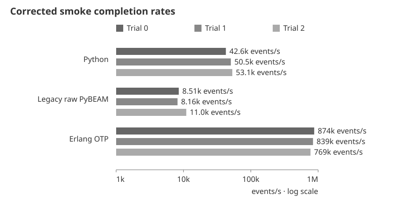
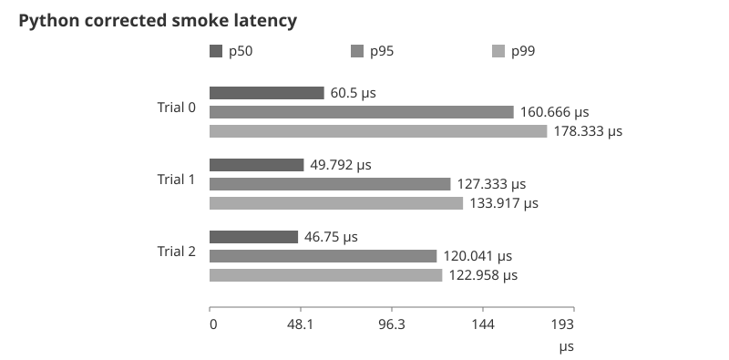
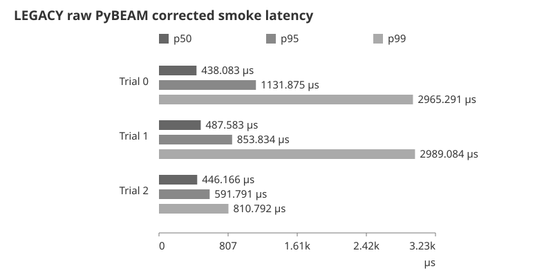
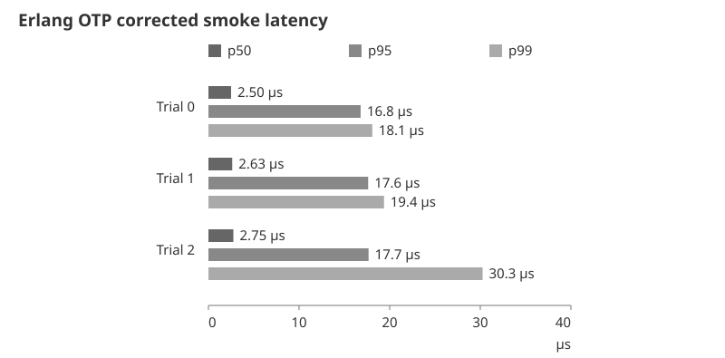

# Corrected handler identity smoke

All nine corrected scalar trials passed; ten delivery-fault controls were rejected. Handlers now return their received message ID and executing entity identity after applying the effect, closing the aggregate-count blind spot in the [historical report](COMPARISON.md).

These are uncontrolled smoke observations, not a controlled performance comparison or a production capacity claim.

## Matching trials

Each corrected trial completed 100 events with exact IDs/routes, counts of 50/50, two deletions and confirmed cleanup without forced cleanup or survivors. Each request used two rooms, 17 warmup events, scalar increment 1, seed 1 and four admitted requests; native warmup counts of 8/9 reset to 0/0.









The runs were serial with fixed backend order and very short intervals. Python bounded destination queues, but native mailboxes remained unbounded: only client admission was common.

## Delivery-fault controls

Python reference and legacy raw PyBEAM probes rotated real destinations, duplicated ID 0 or substituted IDs at least 100; all failed. PyBEAM also rejected an incorrect applied count with `Invalid applied acknowledgment`.

Three baseline smoke probes applied all 100 effects and retained counts of 50/50, but the guardian rejected their handler-derived wrong routes or IDs. This checks the aggregate-count blind spot rather than editing results to fabricate a failure.

Every negative trial had confirmed cleanup, no forced cleanup or survivors, and null completion, rate and latency scores. Native failure shutdown remained cooperative.

## Limits

Reply construction and identity/count checks stay inside timing, without per-event Pydantic construction. Other budgets, queue scope, ownership, warmup/reset and timestamps were unchanged.

Asset hashes and manifests are checked adapter attestations, not proof of VM memory mappings or a sandbox. Other workload families remain unsupported; see the [contract](CONTRACT.md).

## Appendix: environment and provenance

### Additional recorded method

The corrected Python reference and baseline smoke handlers reply after applying the increment with the received message ID, their own executing entity ID, and applied count. LEGACY raw PyBEAM rooms bind their own identity once during creation and return the same fields from the actual room handler. Producers verify replies and construct receipts from reply fields, not inferred request labels. The existing applied-count check remains. Erlang already bound these identities and was not weakened.

All timed work used the shared nonblocking exclusive load lock and ran serially. Budgets stayed at 15 seconds, 512 MiB, eight processes, 32 threads, and 16 MiB artifacts. These remain `uncontrolled_smoke` observations on an unreserved macOS host. Only 100 events were measured, in fixed backend order. There is no controlled performance winner, no capacity claim, and no evidence about the new `@actor` frontend.

Mean rates and sample standard deviations were 48,750.88 and 5,469.76 for Python, 9,221.45 and 1,549.56 for LEGACY raw PyBEAM, and 827,162.71 and 53,152.93 for Erlang. Each latency uses only its producer's own clock. Phase durations, sampled RSS, lifetime CPU observations, manifests, hashes, and ownership journals are retained in the raw directories.

Source commit `56a6125` fixes the receipt identity blind spot confirmed by independent review `6a164`. The old `d3efc78` observations are provisional and superseded. Their raw records remain unchanged under `results/serial-*-4a2219c`. Their measured rates were actual, but producer labels did not prove the identity of the executing handler.

Both Python runtimes used GIL CPython 3.14.10. Both native runtimes used OTP 29.1.2, ERTS 17.1.1, and one online scheduler. PyBEAM used the unchanged private native revision `9baab2f4c16e37fab0c98dd3417c61f0d8f4a4d3`. Its two actor PIDs disappeared, native contexts returned from three to one, and room state was collected. Three contexts are not three interpreters or CPU cores. There was one interpreter. CPU affinity was not enforced on macOS.

`results/corrected-negative-56a6125` retains ten full-guardian negative trials. No result files were edited to manufacture these failures. The probes rotate actual destinations or substitute IDs passed into the real handlers. Python reference probes alter the delivered queue/envelope. Native probes rotate actor references or alter the ID passed to the effect handler inside the actual actor. Received handler replies are retained in `received-replies.json`.

The standalone test command passed **121 tests in 11.10 seconds**, without an editable package installation or a caller-provided `PYTHONPATH`. The benchmark pytest configuration now supplies its repository/source paths. Ruff check/format and strict ty passed. Regenerating all four wire schemas produced no changes. No type ignores or casts were added.

The three historical directories `native-reference-{final,small,verified}-b51bb1c` were copied from `bench-beam` into `evidence/native-reference-archive` before cleanup. All 45 file sizes and SHA256 hashes were compared to the originals. `evidence/native-reference-archive/manifest.json` retains each proof. Its SHA256 is `5a6d019a039cd3fe67c9984cd60f2b2c075473727644f8ded48a0be4cc4c8477`. Archive tests verify the retained bytes without requiring the old source worktree. Historical paths inside original evidence were not rewritten.

An additional 16-room, 1000-event default-size health attempt was blocked before any trial started because another benchmark held the load lock. There was no retry or bypass. The blocked attempt is retained under `results/corrected-default-health-56a6125`. Parent scheduling is required to complete that additional check. The nine corrected small trials above are complete.

The guardian failure fix has independent acceptance. The corrected reference integration has **no final independent approval** and is not merged into canonical main. Keep `benchmark-integration` and `native-bench-pybeam` for reruns. The three finished source adapter worktrees can now be removed by the parent while retaining their unmerged branches. This task did not delete any worktree.

### Recorded commands

```sh
benchmarks/.venv/bin/python -m benchmarks run --config benchmarks/examples/serial_python.json --output benchmarks/results/corrected-python-56a6125
benchmarks/.venv/bin/python -m benchmarks run --config benchmarks/examples/serial_pybeam.json --output benchmarks/results/corrected-legacy-pybeam-56a6125
benchmarks/.venv/bin/python -m benchmarks run --config benchmarks/examples/serial_erlang.json --output benchmarks/results/corrected-erlang-56a6125
uv run --project benchmarks python -m pytest -c benchmarks/pyproject.toml benchmarks/tests -q
```

### Reproduction boundary

Python and pure OTP references work in-repo; PyBEAM still needs a private pinned build manifest that the canonical builder does not produce (see [build boundary](CONTRACT.md#current-build-boundary)).

### Optional private PyBEAM rerun

This needs a separate clean checkout at the builder's pinned native revision, with no shared or escaping build outputs. These commands deliberately build private benchmark assets, not the canonical runtime:

```sh
NATIVE="$HOME/repos/native-benchmark-current"
PYTHON="$(mise exec -- uv python find 3.14.10)"
mise exec -- uv run --project benchmarks python -m benchmarks.pybeam_reference_build "$NATIVE" --python "$PYTHON"
mise exec -- uv run --project benchmarks python -m benchmarks run --config benchmarks/examples/serial_pybeam.json --native-source "$NATIVE"
```

### In-repository reproduction

Run serially from the repository root; omit `--output` to create fresh result directories without overwriting archived evidence. These commands run new smoke observations, not identical historical values.

```sh
mise exec -- uv sync --project benchmarks --locked
mise exec -- uv run --project benchmarks python -m benchmarks --help
mise exec -- uv run --project benchmarks python -m benchmarks.native_reference --build
mise exec -- uv run --project benchmarks python -m benchmarks run --config benchmarks/examples/serial_python.json
mise exec -- uv run --project benchmarks python -m benchmarks run --config benchmarks/examples/serial_erlang.json
mise exec -- uv run --project benchmarks python -m pytest -c benchmarks/pyproject.toml benchmarks/tests -q
```
