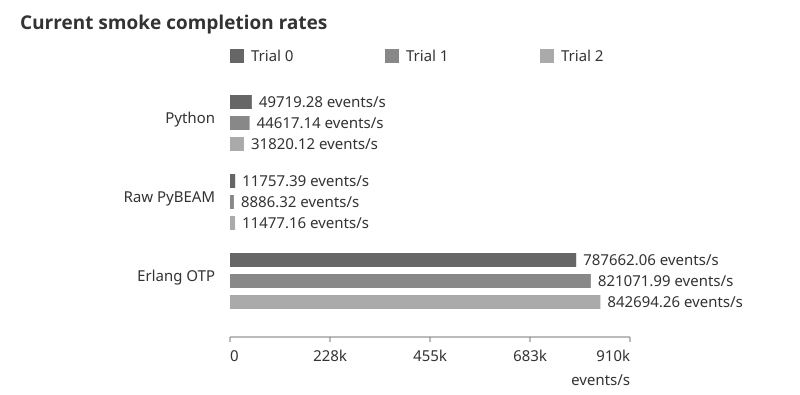
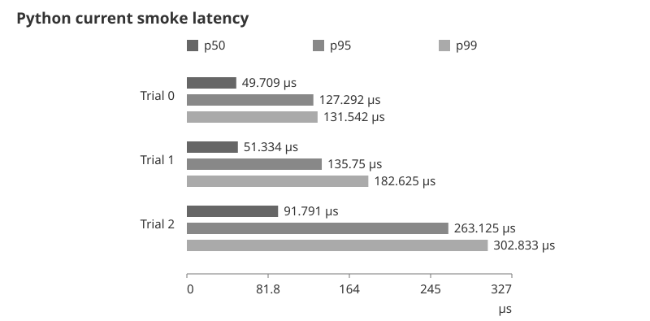
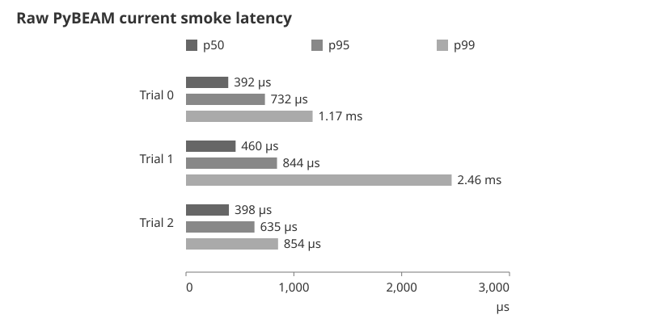
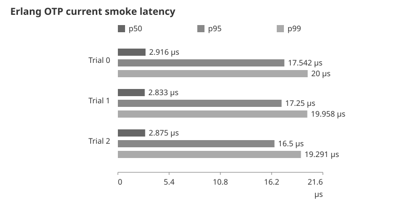

# Current runtime scalar references

Nine current-runtime scalar trials passed and 16 delivery-fault controls were rejected. This private integration candidate measures the raw unbounded actor API, not the new `@actor` frontend; it is neither release clearance nor a performance ranking.

These are uncontrolled smoke observations, not a controlled performance comparison or a production capacity claim.

## Recorded results









Backend order rotated over three rounds, so every backend occupied every position once. Each healthy trial retained 100 receipts, terminal counts of 50/50, and confirmed cleanup without forced cleanup or survivors.

Ten identity/count controls and six full-delivery controls were rejected. The latter applied all 100 effects with counts of 50/50 before the guardian rejected wrong routes, duplicate IDs or substituted IDs; failed trials received no scores.

## What ran

Each trial used uniform `rooms.local`, two entities, 100 measured events, 17 warmup events and a four-request window. Python bounded its destination queues; native mailboxes remained unbounded, with only client admission common.

The raw adapter uses `ActorSpec`, `ActorRef`, `OwnedActorRef`, `spawn` and explicit `UnboundedMailbox`. Handler replies carry their received message ID and bound room identity after the effect; identity checks and real API calls remain inside timing.

The guardian owns VM startup through the existing `spawn_owned`, `py_launch` and runtime loader. No new supervisor, launch API or runtime override was introduced.

One GIL-enabled interpreter used native contexts that went from one to three and back to one. Loaded C created/destroyed counters were 1/0, 3/0 and 3/2; actor PIDs disappeared and Python state was collected before cooperative VM shutdown.

## Limits

Trials ran serially under the nonblocking load lock, without automatic retries. RSS is sampled resident memory rather than PSS, and CPU observations include process lifetime work.

No HTTP comparison, new actor frontend, churn, durability, retry, full native CT suite or installed-wheel gate is claimed. The existing passive peer-close flake was not retested.

The local website at `http://127.0.0.1:38921` queues only fixed scalar profiles, serially. Missing assets disable a card with a reason; it does not build/install anything or provide public authentication.

## Appendix: environment and provenance

This is a private integration candidate. It needs a fresh independent review because the runtime changed. It is not release clearance or a performance ranking.

The candidate started at PyBEAM `421415a4dfa7d4758b26a0144441f9eaf8290551`. The approved reference changes were selected from `2c7b846`. No old SDK core files were merged. The measured code is `fe71ba1f52d239871a97cb2e4b87bcdf2b6794aa`.

The private native checkout is `../native-benchmark-current` at `a1ca04bfcaea817654ec7d1972f210c7a60075c4`. Its source is unchanged. Its NIF and Erlang modules were built in that private checkout with the recorded builder commands. CMake used at most two jobs. These are not copied canonical artifacts. No canonical native build was performed.

The loaded private NIF SHA256 is `8a98acf2a0cdd74f03abf8c9abd53255ddeaf171734f87d1d5cdfdf5681c3b8f`. The build uses CPython 3.14.10 and OTP 29.1.2 with ERTS 17.1.1. The host is macOS 27.2.1 arm64. `otool` reports a minimum macOS version of 27.2 for this artifact. No older OS compatibility was tested. Each native trial contains its build manifest, asset hashes and source fingerprint.

The corrected historical reports and measurements from SDK `6bd1069` with native `9baab2f` are unchanged. They are a separate baseline. They were not relabeled as current results. Git comparisons against `2c7b846` found no changes in the corrected, serial or archived evidence paths.

`results/current-fe71ba1/` contains nine passing trials. Backend order rotates as Python/Erlang/PyBEAM, Erlang/PyBEAM/Python and PyBEAM/Python/Erlang. Every backend was run once in each position. Each result has 100 receipts and final counts of 50/50. All cleanup states are confirmed with no survivors or forced cleanup.

`results/current-negative-fe71ba1/` contains 16 rejected trials. Ten retain the approved identity and count controls. Six additional controls let all 100 effects finish before the common guardian rejects a wrong route, all IDs equal to zero or IDs increased by 100. Those six results still have counts of 50/50. Rejected trials have null completion, latency and throughput summaries. Cleanup is confirmed without forced cleanup.

`results/current-fe71ba1/artifact-manifest.json` records stable file sizes and SHA256 values for 427 new evidence files. The recorded native asset hashes were checked again against file bytes. Python and pure OTP provenance each contain only the Python source checkout. Neither claims an unused PyBEAM native source.

The final check logs are under `results/current-fe71ba1/checks/`.

* Ruff lint and format checks passed for the checkout.
* Strict ty passed for the root and the separate benchmark project, with warnings treated as errors.
* All 132 benchmark tests passed without an inherited PYTHONPATH. This includes the original 121 tests, five current profile checks and six full delivery controls. The current native fixture executed loaded C counters.
* The nonruntime, nonbrowser core selection passed 433 tests, with 58 deselected. It included optional import isolation, style and public typing tests. A private CPython 3.14.10 test environment explicitly installed the optional framework dependencies and Hornbeam's Python package. Earlier attempts using a temporary uv overlay could not find the sibling ty executable. Those setup failures were not counted as passes. The separate test environment resolved that issue without source changes.
* The actual Chrome test passed with `--run-browser`. It started Python and Erlang reference profiles, checked their displayed results and SVG values, tested cancellation and confirmed cleanup after guardian death and application shutdown. No page or console errors were reported. It is now marked `browser` and skips unless explicitly enabled. A failed job reports its status and logs instead of only waiting for a completion label.

Python-only jobs have null native configuration. PyBEAM still requires its actual source and verified NIF assets. Source archives without Git metadata have a clear unsupported capability message rather than an invented Git revision. The separate QA fixes are commits `0f9e85b` and `a7e5b84`. A standalone version is commit `a7ee7ace6e3d78ab6d1e5f30bb851f89c244dd24` on `experiment/benchmark-current-qa`, based directly on `421415a`.

It includes the nullable schema and does not depend on the reference backends. Its offline gates passed 11 focused tests, with Chrome correctly skipped without opt-in. No timed load was launched after the requested clock pause.

### Recorded commands

```sh
uv sync --extra showcase
uv sync --project benchmarks
uv run --project benchmarks python -m benchmarks.pybeam_reference_build \
  ../native-benchmark-current --python /opt/homebrew/opt/python@3.14/bin/python3.14
uv run --project benchmarks python -m benchmarks.native_reference --build
uv run --project benchmarks python -m benchmarks run --config benchmarks/examples/serial_python.json
uv run --project benchmarks python -m benchmarks run --config benchmarks/examples/serial_erlang.json
uv run --project benchmarks python -m benchmarks run --config benchmarks/examples/serial_pybeam.json \
  --native-source ../native-benchmark-current
uv run --extra showcase python -m examples.showcase \
  --trusted-native-root ../native-benchmark-current
```

### Reproduction boundary

Python and pure OTP references work in-repo; PyBEAM still needs a private pinned build manifest that the canonical builder does not produce (see [build boundary](CONTRACT.md#current-build-boundary)).

### Optional private PyBEAM rerun

This needs a separate clean checkout at the builder's pinned native revision, with no shared or escaping build outputs. These commands deliberately build private benchmark assets, not the canonical runtime:

```sh
NATIVE="$HOME/repos/native-benchmark-current"
PYTHON="$(mise exec -- uv python find 3.14.10)"
mise exec -- uv run --project benchmarks python -m benchmarks.pybeam_reference_build "$NATIVE" --python "$PYTHON"
mise exec -- uv run --project benchmarks python -m benchmarks run --config benchmarks/examples/serial_pybeam.json --native-source "$NATIVE"
```

### In-repository reproduction

Run serially from the repository root; omit `--output` to create fresh result directories without overwriting archived evidence. These commands run new smoke observations, not identical historical values.

```sh
mise exec -- uv sync --project benchmarks --locked
mise exec -- uv run --project benchmarks python -m benchmarks --help
mise exec -- uv run --project benchmarks python -m benchmarks.native_reference --build
mise exec -- uv run --project benchmarks python -m benchmarks run --config benchmarks/examples/serial_python.json
mise exec -- uv run --project benchmarks python -m benchmarks run --config benchmarks/examples/serial_erlang.json
mise exec -- uv run --project benchmarks python -m pytest -c benchmarks/pyproject.toml benchmarks/tests -q
```
