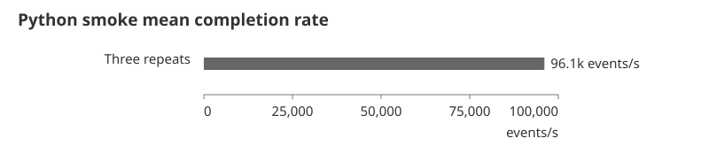
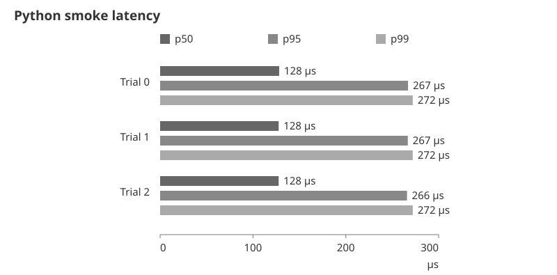

# Smoke evidence and comparison status

The Python-only smoke passed three fresh subprocess repeats: 1,000 distinct completions each, correct destinations and terminal counts, and confirmed cleanup without survivors. No native backend ran in this experiment.

These are uncontrolled smoke observations, not a controlled performance comparison or a production capacity claim.

## Diagnostic observations





The rate chart shows the recorded three-repeat mean, not per-repeat rates; those raw rates are unavailable in this checkout. Sample standard deviation was 302.76 events/s.

## What ran

Uniform `rooms.local` used seed 1, 16 task entities, 100 warmup events and 1,000 measured increments per repeat. Python passed in-process objects without serialization; the canonical JSON scalar fixture was one byte, not a claim about encoded transport bytes.

Each repeat observed a queue peak of one and an inflight peak of 16. All 16 entities shut down, with zero reported failure/loss, no surviving owned processes and no forced cleanup.

Lifetime adapter CPU samples were approximately 0.159, 0.156 and 0.158 seconds, including startup and warmup. Harness and guardian observations remained separate; no child VM existed.

## Comparison status

| Backend | Status |
| --- | --- |
| Python asyncio smoke | Three correctness repeats passed |
| Actual PyBEAM native actors | Not run; native ownership/build validation still needed |
| Native Erlang or Elixir | Not run in this experiment |

No speed ranking, native crash probe, two-node run, long run, integration pipeline or MVP gate follows from this smoke. The managed launcher's unregistered detached VM path is not covered by the guardian's spawn-ownership guarantee; see the [contract](CONTRACT.md).

## Appendix: environment and provenance

### Additional recorded method

The diagnostic mean was 96068.14 completed events per second, with sample standard deviation 302.76 across three repeats. CPU samples were observed lifetime lower bounds of about 0.159, 0.156, and 0.158 seconds for the adapter processes. They include startup and warmup. The raw files keep harness and guardian memory and CPU separate. No child VM existed in these Python runs.

The watchdog settings were 15 seconds per repeat, 512 MiB of observed workload-tree RSS, eight processes, 32 threads, and 16 MiB of artifacts. Sampling was requested every 20 ms, with observation overhead in addition to that interval. These were sampled budgets, not physical allocation guarantees. One core was requested but CPU affinity was not enforced on macOS.

The default smoke passed three fresh subprocess repeats at contract baseline `af2e257c9bdfdf420f3f523b5d20313f2163f0ab`. The checkout was clean when provenance was captured. Its parent source baseline is `6bd10699823046e94c6444b45904ae5a679a9e0b`. The paired native checkout was clean at `9baab2f4c16e37fab0c98dd3417c61f0d8f4a4d3` and was not modified or executed.

Raw evidence is local under `benchmarks/results/contract-baseline-af2e257/`. It includes source fingerprints, full runtime metadata, three adapter results, 3000 validated receipt JSONL records, resource samples, and cleanup outcomes. Results are ignored by Git. This note does not replace those files.

The runtime was conventional CPython 3.14.10 with the GIL enabled, one interpreter, and one event-loop worker. Pydantic was 2.14.3 and psutil was 7.2.2. The host was macOS 27.2.1 on arm64 with 10 logical CPUs. The recorded one-minute load average was about 1.99. The host was not controlled. No OTP, ERTS, or Elixir runtime was used by this smoke.

Ruff lint and format checks passed. Strict ty passed with warnings treated as errors. All 23 harness tests passed. The tests cover strict boundary parsing, accidental scale rejection, completion and terminal-state rejection, percentile and repeat statistics, advisory locking, wall-time and observed RSS/process/thread/artifact budgets, false cleanup acknowledgments, PID creation-time guards, adapter death, and runner death with guardian-owned detached-child cleanup.

### Recorded commands

```sh
uv run --project benchmarks python -m benchmarks run --output benchmarks/results/contract-baseline-af2e257
```

### Public reproduction

From a fresh Git checkout, install [mise](https://mise.jdx.dev/getting-started.html) and a C/C++ compiler with make, then run these commands from the repository root. Do not run `mise run setup` or add sibling checkout overrides. The native build uses at most two compiler jobs; dependency installation alone does not build it.

```sh
mise trust
mise install
mise exec -- uv sync --locked --project benchmarks
mise exec -- uv run --locked --project benchmarks python -m benchmarks.canonical_build
mise exec -- uv run --locked --project benchmarks python -m benchmarks.native_reference --build
mise exec -- uv run --locked --project benchmarks python -m benchmarks run --config benchmarks/examples/serial_pybeam.json
mise exec -- uv run --locked --project benchmarks python -m benchmarks run --config benchmarks/examples/serial_python.json
mise exec -- uv run --locked --project benchmarks python -m benchmarks run --config benchmarks/examples/serial_erlang.json
```

These short serial checks run 100 events per trial, three trials per backend. They create new ignored result directories; they do not regenerate identical historical values or overwrite archived evidence. `--native-source` still selects an explicit matching native checkout; the showcase requires `--trusted-native-root _build/hornbeam/lib/erlang_python`.
