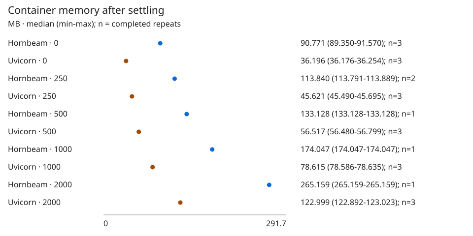
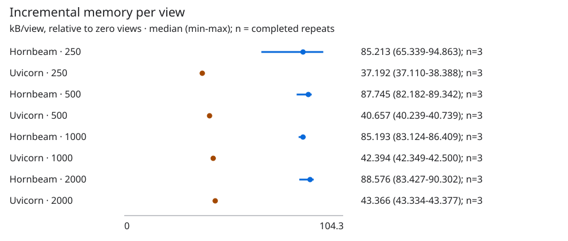
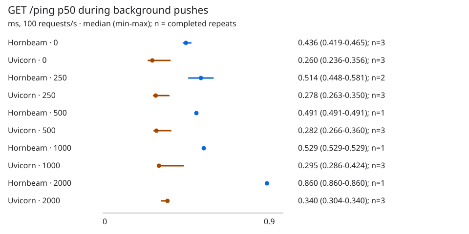
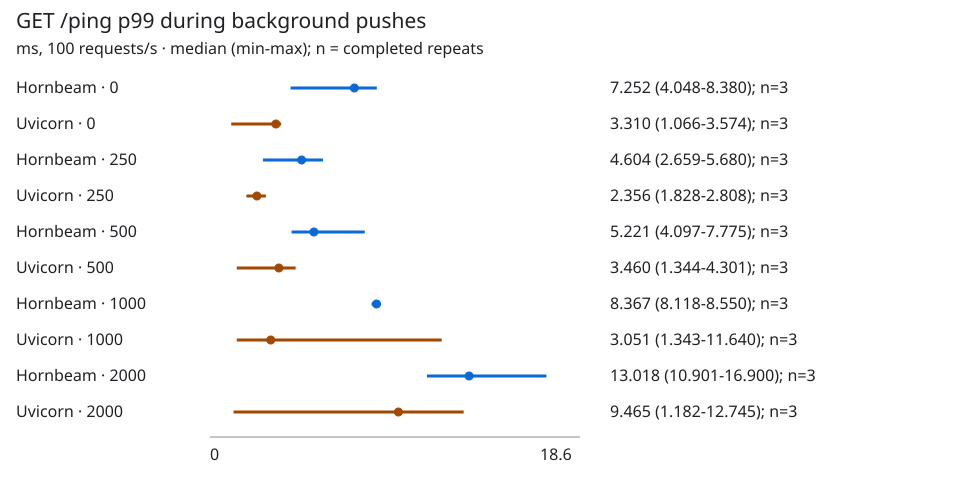
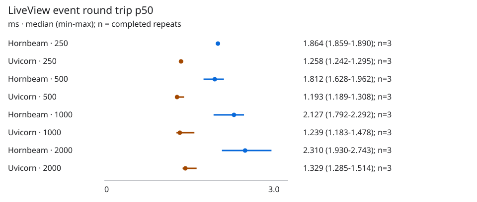
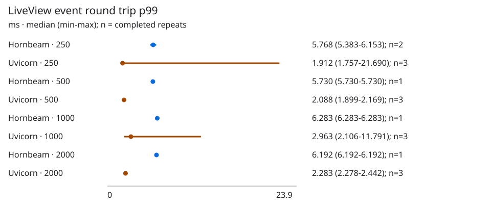
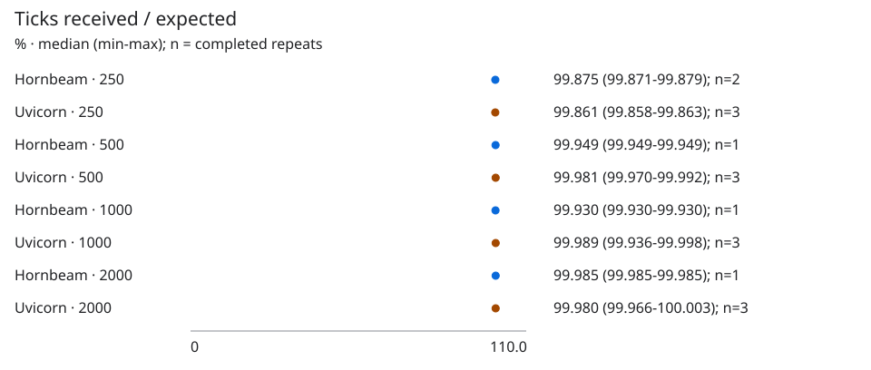

# PyView background-push load

From the repository root, after the setup in the appendix:

```sh
mise exec oha@1.17.0 -- taskset -c 4-7 uv run --no-sync python -m benchmarks.web.pyview_load --output "$HOME/pyview-load-new"
mise exec -- python -m benchmarks.web.pyview_charts "$HOME/pyview-load-new"
```

Add `--smoke` to the first command for a two-second protocol check with zero
and four views (not a capacity measurement). Output directories must be new
and outside the repository. The second command regenerates the SVGs using
only Python's standard library; it expects full 30-second measurements.

## Results

Both servers completed all five counts in all three repeats (30 trials).
Dots are medians, whiskers are min–max, and **n** is successful repeat count.
At 2000 views, incremental memory was 88.576 (83.427–90.302) kB/view for
Hornbeam and 43.366 (43.334–43.377) kB/view for Uvicorn. Container memory
was 266.191 MB and 122.950 MB respectively.










Every completed HTTP trial returned 3000 HTTP 200 responses without oha errors.
Every completed nonempty trial received all 300 event replies. Aggregate tick
delivery was 99.821–100.042% of views × elapsed seconds; timer phase and window
boundaries allow counts slightly above 100%.



## What this measures

The same self-contained PyView app runs on both servers: each view schedules
`schedule_info` at 1 Hz, increments a counter, and re-renders. `GET /ping` returns
`ok`. There are no PyBEAM services. The Python client fetches a fresh page per
view for its signed session and CSRF token, validates the Phoenix WebSocket join,
and continuously reads nonempty diffs. Joins run in batches of 32 across four
loopback source addresses.

Each count gets a fresh container, five seconds to settle after joining,
then one cgroup v2 `memory.current` sample. This includes the whole container,
not just Python heap or RSS. The per-view slope is
`(memory_at_N - memory_at_0) / N`, pairing baselines within each repeat.
MB and kB are decimal units. During the next 30 seconds, oha sends 100 requests/s
with concurrency 16 and latency correction. Ten sockets receive one event probe
per second; latency runs from send to successful rendered reply. Each trial's
percentiles are summarized separately, not pooled across repeats.

This is not a saturation test, CPU-heavy workload, browser rendering test,
per-view tick-delay guarantee, or production capacity claim. Slow-consumer
queues, shared state, durability, multi-worker Uvicorn, distributed execution,
and long-term leaks were not measured. Both servers' teardown logs report failed
timer removal after socket closure; disconnect cleanup was not benchmarked.

## Appendix: setup and environment

```sh
mise install
mise exec -- uv sync --locked --all-extras
git -C ../hornbeam fetch origin main
git -C ../hornbeam switch --detach 87cfb301c5d2958e9626d727fba786239a76b0be
mkdir -p _checkouts
ln -s ../../hornbeam _checkouts/hornbeam
mise exec -- uv run --locked python tools/build_native.py
mise install oha@1.17.0
docker build -t pybeam-web:jammy benchmarks/web
```

Create the checkout link only if it does not already exist; if it exists, verify
its target. The native build uses `_checkouts/hornbeam`, overriding `rebar.config`'s
Hornbeam pin. The benchmark launcher gives checkout BEAM files precedence over
stale copies in `lib/`. The Python package pin in `pyproject.toml` matches the
native pin, but is not the Erlang server build source. Other native dependencies
retain the PyBEAM pins, including erlang-python below.

Builds need a C compiler and mise tools. The image mounts home read/write
at its original path: use only a trusted image. This is contributor setup,
not an end-user installation claim. The runner holds `measurement_lock`; do not
run benchmark tests or other loads concurrently. Raw JSON, logs, exit states,
and failure tracebacks stay outside Git.

- Measured 2026-11-18; raw run: `$HOME/pyview-owned-table`, with no concurrent tests.
- Host: Intel Xeon x86_64, 8 vCPUs, 31 GiB RAM, no swap; Ubuntu 22.04.5,
  Linux 6.8.0-1060-aws; Docker 29.9.2, cgroups v2, oha 1.17.0.
- Both containers: CPUs 0–1, two-CPU quota, 2 GiB memory, no additional swap,
  host network, 200,000 file descriptors. Clients/oha: CPUs 4–7, outside cgroup.
- Hornbeam: two worker contexts, one shared loop, two acceptors, two BEAM
  schedulers. Uvicorn: one worker, asyncio, h11, websockets. Compression and
  client automatic pings disabled. This reuses the web benchmark configuration,
  not a matched Python worker-count comparison or tuning search.
- Python: conventional CPython 3.14.10 (GIL enabled); OTP 29.1.2 / ERTS 17.1.1.
- PyView 0.9.0 at `d29dda1fb1f3a09c3c0a3c9102a8f0490f6f9972`;
  Starlette 1.10.0, Uvicorn 0.54.0, websockets 16.1.1.
- PyBEAM base: `f58a0210a31075416c8bd8fd4db39c2dfce30568`, with checkout-first
  launch-path selection committed alongside this document.
- Hornbeam rerun pin: `87cfb301c5d2958e9626d727fba786239a76b0be` (merged session-table
  fix). Measurements are retained from the pre-merge run without a benchmark rerun;
  erlang-python: `40e5c41e898f77c424ac54a038305fc90bb1d7d8`;
  erlang-ws: `09bea3e650187aaeeaba1a8c734338bdeedfe136`;
  erlang-h1: `40889c592e5c7ef9e1cb8e6e5560d96d6cb5fa7a`.
- Container base: Ubuntu 22.04, glibc 2.35, digest pinned in `Dockerfile`.
