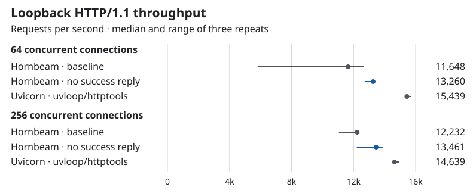
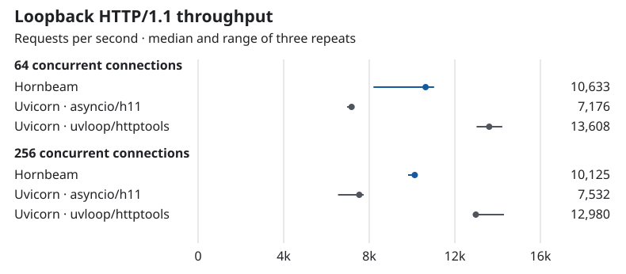

# ASGI serving benchmark

One application returns 19-byte JSON from `GET /` and echoes text on `/ws`.
The four launch paths are A: Hornbeam; B: Uvicorn in PyBEAM's managed runtime;
C: standalone Uvicorn, one worker; C2: standalone Uvicorn, two workers.
This measures serving only, not shared state, persistence, or application work.

## Native HTTP throughput

After the runtime and Hornbeam changes merged, Hornbeam trailed Uvicorn with
uvloop/httptools by 8% at 64 connections and 9% at 256 connections on pooled
median throughput. The two batches disagreed on which Hornbeam build was
faster. All trials returned only HTTP 200 responses, but VM CPU contention
varied during the runs, so this comparison does not isolate the effect of
skipping success replies.



[Reproduce the task-reply comparison](#task-reply-comparison-appendix).

### Earlier comparison with asyncio/h11

On the small JSON route, Hornbeam served 34–48% more requests per second than
single-worker Uvicorn with asyncio/h11, and 22% fewer than single-worker Uvicorn
with uvloop/httptools. This is a loopback HTTP/1.1 test, not a container,
WebSocket, or production-capacity result.



### Reproduce the host run

From a clean PyBEAM checkout on Linux with CPUs 0–7, prepare the Hornbeam
checkout in the [appendix](#host-run-appendix), then run:

```sh
mise install
mise exec -- uv sync --locked --all-extras
mkdir -p _checkouts
ln -s "$(realpath ../hornbeam-web-asgi)" _checkouts/hornbeam
mise exec -- uv run --no-sync python tools/build_native.py
mise exec -- uv pip install --python .venv/bin/python uvloop==0.23.0 httptools==0.8.0
mise install oha@1.17.0
mise exec oha@1.17.0 -- uv run --no-sync python -m benchmarks.web.run \
  --host-http --output "$HOME/web-http"
```

The output directory must not exist. The runner pins each server to CPUs 0–1
and the load generator to CPUs 4–7, rotates server order, and rejects trials
with errors or non-200 responses. It measures each concurrency for 10 seconds
after a warm-up. To recover the median and range from the saved samples:

```sh
for server in hornbeam uvicorn uvicorn-standard; do
  for clients in 64 256; do
    printf '%s c%s: ' "$server" "$clients"
    jq -sr 'map(.summary.requestsPerSec) | sort | [.[1], .[0], .[2]] | @tsv' \
      "$HOME"/web-http/web-"$server"-?.http"$clients".json
  done
done
```

## Reproduce the container benchmark

Run from the repository root on a Linux host with CPUs 0–7, container-engine
access, and sibling runtime checkouts as described in
[development.md](../../docs/development.md). Use the source revisions below.
Create the two `_checkouts` links once, if they do not already exist. Checkout
links override the dependency pin; select the measured revisions before building.

```sh
mise install
mise exec -- uv sync --locked --all-extras
mkdir -p _checkouts
ln -s ../../hornbeam _checkouts/hornbeam
ln -s ../../erlang-python _checkouts/erlang_python
mise exec -- uv run --locked python tools/build_native.py
mise install oha@1.17.0
mise use --global oha@1.17.0
docker build -t pybeam-web:jammy benchmarks/web
mise exec -- uv run --no-sync python -m benchmarks.web.run --smoke --output "$HOME/web-smoke"
mise exec -- uv run --no-sync python -m benchmarks.web.run --output "$HOME/web-full"
```

Output directories must not exist and must be outside the repository. The runner
stores raw measurements and container logs there, then stops/removes each
container. The default runner measures all four paths and recalculates the
fixed rate from saturation. The A/B follow-up selected only those paths and
retained 251 requests/s for comparison with the original run.

The image mounts the current user's home directory read/write at the
same path so the built runtime and virtual environment remain usable; run only
with a trusted image. No raw results or logs are committed.

## Method

Measured 2026-11-17 on an otherwise idle eight-vCPU virtual machine. All table
cells with parentheses are **median (minimum–maximum)** over three repeats,
not confidence intervals. Latencies are milliseconds. A fresh container is used
for each saturation pair, fixed-rate run, and WebSocket ramp in each repeat.

A and B were re-measured after the runtime capacity fixes; C and C2 retain the
earlier reference measurements and were not re-run. The dependency pin now
targets merged runtime `9bbec50`; the tables measure the pre-merge revision below,
not that later merge.

| Component | Configuration |
| --- | --- |
| Host | x86_64, Intel Xeon, 8 vCPUs, 31.3 GiB RAM, no swap |
| OS | Ubuntu 22.04.5, Linux 6.8.0-1060-aws, glibc 2.35 |
| Python | CPython 3.14.10, conventional build, live GIL enabled |
| BEAM | OTP 29.1.2 / ERTS 17.1.1 |
| Python libraries | FastAPI 0.163.0, Uvicorn 0.54.0, websockets 16.1.1 |
| Load / container tools | oha 1.17.0, Docker 29.9.2, cgroups v2 |
| PyBEAM | A/B: `e071491`; C/C2: `68e7b225e48adc5008ec8cb15f7f48842628ed3a` |
| Hornbeam | `c97d49e6537603ec46cd55116a1f1bb1e49a69ee` |
| erlang-python measured for A/B | `04058f3ea1b0946376b0b02b8fc908716c708e05` (capacity fixes and `TCP_NODELAY` enabled) |
| Container base | Ubuntu 22.04, glibc 2.35; digest pinned in `Dockerfile` |

Every server uses host networking and exactly
`--cpus=2 --cpuset-cpus=0-1 --memory=2g --memory-swap=2g`, with
`--ulimit nofile=200000:200000`. The HTTP load generator uses four threads on
CPUs 4–7. Four WebSocket client processes each use one of those CPUs and a
distinct source address, `127.0.0.2`–`127.0.0.5`; no source exceeds 12,500 sockets.
The host's ephemeral-port range is 32768–60999.

Hornbeam uses two schedulers (`+S 2:2`), two worker contexts, two acceptors,
one event-loop pool entry, ASGI lifespan enabled, 30-second request timeout,
and a 3,600,000 ms WebSocket timeout. Managed Uvicorn uses the existing managed
launcher defaults: one scheduler, one context, one event-loop pool entry,
and `ErlangEventLoop`. It does not start Hornbeam's HTTP listener.
Standalone Uvicorn uses `asyncio`; all Uvicorn variants use `h11`, the
`websockets` protocol implementation, backlog 4096, disabled access logs,
disabled WebSocket compression and pings, and a three-second graceful-shutdown
timeout. The optional `httptools` and `uvloop` libraries were not installed.

HTTP saturation runs last 30 seconds at each of c64 and c256, following a
two-second c16 warm-up. Requests use HTTP/1.1 keep-alive with compression disabled
and a five-second timeout. Fixed-rate runs last 30 seconds at c64, with
`--latency-correction -q 251`: the original comparison rate, retained for the
follow-up rather than recalculated. These are successful-response latency
percentiles emitted by the load generator; errors are noted separately rather
than treated as latency samples.

WebSockets ramp in batches of at most 64 concurrent handshakes per client
process, to 1,000 / 5,000 / 10,000 / 20,000 / 30,000 / 50,000 total connections.
Each reached step is held for at least 30 seconds unless the server exits.
Opening-handshake timeout is five seconds. Each sampling round echoes a 15-byte
message concurrently on up to 100 rotating sockets per client process, with a
three-second echo timeout and about one second between rounds. The ramp stops
at its first failed step; it does not retry failed opens or refine the limit.
Echo p99 uses `benchmarks.metrics.percentile` (nearest rank) on successful
round trips; disconnected sockets remain counted as errors, not replaced.

Memory is the container's `memory.current`, sampled before opening connections
and after ramping/during each hold. Delta per connection is
`(maximum observed hold memory − idle baseline) / minimum live connections`.
It includes runtime warm-up, allocator retention and kernel socket charges,
not just connection objects. Memory while ramping is not sampled, so failed
ramps do not establish peak memory or a per-connection memory estimate.

## HTTP saturation

| Path | Concurrency | Requests/s | p50 ms | p99 ms |
| --- | ---: | ---: | ---: | ---: |
| A: Hornbeam | 64 | 7,701.94 (7,199.34–8,243.23) | 7.73 (7.51–8.00) | 18.35 (14.24–20.66) |
| A: Hornbeam | 256 | 7,916.94 (5,965.18–8,365.00) | 30.70 (30.04–38.15) | 62.11 (53.09–69.85) |
| B: managed Uvicorn | 64 | 2,494.30 (2,325.78–2,629.03) | 24.76 (23.14–26.55) | 50.14 (46.86–50.60) |
| B: managed Uvicorn | 256 | 2,616.53 (2,237.48–2,944.10) | 56.76 (56.00–60.67) | 96.23 (94.17–126.69) |
| C: Uvicorn ×1 | 64 | 5,839.50 (5,783.07–5,928.25) | 10.68 (10.67–10.95) | 13.10 (11.40–21.74) |
| C: Uvicorn ×1 | 256 | 5,511.02 (5,358.96–5,876.46) | 45.32 (43.18–46.85) | 73.51 (47.18–75.42) |
| C2: Uvicorn ×2 | 64 | 1,554.72 (1,552.75–1,557.39) | 41.00 (41.00–41.00) | 46.07 (43.99–46.94) |
| C2: Uvicorn ×2 | 256 | 6,024.85 (6,021.49–6,097.20) | 41.96 (41.13–41.99) | 51.09 (51.03–54.00) |

B at c256 recorded **494 / 600 / 666 request timeouts** across the three runs
(494–666 per run): this is **not clean throughput**. Percentiles exclude those
failures. Other saturation runs had no recorded request errors.
C2's poor c64 result was repeatable; its cause was not investigated.

## Fixed-rate HTTP

All twelve runs sustained the offered 251 requests/s without recorded errors.

| Path | Achieved requests/s | p99 ms |
| --- | ---: | ---: |
| A: Hornbeam | 250.99 (250.98–250.99) | 0.69 (0.63–3.37) |
| B: managed Uvicorn | 250.99 (250.99–250.99) | 3.38 (1.94–7.08) |
| C: Uvicorn ×1 | 250.99 (250.98–250.99) | 0.54 (0.44–0.70) |
| C2: Uvicorn ×2 | 250.99 (250.99–250.99) | 1.00 (0.98–1.93) |

## WebSocket capacity

A clean step means every requested connection remained open throughout the
hold, with no opening or sampled-echo errors. Clean counts and first failed
targets were identical across all three repeats. These are coarse measured
bounds, not exact maximum capacities. Remaining connections at a failed step
are not a successful target hold.

| Path | Largest clean step | First failed target | Minimum live at failed step | Idle baseline MiB |
| --- | ---: | ---: | ---: | ---: |
| A: Hornbeam | 10,000 | 20,000 | 0 (0–0) | 92.32 (92.28–92.80) |
| B: managed Uvicorn | 30,000 | 50,000 | 0 (0–0) | 116.00 (115.95–116.04) |
| C: Uvicorn ×1 | 30,000 | 50,000 | 0 (0–0) | 36.51 (36.38–36.54) |
| C2: Uvicorn ×2 | 30,000 | 50,000 | 24,353 (0–24,922) | 97.02 (96.73–97.15) |

- A opened all 20,000 connections, then the container ran out of memory early
  in each hold. B ran out of memory while ramping toward 50,000. All six saved
  states report `OOMKilled: true`, exit code 137. Neither old readiness-capacity
  error appeared. The first observed limit is now the 2 GiB container budget,
  not an exact connection maximum.
- C and C2 encountered container OOM kills while ramping toward 50,000,
  confirmed by saved container state (`OOMKilled: true`) in all six runs.
  C lost all sockets; C2 sometimes retained a surviving worker's sockets.
  Neither establishes a clean 50,000-connection capacity. No source-port
  exhaustion was observed.

C's third reference ramp uses a complete replacement after a memory-sampler
exit-detection fix; the interrupted attempt is excluded. C2's third fixed-rate
run and ramp ran separately with the same settings.

## WebSocket memory and echo latency

Only clean steps are included below; every cell has three completed holds of
at least 30 seconds. KiB means 1,024 bytes. Memory differences at small counts
include substantial warm-up/allocator overhead, especially for A.

| Path | Held connections | Delta KiB/connection | Echo p99 ms |
| --- | ---: | ---: | ---: |
| A: Hornbeam | 1,000 | 151.06 (103.51–156.10) | 129.59 (127.34–156.77) |
| A: Hornbeam | 5,000 | 71.78 (71.77–72.18) | 327.04 (293.24–360.52) |
| A: Hornbeam | 10,000 | 84.48 (83.22–85.91) | 60.14 (59.24–220.67) |
| B: managed Uvicorn | 1,000 | 41.39 (41.34–44.24) | 142.14 (120.16–286.72) |
| B: managed Uvicorn | 5,000 | 41.42 (41.37–41.43) | 217.57 (150.80–487.45) |
| B: managed Uvicorn | 10,000 | 41.62 (41.44–41.74) | 761.81 (270.82–1,156.73) |
| B: managed Uvicorn | 20,000 | 41.54 (41.47–41.58) | 1,389.63 (132.92–1,619.20) |
| B: managed Uvicorn | 30,000 | 41.50 (41.42–41.51) | 2,280.45 (1,920.19–2,786.08) |
| C: Uvicorn ×1 | 1,000 | 42.31 (42.14–42.33) | 30.96 (27.99–47.70) |
| C: Uvicorn ×1 | 5,000 | 42.09 (42.06–42.10) | 39.29 (35.27–43.65) |
| C: Uvicorn ×1 | 10,000 | 41.88 (41.87–41.98) | 44.56 (37.38–45.86) |
| C: Uvicorn ×1 | 20,000 | 41.98 (41.96–41.99) | 69.31 (37.54–84.27) |
| C: Uvicorn ×1 | 30,000 | 41.89 (41.87–41.91) | 93.47 (26.29–104.01) |
| C2: Uvicorn ×2 | 1,000 | 42.26 (42.20–42.57) | 13.76 (13.48–16.60) |
| C2: Uvicorn ×2 | 5,000 | 42.00 (41.93–42.02) | 22.24 (14.11–28.58) |
| C2: Uvicorn ×2 | 10,000 | 41.93 (41.92–42.08) | 19.79 (16.34–21.30) |
| C2: Uvicorn ×2 | 20,000 | 41.88 (41.88–41.92) | 81.08 (77.75–92.11) |
| C2: Uvicorn ×2 | 30,000 | 41.82 (41.81–41.84) | 15.12 (14.81–17.93) |

These loopback measurements do not establish network-facing capacity or
application-level parallelism. B holds more sockets after the fixes, but its
large-count echo latency remains high and variable.

## Why managed Uvicorn trails standalone Uvicorn

Separate single 30-second c64 diagnostics used the same app and resource limits;
they are not the three-repeat medians above. Before the `TCP_NODELAY` fix
(`474aa42`), managed Uvicorn reached 1,466.05 requests/s with 43.00 ms p50.
With the fix (`2dc02fd`, included in diagnostic revision `0f18016`), it reached
2,870.02 requests/s and 21.15 ms p50. Re-enabling Nagle on that same main
reproduced 1,501.31 requests/s and 41.99 ms p50; accepted-socket checks verified
`TCP_NODELAY` off/on/off. The standalone control reached 6,107.26 requests/s.

In-process profiling during a 10-second load found per-response keep-alive timer scheduling and
cancellation through the native loop: 13,452 schedules and 13,398 cancellations
took 0.734 seconds of profile internal time. Suppressing those timers in a
diagnostic raised unprofiled c64 throughput to 4,047.77 requests/s, but removes
idle expiry and is not a production fix. Leases were not duplicated per request:
about 13,400 requests needed only 66 reader registrations and 65 releases.

The managed transport made 26,867 receive attempts for about 13,400 requests,
versus 20,478 for about 20,400 standalone requests: its drain-until-EAGAIN loop
adds receive attempts. These measurements identify contributors, not a complete
whole-runtime CPU breakdown. The remaining gap and c256 timeouts are unattributed.

## Task-reply comparison appendix

Use a clean checkout of this benchmark and run from its root. The measurements
used PyBEAM `543e792467d1e7c806e13432cc7a3dd4ff03bc59`, Ubuntu 22.04,
OTP 29.1.2, and CPython 3.14.10 with Uvicorn 0.54.0. Both builds use the same
Python executable. The second batch saw up to 14% VM CPU steal in a
one-second host sample. The chart includes all trials from both batches.

```sh
set -e
mise install
mise install oha@1.17.0
mise exec -- uv sync --locked --all-extras
mise exec -- uv pip install --python .venv/bin/python uvloop==0.23.0 httptools==0.8.0
export PYBEAM_BUILD_PYTHON="$PWD/.venv/bin/python"
export PYTHON_CONFIG="$(dirname "$(realpath "$PYBEAM_BUILD_PYTHON")")/python3.14-config"
export ERL_FLAGS='+S 2:2' CMAKE_BUILD_PARALLEL_LEVEL=2

work="$(mktemp -d)"
git worktree add --detach "$work/baseline" 543e792467d1e7c806e13432cc7a3dd4ff03bc59
git clone https://github.com/h0rv/hornbeam.git "$work/hornbeam"
git clone https://github.com/h0rv/erlang-python.git "$work/erlang-python"

build() {
  checkout="$1"
  git -C "$work/hornbeam" worktree add --detach "$work/hornbeam-$2" "$3"
  git -C "$work/erlang-python" worktree add --detach "$work/runtime-$2" "$4"
  mkdir "$checkout/_checkouts"
  ln -s "$work/hornbeam-$2" "$checkout/_checkouts/hornbeam"
  ln -s "$work/runtime-$2" "$checkout/_checkouts/erlang_python"
  (cd "$checkout" && mise trust && mise exec -- rebar3 as hornbeam compile)
}

build "$work/baseline" baseline \
  297881ca7961e633f29739c861e818fbb9765d9a 71b35223f89f589d535eaf261dd955428dcb042f
build "$PWD" candidate \
  2a52be4ed5467239a339143e98e9722bc7c6a114 54fdf367d91d9b7f0d9813af64ce1f10599c63d9

for batch in 1 2; do
  mise exec oha@1.17.0 -- uv run --no-sync python -m benchmarks.web.run \
    --host-http --hornbeam-baseline "$work/baseline/_build/hornbeam" \
    --output "$work/results-$batch"
done
```

## Host run appendix

The host run used Ubuntu 22.04.5 on an eight-vCPU Intel Xeon VM, OTP 29.1.2,
and the same shared build of CPython 3.14.10 for Hornbeam and Uvicorn.
The erlang-python pin was `32ad6748fe5e08eae627b1231f809423eea72963`.
The Hornbeam override is the commit from
[the complete-response PR](https://github.com/h0rv/hornbeam/pull/18).
With a sibling Hornbeam clone, prepare the checkout from the PyBEAM root:

```sh
git -C ../hornbeam fetch origin pull/18/head
git -C ../hornbeam worktree add --detach "$(realpath -m ../hornbeam-web-asgi)" \
  f84eb587ddc42467322903912078d48a20577588
```
