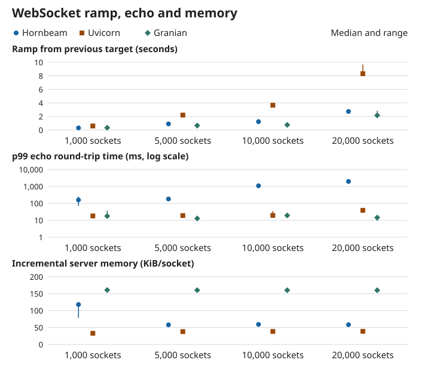
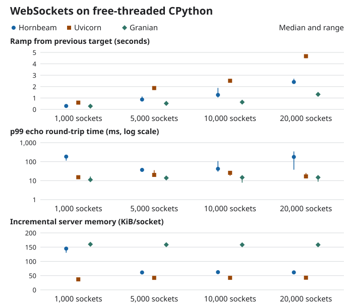
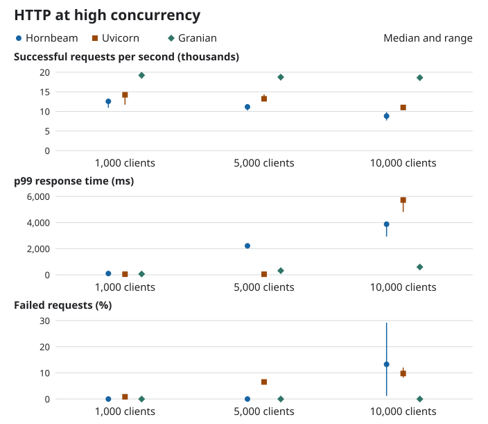
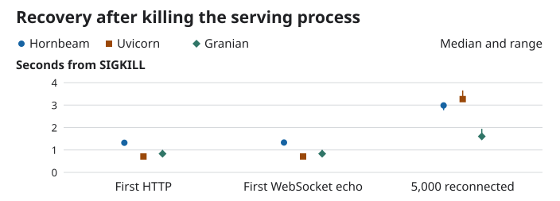

# High-concurrency ASGI benchmark

Hornbeam, Uvicorn with uvloop/httptools, and Granian run the same FastAPI
application: a small JSON response and a WebSocket text echo.

## Results

**WebSockets.** All three kept 20,000 connections open. Hornbeam timed out on
33–106 echoes per run before [batching path subscriptions](https://github.com/h0rv/hornbeam/pull/23).
Afterward, two runs were clean and one had 51 echo timeouts. Neither peer
timed out. Hornbeam's median ramp for the last 10,000 sockets fell from 3.26
to 2.70 seconds, between Granian (2.16 seconds) and Uvicorn (8.31 seconds).
Hornbeam's p99 echo latency was 1.8–2.1 seconds in the clean runs; neither
peer exceeded 46 ms.



In a separate diagnostic run, a forced full Python collection took 1.1
seconds of CPU time at 20,000 live Hornbeam sockets and reclaimed no objects.
Hornbeam can finish wire upgrades before every application has accepted its
socket, so that startup work can continue into the first echo samples.

**Free-threaded diagnostic.** On CPython 3.14t with default GC, all three
servers held 20,000 sockets without errors in three repeats. Hornbeam's median
p99 echo latency fell to 177 ms (38–344 ms), still above Uvicorn (17 ms) and
Granian (15 ms). All nine crash trials reconnected 5,000 sockets and verified
echoes. This is a separate runtime comparison, not a fix for the packaged build.
A forced full collection at 20,000 Hornbeam sockets used 0.22 seconds of CPU
time and still reclaimed no objects.



**HTTP.** At 10,000 concurrent clients, Granian delivered 17,800 successful
responses per second at the median, with no failed attempts. Uvicorn delivered
10,800 per second with 11.5% failed attempts; Hornbeam delivered 9,800 per
second with 13.5% failed attempts. These are connection targets, not verified
counts of established sockets.



**Process crash.** Every listener address was reusable within 110 ms, and
no original WebSockets remained open when checked. Median time to reconnect
5,000 clients and verify echoes was 1.31 seconds for Granian, 2.24 for
Hornbeam, and 3.15 for Uvicorn.



Dots show medians and lines show the full range across three trials, excluding
WebSocket steps with any failures.

## Reproduce the run

Follow the [setup in the appendix](#appendix), then run from the PyBEAM root:

```sh
mise exec oha@1.17.0 -- uv run --locked --project benchmarks \
  python -m benchmarks.web.scale --output "$HOME/web-scale"
```

Use a new output directory outside the checkout. Add `--smoke` for a short
functional check. The runner saves per-trial HTTP summaries, WebSocket samples,
crash results, and server logs.

## What the benchmark measures

- **HTTP:** closed-loop HTTP/1.1 keep-alive clients with one request in flight
  per connection. Concurrency is the load generator's target, not an observed
  count of established sockets. Goodput is HTTP 200 responses divided by the
  load generator's elapsed time, including its final drain.
- **WebSockets:** four client processes open sockets in batches, then hold each
  target for at least 10 seconds. Ramp time measures how long it takes to add
  the sockets for that step as seen by the clients, not when the last ASGI
  application accepts its socket. Each round sends one echo
  on up to 100 rotating sockets per client process, with a three-second timeout.
  A step is clean only if the full target stays open at every sample and no
  handshake or echo fails. The ramp stops at the first failed step. Memory is
  peak sampled proportional set size (PSS) of the server process tree, not
  client or kernel socket memory.
- **Crash:** after a clean echo burst with 5,000 open WebSockets, the harness
  dispatches another burst, sends `SIGKILL` to the whole serving process group,
  and probes for the first successful bind before restarting on the same port.
  All timings start at the signal. HTTP and WebSocket recovery require a valid
  response and a fresh echoed message, respectively. Full recovery includes
  opening new connections to the original target and checking another echo
  burst. Clients don't reconnect automatically; the harness does it.

The crash test measures single-instance process loss and external restart,
not graceful shutdown, worker-level fault isolation, durable state, or
failover to a replica. The workloads use loopback without TLS or application I/O.

## Appendix

Use a clean checkout on Linux with CPUs 0–7 available and an open-file limit of
at least 32,768. Use a separate Hornbeam checkout so the benchmark does not
change PyBEAM's production pins:

```sh
mise install
mise install oha@1.17.0
mise exec -- uv sync --locked --all-extras
mise exec -- uv pip install --python .venv/bin/python \
  uvloop==0.23.0 httptools==0.8.0 granian==2.8.8

git clone https://github.com/h0rv/hornbeam.git ../hornbeam-web-scale
git -C ../hornbeam-web-scale checkout --detach 874df8dd82912ae627cf2a7b6f91f784ae88d8e0
hornbeam_dir="$(realpath ../hornbeam-web-scale)"
python_config="$(mise where python@3.14.10)/bin/python3.14-config"
mise --cd "$hornbeam_dir" exec python@3.14.10 erlang@29.1.2 rebar@3.28.0 cmake@4.5.0 -- \
  env PYTHON_CONFIG="$python_config" ERL_FLAGS='+S 2:2' CMAKE_BUILD_PARALLEL_LEVEL=2 rebar3 compile
mkdir -p _build
ln -sT "$hornbeam_dir/_build/default" _build/hornbeam
```

To rerun the pre-fix baseline, build Hornbeam at
`d3b7850aacad81145b5d9d314dbe27e367cdcdc5` instead and use a different output directory.
Both standalone builds pin erlang-python to
`54fdf367d91d9b7f0d9813af64ce1f10599c63d9`. Check that
`ldd _build/hornbeam/lib/erlang_python/priv/py_nif.so` resolves
`libpython3.14.so` before running.

The run used an eight-vCPU Intel Xeon VM on Ubuntu 22.04.5 (Linux 6.8),
OTP 29.1.2, CPython 3.14.10, FastAPI 0.163.0, Uvicorn 0.54.0, and
`websockets` 16.1.1. All servers are eligible for CPUs 0–1; client work is
on CPUs 4–7. Hornbeam uses two BEAM schedulers, two worker contexts and one
event-loop pool entry. Uvicorn and Granian each use one ASGI worker. Uvicorn
uses the `websockets` backend. Granian uses ASGI/HTTP/1, uvloop, and a
backpressure limit of 65,536 so admission does not cap the ramp.

The test rotates server order across three repeats and starts a fresh
instance for each phase. The kernel's listener backlog limit was 4,096 and
the process open-file limit was 65,536. Host CPU steal reached 10% in one-second
samples; treat the ranges as observations on this VM, not performance bounds.

The HTTP generator is oha 1.17.0. It warms each instance for two seconds at
concurrency 16 and runs each test level for 10 seconds before draining. Crash
probes retry 50 ms after failures and stop trying for the first response after
30 seconds. The three WebSocket phases (steady ramp, crash, and reconnect) use
the same echo payload and count only matching responses.

### Reproduce the free-threaded diagnostic

Use separate PyBEAM and Hornbeam checkouts so the conventional and
free-threaded builds cannot mix. Build and link the standalone Hornbeam
checkout as above, but skip the conventional `.venv` setup. Then reconfigure
the native module to link to CPython 3.14t and install the same ASGI servers
in the free-threaded environment:

```sh
mise exec -- uv python install 3.14.10t
python_t="$(mise exec -- uv python find 3.14.10t)"
python_root="$(dirname "$(dirname "$python_t")")"
bridge="$hornbeam_dir/_build/default/lib/erlang_python"
mise exec erlang@29.1.2 cmake@4.5.0 -- cmake \
  -S "$bridge/c_src" -B "$bridge/_build/cmake-314t" \
  -DPython3_EXECUTABLE="$python_t" -DPython3_ROOT_DIR="$python_root" \
  '-DPython3_FIND_ABI=ANY;ANY;ANY;ON'
mise exec cmake@4.5.0 -- cmake --build "$bridge/_build/cmake-314t" -j 2
ldd "$bridge/priv/py_nif.so" | grep 'libpython3.14t'
mise exec -- uv venv --python "$python_t" .venv
mise exec -- uv pip install --python .venv/bin/python \
  fastapi==0.163.0 uvicorn==0.54.0 websockets==16.1.1 \
  uvloop==0.23.0 httptools==0.8.0 granian==2.8.8
mise exec oha@1.17.0 -- uv run --locked --project benchmarks \
  python -m benchmarks.web.scale --output "$HOME/web-scale-314t"
```

The server processes use the free-threaded build; the load generator still
uses the locked benchmark environment. This comparison does not change the
packaged PyBEAM runtime.

### Inspect HTTP results

To inspect HTTP goodput, p99 latency in milliseconds (including non-200
responses), and percentage of failed attempts from a rerun:

```sh
for file in "$HOME"/web-scale/*.http*.json; do
  printf '%s: ' "${file##*/}"
  jq -r '
    (.statusCodeDistribution."200" // 0) as $ok |
    ([.errorDistribution[], .statusCodeDistribution[]] | add) as $total |
    [($ok / .summary.total | round), (.latencyPercentiles.p99 * 1000),
     (100 * ($total - $ok) / $total)] | @tsv' "$file"
done
```
