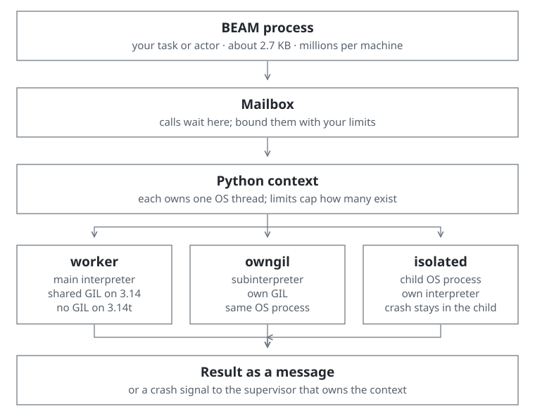
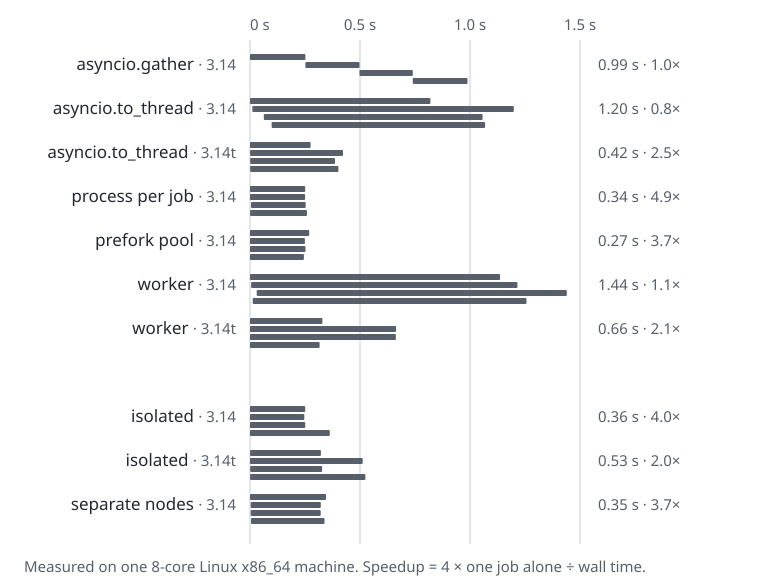

# How Python work runs

A BEAM process costs about 2.7 KB, so you can run millions. A Python interpreter costs far more, so PyBEAM does not start one per process. Each task or actor gets a Python context, limits cap how many run at once, and you choose how each context runs Python.

## From a BEAM process to Python



1. Your task or actor is a BEAM process. Calls wait in its mailbox until its context is free, and `TaskLimits` or an actor group's `max_children` caps how many contexts exist, so a million callers become a queue, not a million interpreters.
2. A context owns one OS thread. Its mode decides which interpreter and GIL run your code.
3. The result comes back as a message. If the context dies, its supervisor gets a crash signal and starts a fresh one. Supervision restarts the context; it does not replay the call or keep its in-memory state.

## Choose a mode

Each mode trades startup, memory and call cost for parallelism and crash isolation. Start and memory are per context, and call is an empty round trip. Free threading comes from the interpreter you install, CPython 3.14 or 3.14t.

| Mode | Parallel CPU | Crash kills | Start | Memory | Call p50/p99 |
| --- | --- | --- | --- | --- | --- |
| `worker` · 3.14 | No | The VM | 1.3 ms | 15 KiB | 17/31 µs |
| `worker` · 3.14t | Yes | The VM | 1.5 ms | 21 KiB | 29/51 µs |
| `owngil` · 3.14 | Yes | The VM | 79 ms | 10.5 MiB | 14/23 µs |
| `isolated` · 3.14 | Yes | That child | 90 ms | 24 MiB | 76/146 µs |
| Separate nodes | Yes | That node | Seconds | A whole VM | Network |

- `worker`: I/O-bound async code and cheap calls. On 3.14t it also runs CPU work in parallel, if your C extensions support free threading.
- `owngil`: parallel pure-Python CPU work on 3.14. Extensions must support subinterpreters, and values are copied in and out.
- `isolated`: C extensions that can crash or leak. Only that call fails.
- Separate nodes: more than one machine, or surviving a whole VM failure.

Tasks and actors run in `worker` mode; `owngil` and `isolated` are not yet available to them. `dedicated_loop=True` gives each task its own event loop and thread, so CPU-bound tasks do not wait on each other's loop.

```python
from pybeam import run
from pybeam.codec import Json
from pybeam.tasks import ExecutionMode, TaskFunction, TaskLimits, TaskSupervisor


async def checksum(iterations: int) -> int:
    value = 0
    for index in range(iterations):
        value = (value * 31 + index) & 0xFFFFFFFF
    return value


async def main() -> None:
    job = TaskFunction(
        checksum,
        Json(int),
        Json(int),
        execution=ExecutionMode.WORKER,
        dedicated_loop=True,
    )
    limits = TaskLimits(capacity=4, max_bytes=4096, shutdown_ms=1000)
    async with TaskSupervisor(limits) as supervisor:
        tasks = [await supervisor.start(job, 3_000_000) for _ in range(4)]
        for task in tasks:
            print(await task)


if __name__ == "__main__":
    run(main)
```

It prints the same checksum four times.

## Fan out: four CPU jobs

Each row runs the same four pure-Python jobs at once. Bars show when each job ran.



With the GIL, asyncio, threads and `worker` run the jobs one at a time. On 3.14t, threads and `worker` overlap them. `owngil`, `isolated`, a process per job, a prefork pool and separate nodes overlap them on either build, at the costs in the table above.

## Blast radius: one job calls `os.abort()`

Four jobs run; one aborts the interpreter.

| Lane | Other jobs that finish | Replacement ready in |
| --- | --- | --- |
| asyncio, threads | 0 of 3: the process dies | Restart the app |
| `worker`, `owngil` | 0 of 3: the VM dies | Restart the app |
| Process per job | 3 of 3 | 80 ms for a new process |
| Prefork pool | 0 of 3: the pool breaks | 53 ms for a new pool |
| `isolated` | 3 of 3 | 70 ms for a new child |
| Separate nodes | 3 of 3 | 254 ms for a new node |

Subinterpreters isolate Python state, not native crashes. Only a separate OS process keeps a segfault away from everything else.

## Fan in: 100,000 callers

100,000 callers each make one empty call.

| Lane | Contexts | Memory per caller | Start all callers | Finish all calls |
| --- | --- | --- | --- | --- |
| asyncio tasks | 1 event loop | 1.1 KB | 463 ms | 429 ms |
| `worker` · 3.14 | 8, at most 32 calls admitted | 2.7 KB | 232 ms | 2.59 s |
| `worker` · 3.14t | 8, at most 32 calls admitted | 2.7 KB | 258 ms | 1.80 s |

For empty calls on one machine, asyncio is cheaper and faster. What the BEAM callers add: each one is preemptively scheduled, supervised and can live on another node, and the admission limit bounds how much Python work runs at once.

Numbers on this page come from one 8-core machine and vary with hardware and load.
