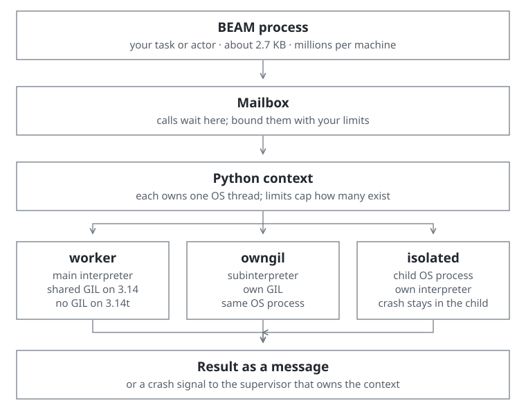

# How a call reaches Python

1. Each actor has a BEAM process and mailbox. It handles one call at a time, leasing a worker for construction and each call. The group's `max_children` caps actors, not worker contexts; the node-wide pool bounds active actor workers and queues checkouts at its cap.
2. Tasks own their execution context. `TaskLimits` caps task ownership slots; starting a task when those slots are full raises `Overloaded`. The context's mode decides which interpreter runs the code and what a crash takes down.
3. The result comes back as a message. If an actor crashes, its group starts a replacement with fresh state; it does not replay the call. Tasks are temporary children: their supervisor does not restart them.

Next: [Where parallel Python comes from](parallelism.md).
