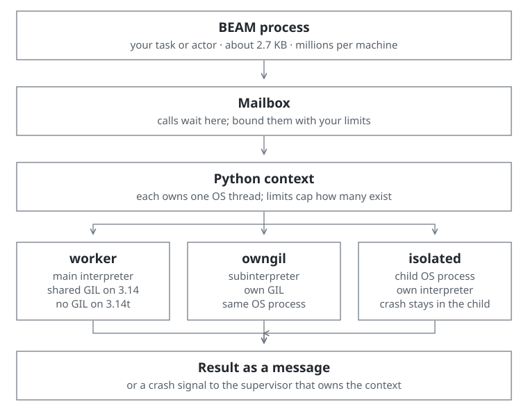
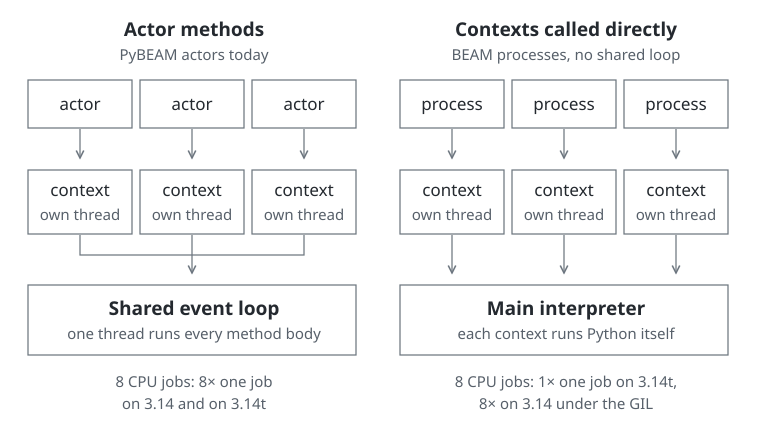

# How PyBEAM works

This section explains the runtime under the API, for people changing PyBEAM or debugging how it behaves. You do not need it to use the library.

PyBEAM embeds CPython in the BEAM, Erlang's virtual machine, through [erlang-python](https://github.com/h0rv/erlang-python). The BEAM provides process identity, mailboxes, supervision and scheduling; erlang-python owns how Python code runs inside it; [Hornbeam](https://github.com/h0rv/hornbeam) provides the counter, cache and pub/sub services and serves ASGI apps. For an introduction to the BEAM, watch Saša Jurić's [The Soul of Erlang and Elixir](https://www.youtube.com/watch?v=JvBT4XBdoUE) or read the Erlang documentation on [processes](https://www.erlang.org/doc/system/ref_man_processes.html).

## The stack

| Layer | What it is | Measured cost |
| --- | --- | --- |
| OS process | The BEAM VM that `pybeam.run` starts. Everything below shares it. | About 85 MiB at start |
| BEAM scheduler | Runs BEAM processes preemptively. The managed VM starts one (`+S 1:1`), so Python parallelism never comes from BEAM schedulers. | |
| BEAM process | The identity, mailbox, links and supervisor of an actor or task. It holds no Python state. | 2.7 KB |
| Python interpreter | The main CPython interpreter, embedded in the VM. A native crash in it ends the VM. | |
| GIL | On 3.14 one thread at a time runs Python. On 3.14t no lock is held, so threads run Python at the same time. | |
| Worker context | An erlang-python context: one OS thread that runs Python in the main interpreter. Each actor owns one. | 1.1–1.2 ms to create; an actor adds 50–60 KiB and one thread |
| Shared event loop | One asyncio loop thread, erlang-python's `ErlangEventLoop`, which takes I/O readiness and timers from the BEAM. It runs every actor method body and every shared-loop task. | |
| Dedicated loop | A worker task started with `dedicated_loop=True` runs on its context's own loop and thread. | |
| Isolated context | A child OS process with its own interpreter. Requests and results cross as bytes. | 61–132 ms to create, 21–27 MiB |

Distinguish these layers when you reason about a change. A BEAM process is not an interpreter, a thread or an OS process, and a free-threaded build does not make one event loop run on more than one CPU. The [execution model](../../research/execution-model.md) covers each boundary, along with nodes and storage.

## How a call reaches Python

1. Your task or actor is a BEAM process. Calls wait in its mailbox until its context is free. `TaskLimits` or an actor group's `max_children` caps how many contexts exist; starting a task when its ownership slots are full raises `Overloaded` instead of queuing it.
2. The context's mode decides which interpreter runs the code and what a crash takes down.
3. The result comes back as a message. If an actor crashes, its group starts a replacement with fresh state; it does not replay the call. Tasks are temporary children: their supervisor does not restart them.

## Where parallel Python comes from

- **Actors do not run Python in parallel.** Each actor owns a worker context, but every method body runs on the shared event loop thread. CPU-bound or blocking code in one actor stalls all of them, on 3.14 and on 3.14t alike.
- **Worker contexts called directly run in parallel on 3.14t.** When each BEAM process calls its own context with no loop in between, eight CPU jobs took as long as one on 8 CPUs. On 3.14 the GIL serialized them.
- **Dedicated-loop tasks** run on their own thread, so they overlap on 3.14t and take turns on 3.14.
- **Isolated tasks** run in separate OS processes, so they overlap on either build.
- **Actor calls** run on pooled workers, each with its own loop, so blocking calls in different actors overlap on both builds and CPU work overlaps on 3.14t.

[Measurements](measurements.md) has the numbers, and [what to watch for](watch-for.md) covers the failure modes.

## Own-GIL subinterpreters are unsupported

erlang-python also offers own-GIL contexts, one subinterpreter per context. PyBEAM does not support them: pydantic-core, uvloop, httptools, SQLAlchemy, numpy, pandas, cryptography, lxml, msgspec, grpcio, greenlet, ujson, PyYAML and orjson all refuse to load in a subinterpreter on 3.14 and 3.14t. A subinterpreter also isolates Python state, not native crashes. See the [package compatibility results](../../research/execution-modes.md#unsupported-own-gil-subinterpreters).

## Further reading

- [Execution model](../../research/execution-model.md): each boundary from BEAM process to node.
- [Execution modes](../../research/execution-modes.md): the mode probes and their method.
- [Actor capacity](../../research/actor-capacity.md): actor cost, call timing and state movement.
- [Worker design](../../research/worker-design.md): a proposal for running actors on a worker pool. It is not implemented.
