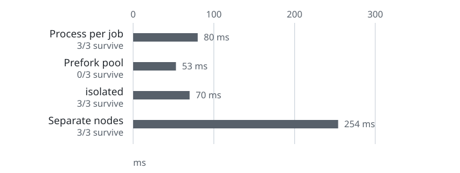

# Measurements

These probes compare execution costs on one machine, not production limits. Bars show measured values; thin whiskers show ranges across runs.

## Contexts

Workers used under 0.1 MiB per context on both builds; isolated contexts used 21–22 MiB on conventional Python and 26–27 MiB on free-threaded Python. When one of four isolated contexts aborted, the other three survived and a replacement was ready in 64–134 ms; aborting a worker killed the VM.

## CPU jobs

Each job runs a 3,000,000-step integer loop, about 0.33 s alone. Free-threaded workers used all 8 CPUs; conventional workers took turns, while isolated contexts overlapped on both builds.

## Fan out: four CPU jobs

With the GIL, asyncio, threads and `worker` ran the jobs one at a time. Free-threaded threads and workers overlapped them, as did isolated contexts, processes, prefork pools and separate nodes.

## Blast radius: one job aborts

An `os.abort()` in asyncio or threads kills the app; in `worker`, it kills the VM, so neither has a replacement timing. A new prefork pool does not recover its interrupted jobs.

## Fan in: many processes, eight contexts

Each process makes one empty call, with at most 32 calls in flight. A million waiting processes used about 2.7 GB (2.7 KB each); the worker ceiling of about 32,000–43,000 calls per second was not traced.

## Not measured

Web serving on conventional and free-threaded Python has its own [ASGI benchmarks](https://github.com/h0rv/pybeam/blob/main/benchmarks/web/SCALE_RESULTS.md).

- Actor throughput, memory and startup cost.

## Appendix: environment and provenance

- Linux x86-64, 8 CPUs, 31 GiB memory; CPython 3.14.10 (GIL enabled) and 3.14.10t (free-threaded), Erlang/OTP 29.1.2.
- Context, CPU and fan-in charts used erlang-python `d60392c`: one conventional plus two free-threaded context-matrix runs. See [actor capacity reproduction](https://github.com/h0rv/pybeam/blob/main/docs/research/actor-capacity.md#recorded-method-and-reproduction).
- Four-job fan-out and blast-radius charts used erlang-python `c007eb5` probes, not controlled same-revision comparisons. See [execution-mode reproduction](https://github.com/h0rv/pybeam/blob/main/docs/research/execution-modes.md#four-job-fan-out-and-blast-radius-reproduction).
