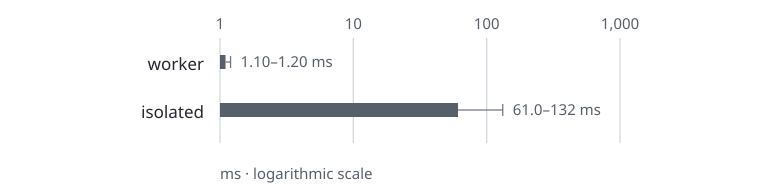
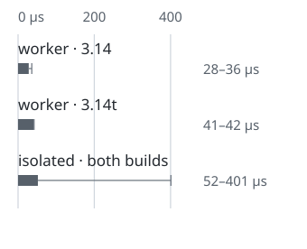
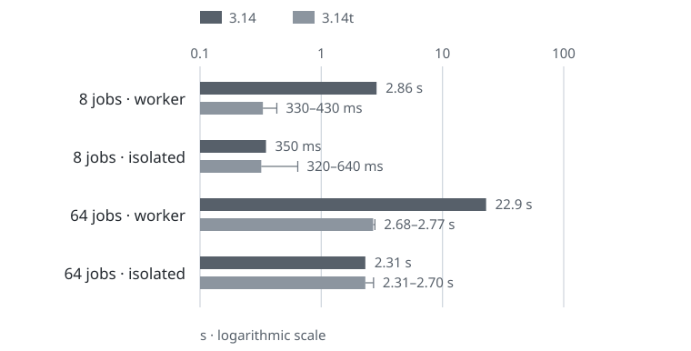
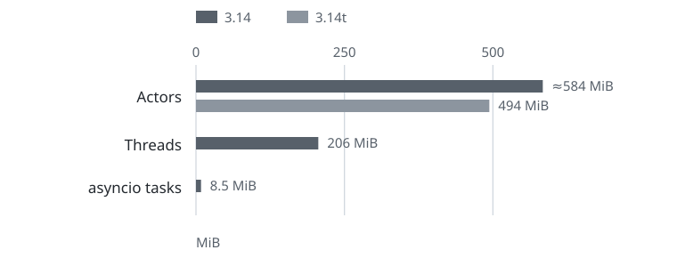
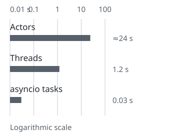
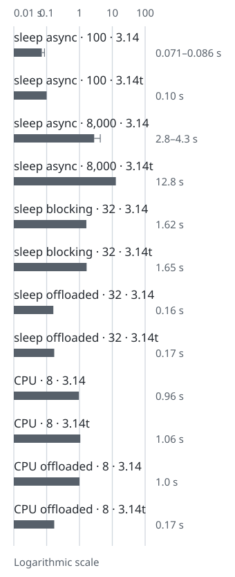
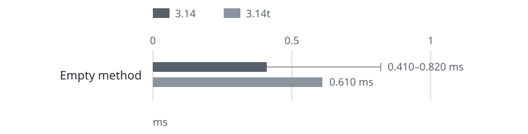
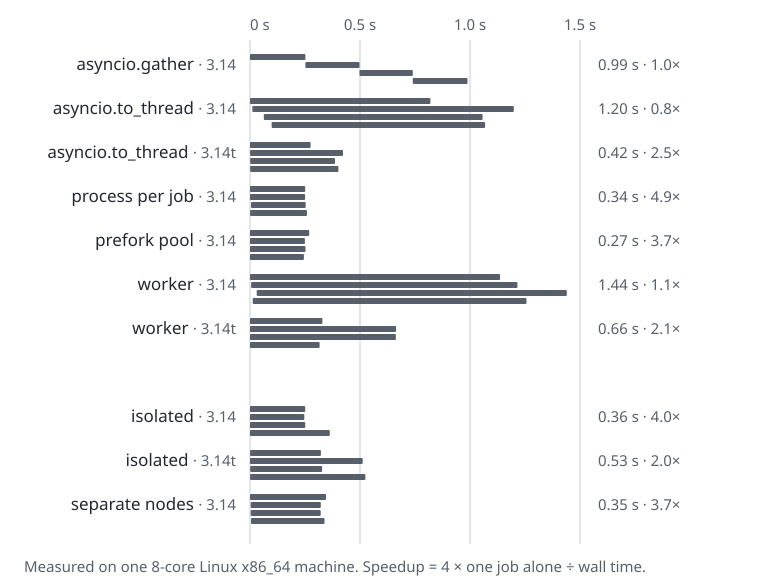
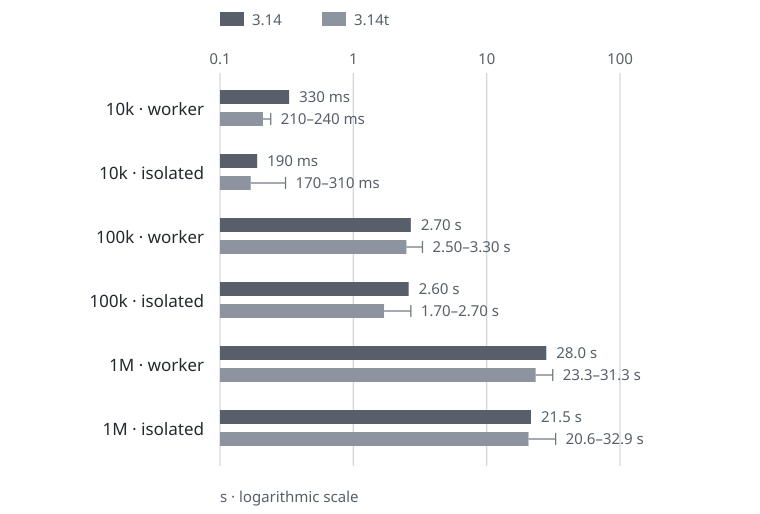

# Measurements

These probes compare execution costs on one machine, not production limits. Bars show measured values; thin whiskers show ranges across runs.

## Contexts



Workers used under 0.1 MiB per context on both builds; isolated contexts used 21–22 MiB on conventional Python and 26–27 MiB on free-threaded Python. When one of four isolated contexts aborted, the other three survived and a replacement was ready in 64–134 ms; aborting a worker killed the VM.



## CPU jobs



Each job runs a 3,000,000-step integer loop, about 0.33 s alone. Free-threaded workers used all 8 CPUs; conventional workers took turns, while isolated contexts overlapped on both builds.

## Actors: before pooled dispatch

These historical actors each owned a worker context and shared one event loop. The charts do **not** describe the current worker pool's memory, thread count or timings.



Actors and blocked threads each added 10,000 OS threads; blocked asyncio tasks added none. Spawning actors did not fail at 10,000, the last checkpoint.



### Method bodies



Calls run together with `asyncio.gather`: sleeps last 0.05 s, and the CPU job runs 2,000,000 loop steps (about 0.12 s alone). Blocking and CPU work serialized on the shared loop; “offloaded” means `await asyncio.to_thread(...)`, which restored overlap.



At 10,000 concurrent calls, one caller loop failed with `RuntimeError: Native callback queue full`; the native callback limit was 8,192 per loop.

## Fan out: four CPU jobs



With the GIL, asyncio, threads and `worker` ran the jobs one at a time. Free-threaded threads and workers overlapped them, as did isolated contexts, processes, prefork pools and separate nodes.

## Blast radius: one job aborts


An `os.abort()` in asyncio or threads kills the app; in `worker`, it kills the VM, so neither has a replacement timing. A new prefork pool does not recover its interrupted jobs.

## Fan in: many processes, eight contexts



Each process makes one empty call, with at most 32 calls in flight. A million waiting processes used about 2.7 GB (2.7 KB each); the worker ceiling of about 32,000–43,000 calls per second was not traced.

## Not measured

- A real web request path on free-threaded Python.
- Actors beyond 10,000 or under container memory limits.
- Actor throughput and memory with pooled dispatch.

## Appendix: environment and reproduce

### Environment and source data

- Linux x86-64, 8 CPUs, 31 GiB memory; CPython 3.14.10 (GIL enabled) and 3.14.10t (free-threaded), Erlang/OTP 29.1.2.
- CPU, actor and fan-in charts: erlang-python `d60392c`; [actor capacity methods and recorded results](../../research/actor-capacity.md). Actors: three conventional runs and one free-threaded run; plain Python: one conventional run; context matrix: one conventional and two free-threaded runs.
- Four-job fan-out and blast-radius charts: earlier erlang-python `c007eb5` probes; [execution modes methods and evidence](../../research/execution-modes.md). These are historical comparisons, not controlled same-revision results.

### Context, CPU and fan-in charts

From the repository root, use a matching Python interpreter and native application build for each build being compared. Follow [development runtime setup](../../development.md#use-a-development-runtime); set `APP` to that build's erlang-python application directory containing `ebin` and `priv/py_nif.so`.

```sh
mise exec -- python docs/research/probes/capacity/modes_matrix.py "$APP"
```

The [matrix runner](../../research/probes/capacity/modes_matrix.py) regenerates CPU and fan-in measurements through the [in-repo probe](../../../examples/modes_lab/probe.escript), including context creation, RSS and empty-call latency. It also runs unsupported own-GIL rows, which are not charted here; repeat runs to obtain ranges rather than expecting identical timings.

### Actor memory, start and method charts

Run from the repository root with a configured `development_runtime`, separately for each matching Python/native build:

```sh
mise exec -- python docs/research/probes/capacity/server.py 38999 &
PROBE_PORT=38999 mise exec -- uv run --locked python docs/research/probes/capacity/pybeam_actors.py
mise exec -- python docs/research/probes/capacity/plain_python.py threads 10000
mise exec -- python docs/research/probes/capacity/plain_python.py tasks 10000
```

Stop the background server afterward. The [actor probe](../../research/probes/capacity/pybeam_actors.py) prints spawn checkpoints and a `RESULT` JSON line; current pooled dispatch changes its results, so reproducing the historical actor numbers requires the pre-pool implementation described in the source data, not today's runtime.

### Four-job fan-out and blast-radius charts

The in-repo modes lab implements both experiments; these commands rerun the same workloads, not guaranteed historical values:

```sh
mise run modes-lab
```

Open `http://127.0.0.1:38941`, choose fan-out with 4 jobs and 3,000,000 iterations, or crash with 4 jobs. Free-threaded lanes require `PYBEAM_LAB_ERLANG_PYTHON_314T` and `PYBEAM_LAB_PYTHON_314T` pointing to matching builds; `PYBEAM_LAB_ERLANG_PYTHON` selects the conventional native application directory.

For direct JSON output, run each baseline and BEAM mode from the repository root:

```sh
for mode in asyncio threads spawn prefork; do
  mise exec -- python -m examples.modes_lab.baselines fanout "$mode" 4 3000000
  mise exec -- python -m examples.modes_lab.baselines crash "$mode" 4 0
done
for mode in worker isolated nodes; do
  mise exec -- escript examples/modes_lab/probe.escript "$APP" "$PWD/examples/modes_lab" fanout "$mode" 4 3000000
  mise exec -- escript examples/modes_lab/probe.escript "$APP" "$PWD/examples/modes_lab" crash "$mode" 4 0
done
```

Repeat the threads, worker and isolated fan-out commands with the free-threaded interpreter and matching native build. Crash commands intentionally abort child processes or VMs; run them in a disposable development environment with core dumps disabled (`ulimit -c 0`).
