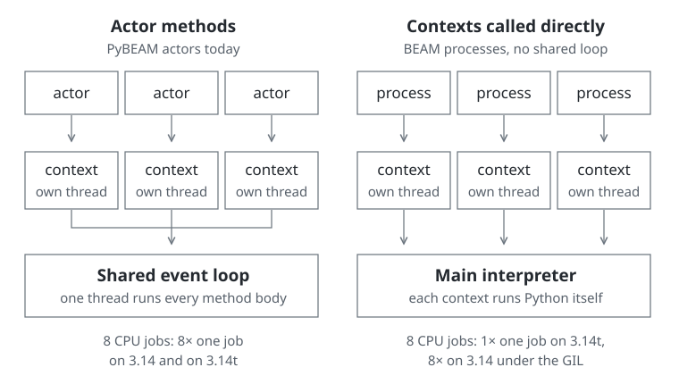

# Where parallel Python comes from

- **Actor calls** run on pooled workers, each with its own loop. Blocking operations that release the GIL, such as `time.sleep`, overlap on different workers on both builds. Pure-Python CPU work can overlap on 3.14t with the GIL disabled; the GIL serializes it on conventional builds.
- **Shared-loop tasks** share one loop thread. CPU-bound or blocking code in one task stalls the other tasks on that loop, even on a free-threaded build.
- **Dedicated-loop tasks** run on their own thread, so they overlap on 3.14t and take turns on 3.14.
- **Isolated tasks** run in separate OS processes, so they overlap on either build.

If an actor's preferred worker is busy, its next call waits up to 100 ms for it before becoming eligible for another worker; it stays queued if none is available. Fallback can change the loop, so do not retain loop-bound objects such as Futures across calls.

Background asyncio tasks continue between calls. When an actor stops or its group closes, teardown cancels and awaits its descendant tasks before releasing the actor's state, including tasks on workers it previously used. A task that ignores cancellation keeps teardown waiting. Blocking code pauses other tasks on the same worker, not on other workers.

[Measurements](measurements.md) records the earlier execution-mode probes, including the pre-pool actor path; those actor costs and timings do not describe the pooled runtime.

## Own-GIL subinterpreters are unsupported

erlang-python also offers own-GIL contexts, one subinterpreter per context. PyBEAM does not support them: pydantic-core, uvloop, httptools, SQLAlchemy, numpy, pandas, cryptography, lxml, msgspec, grpcio, greenlet, ujson, PyYAML and orjson all refuse to load in a subinterpreter on 3.14 and 3.14t. A subinterpreter also isolates Python state, not native crashes. See the [package compatibility results](../../research/execution-modes.md#unsupported-own-gil-subinterpreters).

## Further reading

- [Execution modes](../../research/execution-modes.md): the mode probes and their method.
- [Actor capacity](../../research/actor-capacity.md): actor cost, call timing and state movement.
- [Worker design](../../research/worker-design.md): the broader proposal, including durable state migration. The current pool waits briefly for a busy preferred worker, then falls back while reusing the in-memory actor object; fallback does not load a durable copy.
