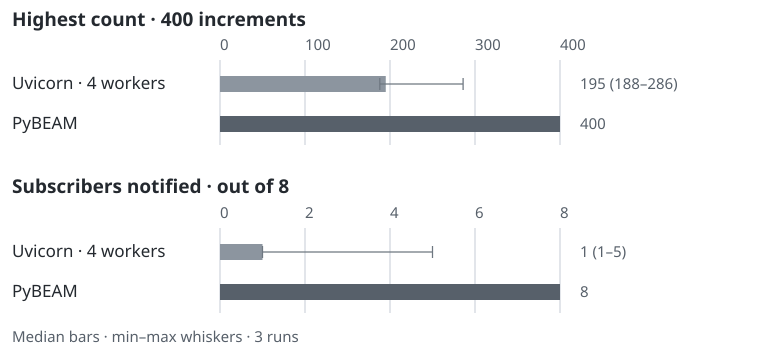
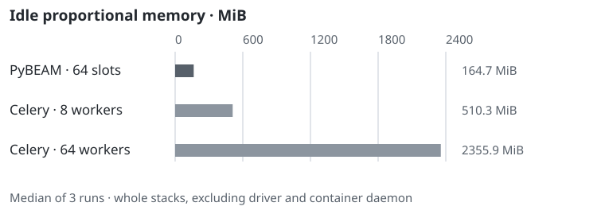

# Benefits and tradeoffs

PyBEAM is for Python services that must keep running and stay cheap to run. An isolated process failure stays inside the call that caused it, shared state and messaging live in the VM, and an idle service uses a fraction of the memory of a worker-per-process stack. In exchange, it serves fewer requests per second than the fastest Python servers.

Every number below comes from a probe you can rerun, listed in the [appendix](#appendix-reproduce). Most are three runs on one shared VM: they indicate direction; capacity depends on the workload.

## One failure stays in one call

<div class="measurement-chart" tabindex="0" role="region" aria-label="Scrollable failure comparison chart">


</div>

With Uvicorn running 4 workers, a segfault drops every connection on the crashed worker, and a CPU-heavy request stalls every client on its worker for the whole loop, 3 seconds here. Other workers keep serving, so the fair comparison is the clients that share a worker with the fault. The kernel spreads clients unevenly: the probes affect 1 to 14 of 20.

In PyBEAM, the crash ends one isolated task with 0 of 20 clients dropped. During the CPU-heavy call, every other client's wait stays within 12 ms. The two probes use different transports: WebSockets for Uvicorn, plain TCP for PyBEAM.

To stop a stuck call, Gunicorn's `--timeout 10` kills the whole worker after about 11 seconds, with every request on it. PyBEAM's `terminate()` stops one call in 16–33 ms, with 0 effects recorded after `terminate()` returns.

The cost: an isolated task is a separate OS process, so it starts slower, uses more memory, and copies its arguments and results. A native crash inside a VM-hosted worker can kill the VM.

## Shared state in the VM

<div class="measurement-chart" tabindex="0" role="region" aria-label="Scrollable shared state comparison chart">



</div>

Each Uvicorn worker keeps its own counters and subscriber lists, so 400 increments end up split across workers and most subscribers miss a message. Worker apps add Redis to fix this. PyBEAM's counter and pub/sub live in the VM, so every run counts 400 and notifies 8 of 8. [Connected nodes](deploy.md) also exchange pub/sub and [presence through BEAM messaging](integrations/pyview.md#send-posts-between-two-local-nodes).

The limits: state lives in memory and is lost on restart, presence is eventually consistent, and pub/sub delivers messages to current subscribers. Applications own recovery of missed messages. Cross-node behavior is tested between nodes on one host.

## Recovery after a node dies

<div class="measurement-chart" tabindex="0" role="region" aria-label="Scrollable node recovery chart">


</div>

When one node of the [agent sessions example](https://github.com/h0rv/pybeam/blob/main/examples/agents/README.md) is killed, its sessions resume on another node in 0.13 seconds with 0 repeated tool calls. The Redis/Celery version takes 144 seconds and repeats five tool calls.

This is one recorded run per stack, killing a process on one host. Host loss and network partitions require separate testing. A tool call interrupted by the kill is reported with an uncertain outcome, so its effects may need cleanup and the application chooses any retry.

## Cost to run

<div class="measurement-chart" tabindex="0" role="region" aria-label="Scrollable idle memory chart">



</div>

Porting a FastAPI and Celery app to PyBEAM takes it from 68 processes to 3 and from 2.3 GiB to 165 MiB idle, with the same 64 concurrent task slots. Memory is proportional set size (PSS), which counts shared pages once.

The tasks sleep, so this measures idle overhead. The port keeps tasks in memory and loses queued tasks when its process dies; Celery with Redis stores queued tasks externally.

1,000 PyBEAM actors fit in 125 MiB. Ray reaches 91 actors at the probe's 8 GiB memory budget. The probe imposes that budget; Ray's capacity depends on available resources.

## What PyBEAM costs

- **HTTP throughput:** on two CPUs, PyBEAM's server delivers 20% fewer requests per second than tuned single-worker Uvicorn and 28% fewer than Granian at 64 connections; at 256 connections, the gaps are 12% and 38%.
- **High socket counts:** at 20,000 open WebSockets, clean conventional-build runs show 1.8–2.1 seconds p99 echo latency versus at most 46 ms for the peers. Two runs are clean; one has 51 echo timeouts. A forced full garbage collection at that size takes 1.1 seconds of CPU, the likely but unproven cause.
- **CPU parallelism:** on the standard Python build, actors run CPU-bound jobs one at a time: 1.0× speedup versus Ray's 7.9×. Use isolated tasks or free-threaded Python with [separate execution loops](execution.md) for parallel CPU tasks. A shared asyncio loop executes one job at a time.

## Appendix: reproduce

Run from the repository root. Linked sources include setup, topology and recorded results; the fault probes use the [source development runtime](../development.md#use-a-development-runtime).

- **Failure and state:** [results and setup](https://github.com/h0rv/pybeam/blob/main/docs/research/pain-points.md). Run each command three times; substitute `crash`, `hog`, `runaway`, and `state` for `<case>`:

  ```sh
  uv run --script docs/research/probes/painpoints/uvicorn_faults.py <case>
  uv run --locked python docs/research/probes/painpoints/native_crash_pybeam.py
  uv run --locked python docs/research/probes/painpoints/loop_stall_pybeam.py
  uv run --locked python docs/research/probes/painpoints/timeout_lies_pybeam.py
  uv run --locked python docs/research/probes/painpoints/worker_state_pybeam.py
  ```

- **Node recovery:** `mise run example:agents-compare`; [recorded results and method](https://github.com/h0rv/pybeam/blob/main/benchmarks/AGENTS_COMPARISON.md).
- **Idle memory:** the [three-configuration sampling recipe](https://github.com/h0rv/pybeam/blob/main/examples/fastapi_celery/README.md#measured-results).
- **Actors and CPU speedup:** `bash docs/research/probes/ray/run.sh`; [environment setup and limits](https://github.com/h0rv/pybeam/blob/main/docs/research/probes/ray/README.md).
- **HTTP:** `mise exec oha@1.17.0 -- uv run --no-sync python -m benchmarks.web.run --host-http --output "$HOME/web-http-granian"`; [pinned build setup](https://github.com/h0rv/pybeam/blob/main/benchmarks/web/RESULTS.md#reproduce-the-comparison-with-granian).
- **Sockets:** `mise exec oha@1.17.0 -- uv run --locked --project benchmarks python -m benchmarks.web.scale --output "$HOME/web-scale"`; [setup and diagnostics](https://github.com/h0rv/pybeam/blob/main/benchmarks/web/SCALE_RESULTS.md#appendix). The source describes the separate forced-GC diagnostic; reproducing it requires additional instrumentation.

The shared Linux x86-64 VM has eight CPUs and 31 GiB RAM. Fault/state probes use CPython 3.14.10, OTP 28.3, Uvicorn 0.54.0, Gunicorn 27.0.1, uvicorn-worker 0.4.0, FastAPI 0.165.0 and websockets 17.4. Other probes use their linked source environments: the socket benchmark uses OTP 29.1.2; agent results use free-threaded Python 3.14.10t; Ray uses packaged conventional Python. The comparisons span these builds.

<style>
.measurement-chart { overflow-x: auto; }
.measurement-chart img { width: 100%; min-width: 680px; max-inline-size: none; height: auto; }
.measurement-chart:focus-visible { outline: 2px solid currentColor; outline-offset: 2px; }
</style>
