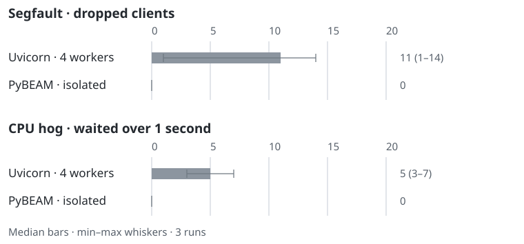
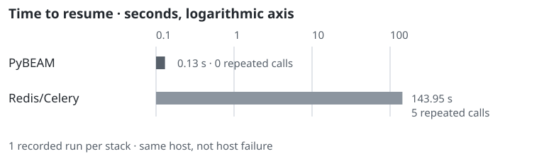

# Benefits and tradeoffs

PyBEAM contains native failures inside isolated calls, provides shared state and messaging without Redis or a broker, and idles at a fraction of a worker-per-process stack's memory. It costs some raw request throughput. These rerunnable measurements mostly cover three runs on one shared VM, not production limits.

## One failure stays in one call

<div class="measurement-chart" tabindex="0" role="region" aria-label="Scrollable failure comparison chart">



</div>

A segfault drops every connection on the affected Uvicorn worker; a CPU-heavy request stalls that worker's clients for the loop's duration, about 3 seconds here. Other workers keep serving. Client assignment is uneven: the comparison is clients sharing a worker, not a fixed quarter of the users.

PyBEAM's isolated child exits with signal 11 and drops none of the 20 observers. During CPU work, other clients' longest wait is 11.70 ms or less. The workloads differ: Uvicorn runs a timed loop over WebSockets; PyBEAM runs 40 million iterations in an isolated child over a TCP probe.

Gunicorn's `--timeout 10` closes the stuck worker's connection after 10.713–10.922 seconds and loses all outstanding pings on that worker. PyBEAM's `terminate()` stops one call in 16.08–33.29 ms, with no effects after it returns in three runs. An isolated task is a separate OS process: startup and memory cost more, and arguments and results are copied. Embedded tasks do not contain native crashes.

## Shared state without Redis

<div class="measurement-chart" tabindex="0" role="region" aria-label="Scrollable shared state comparison chart">


</div>

Per-worker memory splits counters and subscriber lists; worker apps need a shared store such as Redis to coordinate them. PyBEAM's counter and pub/sub live in the VM. [Connected nodes](deploy.md) also exchange pub/sub and [presence without a broker](integrations/pyview.md#send-posts-between-two-local-nodes).

State lives in memory and disappears on restart. Presence is eventually consistent; messages have no replay. Cross-node checks cover loopback nodes, not separate hosts.

## Recovery after a node dies

<div class="measurement-chart" tabindex="0" role="region" aria-label="Scrollable node recovery chart">



</div>

The replicated agent example resumes in 0.13 seconds with no repeated tool calls; Redis/Celery takes 144 seconds and repeats five calls. This is one recorded run per stack after same-host SIGKILL, not host loss or a network partition. The example does not rerun interrupted tools without committed results; that policy does not establish absence of external effects.

## Cost to run

<div class="measurement-chart" tabindex="0" role="region" aria-label="Scrollable idle memory chart">


</div>

The FastAPI/Celery port uses three processes versus 68 with 64 Celery workers. Proportional set size (PSS) accounts for shared pages. These blocking-sleep tasks do not establish CPU throughput, and the port loses tasks and results on process death; the original stack retains queued work across worker restarts.

A separate actor probe fits 1,000 PyBEAM actors in 125 MiB tree RSS; Ray reaches 91 actors at the probe's 8 GiB budget. This is not an equal-actor-count comparison or a Ray capacity limit; summed RSS double-counts shared pages.

## What PyBEAM costs

- **HTTP throughput:** on two CPUs, PyBEAM's server delivers 20% fewer requests per second than tuned single-worker Uvicorn and 28% fewer than Granian at 64 connections; at 256 connections, the gaps are 12% and 38%.
- **High socket counts:** at 20,000 open WebSockets, clean conventional-build runs show 1.8–2.1 seconds p99 echo latency versus at most 46 ms for the peers. Two runs are clean; one has 51 echo timeouts. A separate forced full GC consumes 1.1 seconds of CPU and reclaims no objects; this is not a measured pause duration or proof that GC alone causes the latency.
- **CPU parallelism:** conventional-build actors run CPU jobs one at a time in the actor probe: 1.0× speedup versus Ray's 7.9×. Use isolated tasks or free-threaded Python with [separate execution loops](execution.md), not a shared asyncio loop, for parallel CPU tasks.
- **Process isolation:** each isolated task needs one OS process, with copying, startup and memory overhead; the fault probe measures containment, not process creation throughput.
- **Uncertain limits:** most comparisons have only three runs on a noisy shared VM. Treat them as direction, not capacity or latency guarantees.

## Appendix: reproduce

Run from the repository root. Linked sources include setup, topology and recorded results; the fault probes use the [source development runtime](../development.md#use-a-development-runtime), not the older packaged runtime.

- **Failure and state:** [results and setup](https://github.com/h0rv/pybeam/blob/main/docs/research/pain-points.md). Run each command three times; substitute `crash`, `hog`, `runaway`, and `state` for `<case>`:

  ```sh
  uv run --script docs/research/probes/painpoints/uvicorn_faults.py <case>
  uv run --locked python docs/research/probes/painpoints/native_crash_pybeam.py
  uv run --locked python docs/research/probes/painpoints/loop_stall_pybeam.py
  uv run --locked python docs/research/probes/painpoints/timeout_lies_pybeam.py
  uv run --locked python docs/research/probes/painpoints/worker_state_pybeam.py
  ```

- **Node recovery:** `mise run example:agents-compare`; [recorded results and method](https://github.com/h0rv/pybeam/blob/main/benchmarks/AGENTS_COMPARISON.md).
- **Idle memory:** use the [three-configuration sampling recipe](https://github.com/h0rv/pybeam/blob/main/examples/fastapi_celery/README.md#measured-results). It defines `measure` and `original`, starts the stacks and selects worker counts. Run `measure http://127.0.0.1:8810 "$(pgrep -nf 'python -m examples[.]fastapi_celery[.]app --port 8810 --task-unit 1')"` for the port and `original` for each Celery configuration. These wrappers include idle PSS sampling; the comparison driver alone does not.
- **Actors and CPU speedup:** `bash docs/research/probes/ray/run.sh`; [environment setup and limits](https://github.com/h0rv/pybeam/blob/main/docs/research/probes/ray/README.md).
- **HTTP:** `mise exec oha@1.17.0 -- uv run --no-sync python -m benchmarks.web.run --host-http --output "$HOME/web-http-granian"`; [pinned build setup](https://github.com/h0rv/pybeam/blob/main/benchmarks/web/RESULTS.md#reproduce-the-comparison-with-granian).
- **Sockets:** `mise exec oha@1.17.0 -- uv run --locked --project benchmarks python -m benchmarks.web.scale --output "$HOME/web-scale"`; [setup and diagnostics](https://github.com/h0rv/pybeam/blob/main/benchmarks/web/SCALE_RESULTS.md#appendix). The source describes the separate forced-GC diagnostic but supplies no standalone command for it.

The shared Linux x86-64 VM has eight CPUs and 31 GiB RAM. Fault/state probes use CPython 3.14.10, OTP 28.3, Uvicorn 0.54.0, Gunicorn 27.0.1, uvicorn-worker 0.4.0, FastAPI 0.165.0 and websockets 17.4. Other probes use their linked source environments: the socket benchmark uses OTP 29.1.2; agent results use free-threaded Python 3.14.10t; Ray uses packaged conventional Python. These are not a single-build comparison.

<style>
.measurement-chart { overflow-x: auto; }
.measurement-chart img { width: 100%; min-width: 680px; max-inline-size: none; height: auto; }
.measurement-chart:focus-visible { outline: 2px solid currentColor; outline-offset: 2px; }
</style>
