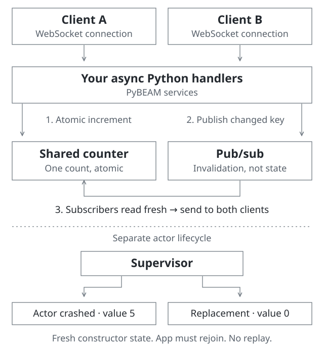

# Why PyBEAM

When concurrent requests share data, you need to coordinate updates and decide what happens after a failure. PyBEAM provides actors, atomic counters, pub/sub and supervision inside your Python application, without a separate broker.

## No locks

- An [actor](actors.md) owns its state and runs one method call at a time, even while a method awaits. Calls never interleave inside an actor, so its state needs no lock.
- Arguments and results are copied, so callers never share a mutable object with an actor.
- A [shared counter](state.md) changes and returns its value in one atomic step.
- [Messaging](messaging.md) notifies subscribers without a separate broker.
- [Supervision](supervision.md) replaces a failed actor with a fresh one.

## Example: two clients, one count

Two WebSocket clients connect to your app and need to see the same count.



1. A handler calls `incr`. The increment and the returned count are one atomic operation.
2. The handler publishes a message naming the changed key.
3. Each subscriber reads the current count and sends it to its client.
4. If a supervised actor crashes, the supervisor starts a replacement from its constructor. Call `rejoin` to get the new reference.

## Compared with plain asyncio

Tasks on an asyncio loop can share mutable objects. A failed task stays failed unless your application restarts it. A PyBEAM actor owns its state, receives copies of its arguments, and is replaced by its group when it fails. That ownership and recovery adds overhead; PyBEAM is not a faster replacement for asyncio.

| Need | Plain asyncio | PyBEAM |
| --- | --- | --- |
| Mutable state shared by tasks | Coordinate access where operations can interleave | Actor methods run one at a time |
| Shared counter | Coordinate local updates or use an external store | Atomic `incr` |
| Notify other connections | Manage local queues or use a broker | `publish` and `subscribe` |
| Recover from a failure | Your own restart code | Supervisor restarts the actor |

## When to use PyBEAM

Consider PyBEAM when concurrent work shares state or needs supervised recovery: web apps with shared counters, live updates, and long-running services. For a script or batch job that needs none of those capabilities, start with plain asyncio.

## How it works

You write ordinary async Python. PyBEAM starts and stops its runtime for you. See [Blocking and CPU work](execution.md) before adding blocking operations, or [How PyBEAM works](internals/index.md) for implementation details.

## Limits

- Actor state, shared values and pub/sub messages live in memory and do not survive a restart. Keep application data in your database; [durable tasks](durable-tasks.md) separately record retryable work.
- A timeout stops waiting; it does not undo the call. Retrying can repeat its effects.
- A restarted actor starts from its constructor. The old state and any in-flight calls are lost.

## Try it

Subscribe to a topic, publish a message, and receive it:

```python
# messaging.py
from pybeam.integrations.hornbeam import Beam, run


async def main() -> None:
    beam = await Beam.connect()

    async with beam.subscribe("orders", max_bytes=4096) as inbox:
        await beam.publish("orders", b"order-42")

        message = await inbox.receive()
        print(message.decode("utf-8"))


if __name__ == "__main__":
    run(main)
```

```console
$ uv run messaging.py
order-42
```

Next, try [shared state](state.md) or [supervision](supervision.md).
