# Actor capacity: plain sync code versus async

Historical actors added a native thread each, and blocking method bodies stalled the shared event loop. These pre-pool measurements are not limits for current pooled actors; direct free-threaded worker calls did run in parallel.


## How an actor method runs

In this historical runtime each actor owned a worker context, and all actor bodies used one event-loop thread. The [native actor][source-1] created a worker context, and worker contexts [shared the main interpreter's loop][source-2]; the probe observed the caller's thread ID in every method.

So every actor method body runs on one event loop thread. An `await` lets other actors run. A blocking call inside an `async def` method stops every actor in the process until it returns.

## Cost per actor

<div class="research-chart" tabindex="0" role="region" aria-label="Scrollable research chart">

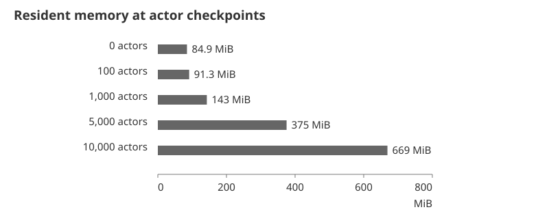

</div>

<div class="research-chart" tabindex="0" role="region" aria-label="Scrollable research chart">

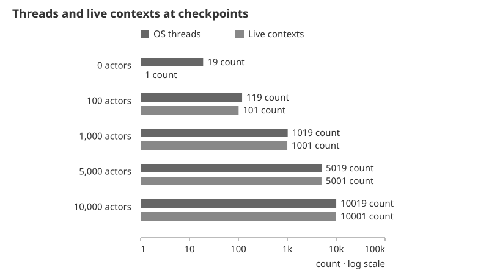

</div>

<div class="research-chart" tabindex="0" role="region" aria-label="Scrollable research chart">

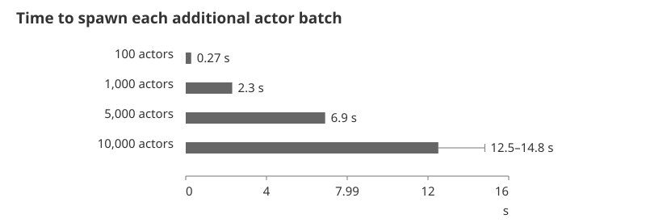

</div>

On free-threaded, 10,000 actors added 494 MiB (about 50 KiB each) and the same 10,000 threads.

Each idle actor added about **60 KiB RSS and one OS thread** on conventional. Spawning took 2.3–3.0 ms per actor and slowed as the count grew; reaching 10,000 took about 24 s. 10,000 was the last checkpoint; spawning did not fail. RSS reached about 920 MiB after the call tests below.

For comparison, plain Python on the same machine:

<div class="research-chart" tabindex="0" role="region" aria-label="Scrollable research chart">

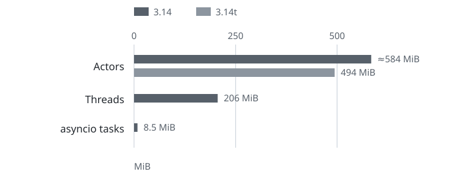

</div>

<div class="research-chart" tabindex="0" role="region" aria-label="Scrollable research chart">

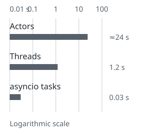

</div>

Actors and threads each added 10,000 OS threads; asyncio tasks added none.

## Calls

All rows call one method on N distinct actors at once with `asyncio.gather`, unless noted. The CPU job is a 2,000,000-step integer loop that takes about 0.12 s alone.

<div class="research-chart" tabindex="0" role="region" aria-label="Scrollable research chart">

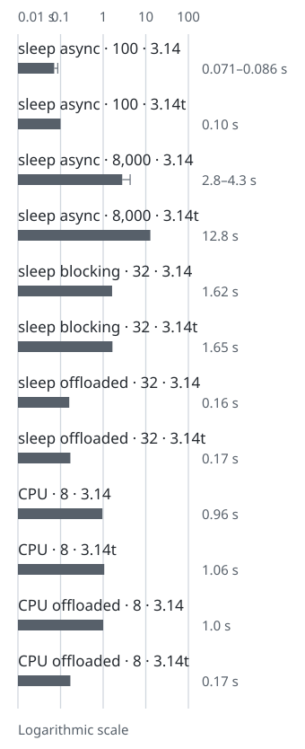

</div>

<div class="research-chart" tabindex="0" role="region" aria-label="Scrollable research chart">

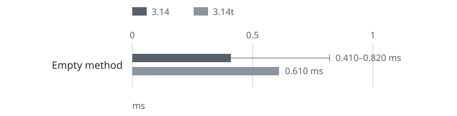

</div>

<div class="research-chart" tabindex="0" role="region" aria-label="Scrollable research chart">

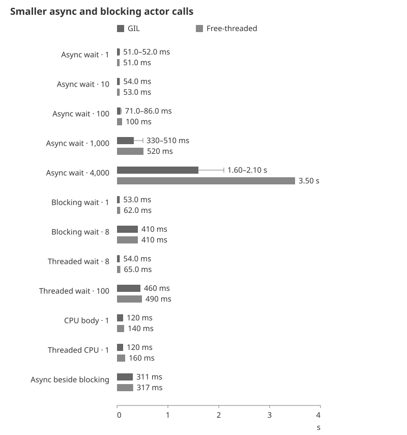

</div>

The 10,000-call async wait failed with `RuntimeError: Native callback queue full` on the conventional build; it was not run on the free-threaded build.

- **Blocking code serializes all actors on both builds.** 32 actors each sleeping 50 ms took 32 × 50 ms. A 10 ms async call waited behind another actor's 300 ms `time.sleep`. Removing the GIL does not change this, because every method body runs on the one loop thread.
- **CPU work in a method body serializes on both builds.** Eight 0.12 s jobs took about 1 s. On free-threaded, the same jobs through `to_thread` took 0.17 s; on conventional they did not overlap.
- **Async methods overlap**, but per-call overhead dominates past about 100 concurrent calls: 8,000 calls took 2.8–4.3 s on conventional and 12.8 s on free-threaded for 50 ms of waiting.
- **About 8,000 calls can be in flight from one caller loop.** The measured erlang-python capped reserved native callbacks per loop at 8,192 (`MAX_RESERVED_PENDING` in `c_src/py_event_loop.h`); [erlang-python#23](https://github.com/h0rv/erlang-python/pull/23) removed that cap. The overflow raised in the caller; after the error, closing the group also hit the full queue and the managed shutdown deadline expired.
- **`asyncio.to_thread` restores overlap** for blocking code, up to the default executor's 12 threads on 8 CPUs: 100 calls took 9 rounds of 50 ms.
- The ~40 ms acknowledgment delay under separate investigation did not appear: one empty call took under 1 ms.

## Fanning out blocking network calls

One actor method makes 10 blocking `http.client` requests to the 50 ms server.

<div class="research-chart" tabindex="0" role="region" aria-label="Scrollable research chart">

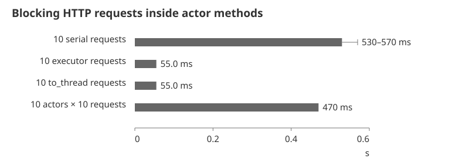

</div>

Fan-out cuts one actor's wall time from 10 × 50 ms to one round trip. The `ThreadPoolExecutor` version still blocks the shared loop, and every other actor, for those 55 ms. With `to_thread`, 100 concurrent requests are limited by the 12-thread default executor.

## Tasks for comparison

`TaskFunction` bodies doing `time.sleep(0.05)`, all started at once:

<div class="research-chart" tabindex="0" role="region" aria-label="Scrollable research chart">

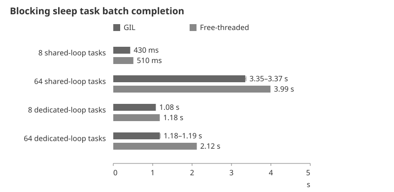

</div>

Shared-loop tasks serialize like actors. Dedicated-loop tasks overlap blocking calls but include the ~1 s untraced completion overhead described in [execution modes](execution-modes.md). Actors have no dedicated-loop option.

## Python contexts called directly from BEAM processes

[`modes_matrix.py`](probes/capacity/modes_matrix.py) drives the modes lab's [`probe.escript`](../../examples/modes_lab/probe.escript). Each of N Erlang processes calls its own erlang-python context with `py_context:call`, with no asyncio loop in between. The CPU job is a 3,000,000-step integer loop that takes about 0.33 s alone. The blocking job is `time.sleep(0.05)` from [`blocking/job.py`](probes/capacity/blocking/job.py).

<div class="research-chart" tabindex="0" role="region" aria-label="Scrollable research chart">

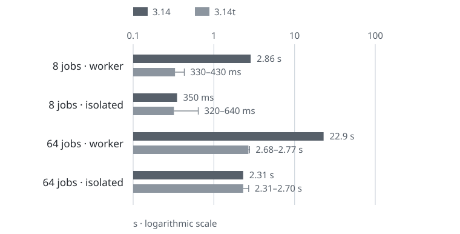

</div>

<div class="research-chart" tabindex="0" role="region" aria-label="Scrollable research chart">

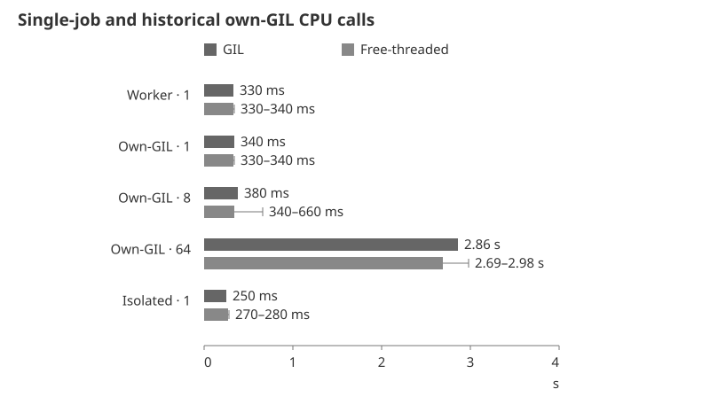

</div>

<div class="research-chart" tabindex="0" role="region" aria-label="Scrollable research chart">

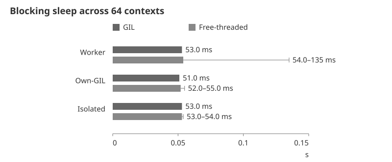

</div>

<div class="research-chart" tabindex="0" role="region" aria-label="Scrollable research chart">

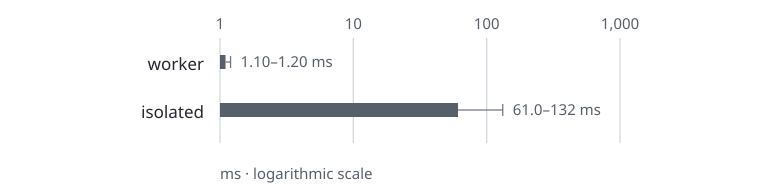

</div>

<div class="research-chart" tabindex="0" role="region" aria-label="Scrollable research chart">

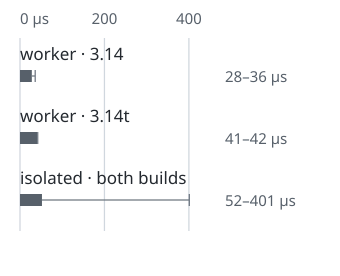

</div>

<div class="research-chart" tabindex="0" role="region" aria-label="Scrollable research chart">

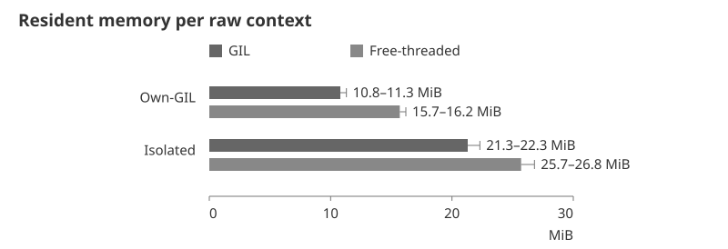

</div>

Worker RSS was under 0.1 MiB per context on both builds. Own-GIL creation took 75–83 ms and empty call p50 was 12–15 µs. A native abort killed the VM in worker and own-GIL modes; isolated kept the other three contexts alive and replaced the child in 64–134 ms.

- **On free-threaded, worker contexts run Python on all 8 CPUs.** Eight CPU jobs took as long as one, and 64 took 8 rounds. On conventional they serialize.
- **The actor slowdown comes from the shared loop, not the GIL.** The same worker contexts that parallelize here serialize when PyBEAM actors dispatch through one asyncio loop.
- **This integer loop ran at the same speed on conventional and free-threaded** (0.33–0.34 s alone). That says nothing about a web request path; see the [FastAPI request path](#a-fastapi-request-path-on-conventional-and-free-threaded) below.
- **Blocking calls overlap in every mode on both builds**, because each context has its own thread.

## Many BEAM processes sharing 8 contexts

The `fanin` probe spawns N Erlang processes. Each one calls an empty Python function on one of 8 contexts, with at most 32 calls in flight.

<div class="research-chart" tabindex="0" role="region" aria-label="Scrollable research chart">

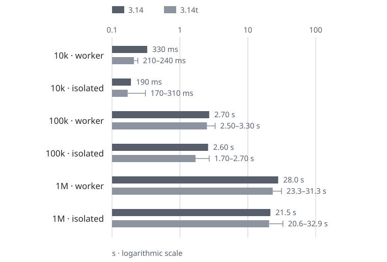

</div>

<div class="research-chart" tabindex="0" role="region" aria-label="Scrollable research chart">

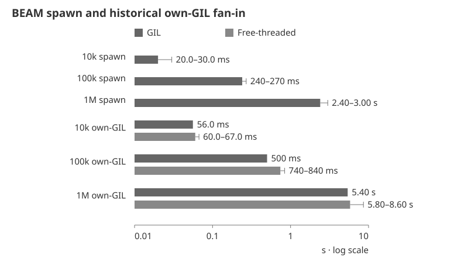

</div>

While they waited, one million BEAM processes used 2.7 KB each, about 2.7 GB in total, as reported by `erlang:memory(processes)`. Worker calls completed at about 32,000–43,000 per second on both builds, and that rate did not rise from conventional to free-threaded. Own-GIL reached about 116,000–185,000 per second. The worker limit was not traced.

## Own-GIL contexts and common packages

[`subinterpreters.py`](probes/capacity/subinterpreters.py) imports each package in a fresh `concurrent.interpreters` subinterpreter, which applies the same extension check that erlang-python's own-GIL contexts use. Binary wheels were installed from PyPI on 2026-11-17.

| Result on conventional | Packages |
| --- | --- |
| Refused: `does not support loading in subinterpreters` | pydantic-core, uvloop, httptools, SQLAlchemy, numpy, pandas, cryptography, lxml, msgspec, grpcio, greenlet, ujson, PyYAML, orjson |
| Loaded | asyncpg, MarkupSafe |
| Not importable | psycopg-binary |


On free-threaded, the same packages were refused in subinterpreters. orjson, psycopg-binary, and grpcio had no free-threaded wheel. Every other package imported with the GIL still disabled, except lxml, which re-enabled it.

Own-GIL contexts cannot load most compiled web and data packages, so this page does not consider them further.

## Moving actor state

[`state/state.escript`](probes/capacity/state/state.escript) keeps a dict of N short strings and an integer counter, and increments the counter once per message. Each figure is the median of 300 messages on one worker context.

- **Pinned:** the dict stays in Python between messages.
- **ETS transfer:** Erlang reads the pickled state from ETS and passes the bytes to Python, which only reads their length.
- **ETS copy:** Python also unpickles, increments, and pickles, and Erlang writes the result back to ETS.

[`state/conventional.py`](probes/capacity/state/conventional.py) measures the same dict as JSON over localhost HTTP and through Redis (`GET`, decode, increment, encode, `SET`). Its raw RESP socket client is lighter than redis-py.

<div class="research-chart" tabindex="0" role="region" aria-label="Scrollable research chart">

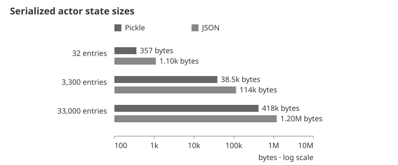

</div>

<div class="research-chart" tabindex="0" role="region" aria-label="Scrollable research chart">

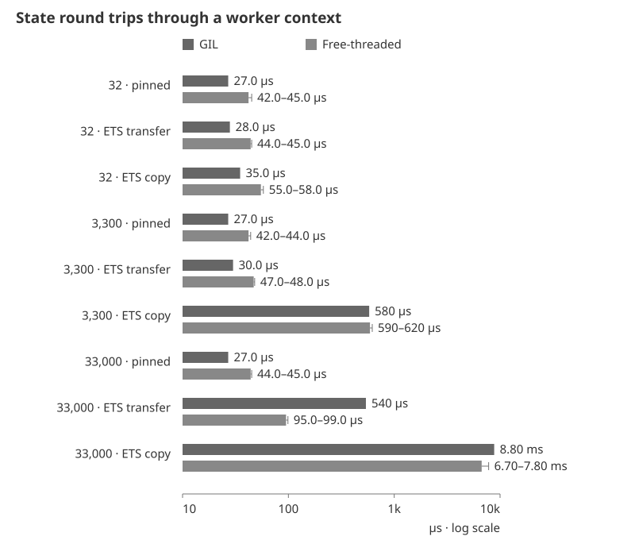

</div>

<div class="research-chart" tabindex="0" role="region" aria-label="Scrollable research chart">

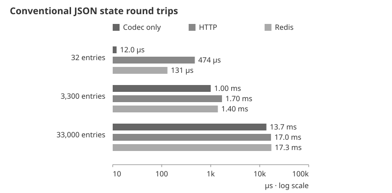

</div>

The JSON rows ran on conventional only.

- **Pinned state costs one call** at every size: 27 µs on conventional and 42–45 µs on free-threaded.
- **ETS lookup and byte transfer are cheap.** An ETS lookup took 0.1–0.7 µs, and passing 418 KB to Python added under 0.6 ms.
- **Decoding and encoding the Python objects dominates the cost of moving state.** It grows with the state size on every path.
- **At small sizes, the network adds most of the cost** on the conventional stack: 474 µs over HTTP and 131 µs through Redis, against 35–58 µs through ETS.

## Pool probes

These probes drive a minimal pool of worker contexts from Erlang on conventional, the same shape the [worker design](worker-design.md) proposes.

**In-flight calls.** [`pool/inflight.escript`](probes/capacity/pool/inflight.escript) starts N Erlang processes at once, each calling an empty function on one of 8 worker contexts, with no window. 10,000, 20,000, and 100,000 concurrent callers finished in 0.29, 0.57, and 5.2 s with no errors. The 8,192 cap applies to async calls from one asyncio loop, not to `py_context:call` from BEAM processes.

**Growing the pool for blocked calls.** [`pool/growth.escript`](probes/capacity/pool/growth.escript) keeps 8 warm contexts, holds B of them with 200 ms `time.sleep` calls, and measures 200 sequential empty calls. A growing pool creates a context whenever none is free, up to the cap.

<div class="research-chart" tabindex="0" role="region" aria-label="Scrollable research chart">

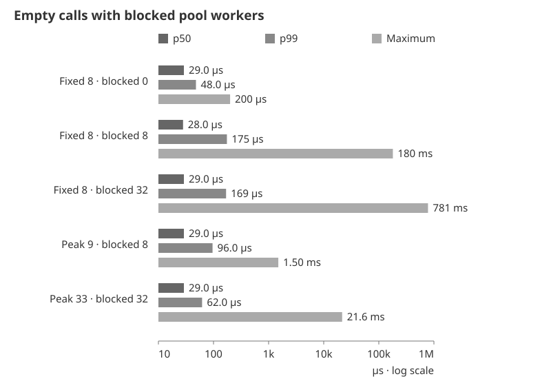

</div>

In a fixed pool, a call waits behind blocked calls for up to several of their durations. Growing on demand cut that wait to the cost of creating contexts: 1.1 ms each, at under 0.1 MiB RSS. Retiring idle contexts was not measured.

## State codecs and what state can hold

[`state/codecs.py`](probes/capacity/state/codecs.py) decodes and re-encodes the same dict as in [moving actor state](#moving-actor-state). Each figure is the median of 200 round trips, on conventional and free-threaded.

<div class="research-chart" tabindex="0" role="region" aria-label="Scrollable research chart">

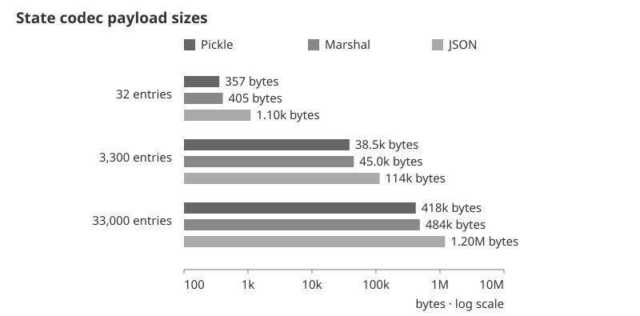

</div>

<div class="research-chart" tabindex="0" role="region" aria-label="Scrollable research chart">

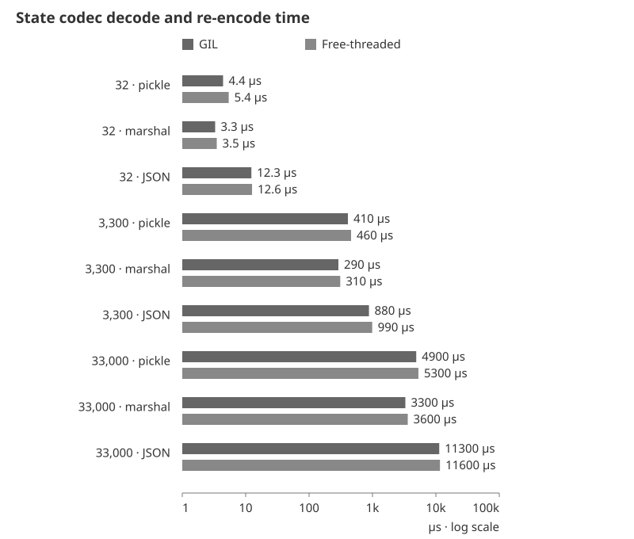

</div>

| State holds | `pickle` | `marshal` | `json` |
| --- | --- | --- | --- |
| A dataclass instance | Works | `ValueError` | `TypeError` |
| A lambda | `PicklingError` | `ValueError` | `TypeError` |
| A `threading.Lock` | `TypeError` | `ValueError` | `TypeError` |
| A socket | `TypeError` | `ValueError` | `TypeError` |
| A generator | `TypeError` | `ValueError` | `TypeError` |


`marshal` was about 30% faster than `pickle` but encodes only built-in types. Locks, sockets, lambdas, and generators cannot go into any durable copy; they can only live in pinned state.

## A FastAPI request path on conventional and free-threaded

The in-process ASGI probe validates a 50-item request model and returns a response model from a plain `def` route. Each thread sends 2,000 requests on its own loop; there is no network or server in this path.

<div class="research-chart" tabindex="0" role="region" aria-label="Scrollable research chart">

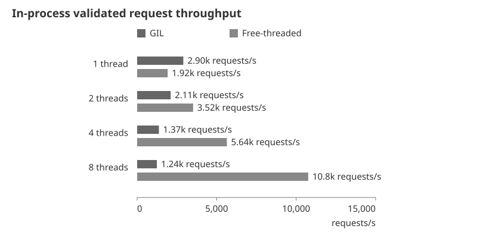

</div>

On this path, one free-threaded thread was 34% slower than one conventional thread. Eight free-threaded threads served 3.7 times the best conventional rate, and the GIL stayed disabled. On conventional, more threads lowered throughput.

## What this measures and what it does not

On this build, a PyBEAM actor is not a cheap sequential process. It costs a native thread and about 50–60 KiB, and plain blocking or CPU-bound code in one actor stalls the rest on both conventional and free-threaded. A BEAM process costs 2.7 KB. On free-threaded, worker contexts called directly from BEAM processes ran Python in parallel on all 8 CPUs.

Not measured:

- `ActorGroup(execution=ExecutionLimits(...))`. The locked erlang-python `DataActorGroup` accepts only `max_children`.
- Memory or thread limits beyond 10,000 actors, or container cgroup limits below this VM's.
- A web request path over a real network with TLS, and codecs outside the standard library. Loopback serving through real servers is in the [ASGI benchmarks](../../benchmarks/web/SCALE_RESULTS.md).
- Retiring idle pool contexts.
- The cause of the worker-context call rate limit of about 40,000 calls per second.

<style>
.research-chart { overflow-x: auto; }
.research-chart img { width: 100%; min-width: 740px; max-inline-size: none; height: auto; }
.research-chart:focus-visible { outline: 2px solid currentColor; outline-offset: 2px; }
</style>

## Appendix: environment and provenance

Chart build labels mean CPython 3.14.10 (GIL) and 3.14.10t (free-threaded), unless a historical probe below specifies otherwise. KB and MB payload sizes are decimal; KiB and MiB are binary.

The conventional state probe used Redis 7.

- Linux x86-64 VM, 8 CPUs, 31 GiB memory, kernel 6.8, `ulimit -u` 128356.
- CPython 3.14.10 conventional (GIL enabled) and 3.14.10t free-threaded, Erlang/OTP 29.1.2. Each build used its own `py_nif.so`, checked with `ldd`.
- erlang-python `d60392c`, as locked in `rebar.lock`; default `ActorGroup` (worker contexts, shared loop).
- [`pybeam_actors.py`](probes/capacity/pybeam_actors.py): three runs on 3.14, one on 3.14t. [`plain_python.py`](probes/capacity/plain_python.py): one run on 3.14. [`modes_matrix.py`](probes/capacity/modes_matrix.py): one run on 3.14, two on 3.14t. Where runs differ, both values are shown.
- Network calls go to [`server.py`](probes/capacity/server.py) on localhost, which answers each `GET` after 50 ms.
- `ExecutionLimits` actor groups were not measured.

[`web/request_path.py`](probes/capacity/web/request_path.py) calls a FastAPI 0.163.1 app in-process through ASGI. Each request is a `POST /orders` whose body Pydantic (pydantic-core 2.50.4) validates as a 50-item model, handled by a plain `def` route that returns a response model. Each thread runs its own asyncio loop and sends 2,000 requests. There is no network or server in the path. This was run once per build.

### Recorded method and reproduction

Build the native runtime and point a project at it as described in [development](../development.md#use-a-development-runtime). Then, from the repository root:

```sh
mise exec -- python docs/research/probes/capacity/server.py 38999 &
mise exec -- python docs/research/probes/capacity/plain_python.py threads 10000
mise exec -- python docs/research/probes/capacity/plain_python.py tasks 10000
PROBE_PORT=38999 mise exec -- uv run --locked python docs/research/probes/capacity/pybeam_actors.py
```

Run the last command from a directory whose `pyproject.toml` sets `development_runtime`.

The PyBEAM probe prints one row per spawn checkpoint and one `RESULT` JSON line, and takes about a minute. Stop the background server afterward.

The mode grid regenerates context creation, RSS, empty-call latency, CPU and fan-in measurements through the in-repo modes-lab probe, including unsupported own-GIL rows. Repeat runs to obtain ranges rather than expecting identical timings.

The mode grid and the state probe take the erlang-python application directory, for example `_build/default/lib/erlang_python`. `py_nif.so` there must be built for the Python you are measuring:

```sh
mise exec -- python docs/research/probes/capacity/modes_matrix.py "$PWD/_build/default/lib/erlang_python"
mise exec -- escript docs/research/probes/capacity/state/state.escript "$PWD/_build/default/lib/erlang_python" "$PWD/docs/research/probes/capacity/state"
docker run -d --rm -p 6390:6379 redis:7-alpine
PROBE_KV_PORT=6390 mise exec -- python docs/research/probes/capacity/state/conventional.py
python docs/research/probes/capacity/subinterpreters.py pydantic_core uvloop numpy sqlalchemy
```

Run the last command with the interpreter whose installed packages you want to check.

[source-1]: https://github.com/h0rv/erlang-python/blob/d60392cdd86a5947f0569d83e0f8dfefcec83410/src/py_data_actor.erl
[source-2]: https://github.com/h0rv/erlang-python/blob/d60392cdd86a5947f0569d83e0f8dfefcec83410/src/py_context.erl#L638-L639

### In-repository checks

The historical actor values require the pre-pool runtime described above; the current runtime can produce different results. Start the local server and run the actor probe as above, then run these additional state, pool and web probes from the repository root.

```sh
mise exec -- uv run --locked python tools/build_native.py
APP="$PWD/_build/hornbeam/lib/erlang_python"
mise exec -- python docs/research/probes/capacity/modes_matrix.py "$APP"
mise exec -- python docs/research/probes/capacity/state/codecs.py
mise exec -- uv run --locked --all-extras python docs/research/probes/capacity/web/request_path.py
mise exec -- escript docs/research/probes/capacity/pool/inflight.escript "$APP" "$PWD/docs/research/probes/capacity/pool" 10000
mise exec -- escript docs/research/probes/capacity/pool/growth.escript "$APP" "$PWD/docs/research/probes/capacity/pool"
```
