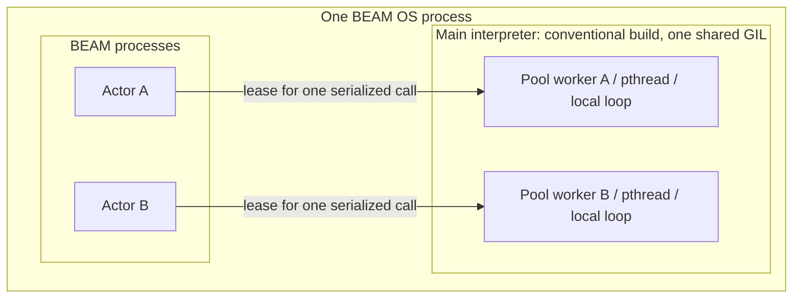
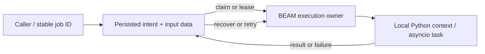

# Python execution and durability

Historical research note: own-GIL subinterpreter mode is unsupported because common native extensions do not load in it; use free-threaded 3.14t workers or isolated OS processes instead. See the [compatibility results](execution-modes.md#unsupported-own-gil-subinterpreters).

## Direction and evidence

Bring BEAM capabilities to Python developers through familiar Python/asyncio APIs and framework integrations. Ordinary use should not require learning Erlang, Elixir, or BEAM operations. Hide integration plumbing, not ownership, overload, cancellation, restart, or durability guarantees. This is not a proposal for another Python scheduler, web framework, ORM, task queue, or workflow engine.

Target modern Python 3.14+ and evaluate newer releases, including 3.15+, when runtime and dependency contracts permit. Free-threaded Python became an officially supported CPython build in 3.14.[C1] Its availability is not proof that every PyBeam primitive supports it. Conversely, today's conventional-GIL baseline is not a permanent limit on the architecture.

The task and raw-context observations below refer to [PyBeam d5bdc9e][P0] and [erlang-python d227c0d][R0]; the builder reference includes the subsequent free-threaded opt-in. Bounded data actors now use the node-wide pool in pinned erlang-python `f893508`. Recheck these constraints when the dependency or build changes. Source inspection is not native-runtime certification. See [measured execution modes](execution-modes.md) for the development-build matrix, task probes and remaining integration failures. Alternative backends are not shipped per-actor/task configuration switches.

## Separate the boundaries

| Boundary | What it means | What does not follow |
|---|---|---|
| BEAM process | Lightweight identity, mailbox, monitors, supervision, scheduling of BEAM code | A Python interpreter, OS thread, durable queue, or preemptible Python coroutine |
| erlang-python context | Owns native execution handoff and lifecycle | A distinct interpreter in every mode |
| Python interpreter | Module/import state, globals and interpreter-local resources | Its own OS process or native-crash boundary |
| Native thread | Executes Python/native work on an OS-scheduled thread | Parallel Python bytecode with a shared conventional GIL |
| Asyncio loop | Locally schedules coroutine steps and callbacks | A distributed task or multicore execution within that loop |
| OS process | Separate address space and stronger native-crash containment | A security sandbox or durable application state |
| BEAM node | One VM/OS process with its local Python execution resources | Replicated state, persisted work, or a separate host |
| Durable backing store | Persists intent/state according to its storage and recovery contract | Automatic rollback or exactly-once external effects |

In this document, **runtime** means the managed BEAM VM plus the Python execution contexts and event-loop drivers integrated by erlang-python. Use the specific boundary when discussing a guarantee. erlang-python owns execution, contexts, embedding and interpreter safety; Hornbeam owns web/ASGI and its service implementations; PyBeam owns typed Python-facing ergonomics and lifecycle integration.

## BEAM-backed asyncio is local

The fork implements `ErlangEventLoop`: asyncio I/O readiness uses `enif_select`, timers use `erlang:send_after`, and a local native driver thread executes Python callbacks. The loop records its owning thread and repeatedly runs `_run_once`.[R1] This integrates asyncio with BEAM; it does **not** make one distributed asyncio loop.

An `asyncio.Task` stays on its local loop and interpreter. It does not automatically become an OTP process. BEAM can send data to another node where another invocation runs, then send back a result; this does not migrate a suspended coroutine, Python stack, socket, lock, or live local object. Remote work can finish even when its acknowledgment is lost; the current distribution implementation explicitly returns uncertain outcomes.[R2]

## Many jobs do not require many interpreters

Many BEAM callers can share a finite pool of Python execution resources. The fork's generic context router already chooses from a finite context pool using scheduler ID.[R3] That generic call path is distinct from the current actor/task implementations:

1. Bounded data actors lease contexts from a node-wide worker pool during construction and each call. The pool starts at available logical CPU count, grows when busy up to `worker_pool_max` (default four times that count), and queues checkouts FIFO at the cap. It prefers the actor's previous worker only when free.[W1][W2] The raw object-actor path still creates its own `worker` context.[R5]
2. Each worker context allocates a dedicated pthread and a namespace in the **main interpreter**. Conventional workers acquire the same GIL; a namespace is not separate module state or a native-crash boundary.[R6]
3. A bounded data actor calls a synchronous dispatch wrapper, which runs its coroutine on a thread-local loop reused by that worker. The actor retains its serialized turn while it waits. Different actors on different workers can overlap blocking methods; GIL-free Python permits CPU parallelism across those threads.[W2][W3]
4. Other async local-object callers still use the shared interpreter driver when it is running. Pure-Python CPU work there delays the driver's other coroutines. Removing the GIL alone does not turn that one loop thread into multicore execution.[R7]

Tasks also allocate a worker context per native task child. `TaskFunction` defaults to `dedicated_loop=False`, taking the shared path; `dedicated_loop=True` runs the body on its context-owned loop. Both still use the main interpreter. Construct and finalize loop-bound resources within their owning body/loop.[P1][R8]

Actor count no longer determines worker-thread count. Actor state, admission tickets and waiting callers still consume memory. Do not infer cheap million-actor scale from BEAM process counts. No measured actor-count or throughput limit is established here.

Data actors now follow **many logical actors → per-actor admission → finite native execution lanes**. A later turn can use another worker and loop: create and finalize loop-bound resources within a turn. Group shutdown releases actor state without destroying pool workers. Restart waits for the old body's native completion, not worker death. The pool does not provide native-crash isolation or bound all retained actor state and waiting producers.[W1][W2][W3]

## Choose an execution boundary

| Choice | Parallelism and isolation | Trade-off | Inspected integration |
|---|---|---|---|
| Conventional CPython workers | One Python bytecode lane under the main interpreter's shared GIL; I/O and native libraries that release it can overlap | Shared module/native state; CPU-bound Python threads do not execute bytecode in parallel there | Conventional CPython 3.14.10 remains the builder default and packaged-wheel ABI; `workers` is limited to one. The launcher leaves the BEAM scheduler count at its runtime default, independently of the Python GIL.[P2][P3][P4] |
| Free-threaded CPython | Multiple actual threads can execute Python in parallel in one interpreter | Shared-state synchronization, extension compatibility, memory and single-thread overhead; one loop still runs one coroutine step at a time | Builder accepts CPython 3.14.10t with `PYBEAM_ALLOW_FREE_THREADED=1`. Dedicated-loop task CPU parallelism was measured; shared-loop tasks do not parallelize. Packaged wheels remain conventional and full integration acceptance is incomplete.[P2][R9] |
| Own-GIL subinterpreters | Separate interpreter state and GIL per lane, with one pthread per context; parallel execution across lanes | Interpreter/import overhead, extension compatibility and data transfer; shared address space/native-crash fate | Fork constructs `PyInterpreterConfig_OWN_GIL`; retained in code but unsupported because common native extensions reject subinterpreters. Actor object references require the main interpreter.[R10][R11][R12] |
| Isolated Python processes | Independent process/interpreter execution; stronger containment of a Python/native child crash | Startup, memory, framing/serialization and IPC; not automatically a sandbox | Fork's `isolated` context runs a Python child through a port and Unix socket. This is not a PyBeam actor-backend switch.[R13] |
| Multiple BEAM nodes | Independent VMs/OS processes with local Python execution resources; can combine with execution strategies above | Placement, deployment, data transfer and partial failure; local nodes share host-failure risk | Experimental `LocalCluster` owns exactly two trusted local VMs, not a general cluster/deployment product.[P5] |

Free-threading and interpreter isolation are different choices; do not assume their benefits stack. Follow CPython's [free-threading][C2] and [multiple-interpreter][C3] contracts and verify the exact dependencies.

Two current restrictions need more than a version upgrade: native actor/local-object helpers reject non-main interpreters,[R12] and one native event-loop admission API returns `unsupported_admission_mode` on free-threaded builds or non-main-interpreter loops.[R9] Actor admission also has separate native gates; do not conflate every admission API. These are integration constraints to investigate, not CPython-wide impossibilities.

A free-threaded build may still enable the GIL through configuration or an unsupported extension import. Check both `sysconfig.get_config_var("Py_GIL_DISABLED")` and `sys._is_gil_enabled()` **inside the embedded interpreter after application imports**.[C2] The fork's C execution-mode enum is compile-time-derived, not evidence that the live GIL stayed disabled.[R14] Verify throughput, event-loop latency, memory, cancellation and native synchronization before claiming multicore support for a primitive.

## Failure and recovery contracts

| Event | Consequence |
|---|---|
| Python exception | Can be returned as a call/task error; not every exception kills or restarts its OTP owner. |
| Timeout | Execution or its side effects may already have happened. Abandoning a reply is not rollback; blind retry can duplicate effects. |
| Cancellation | A local, cooperative request. The body records its loop and asks that loop to cancel its asyncio task; native calls and external effects may not stop or roll back.[R15] |
| Actor PID dies | The pool worker can still be running the old body. Actor restart waits for the gate's native completion; it does not destroy or wait for the worker to die.[W2][W4] |
| Embedded native crash | A C-extension segfault can terminate the entire BEAM OS process, including its subinterpreters. Own-GIL is not native-crash or security isolation. |
| Actor restart | Fresh state unless the application restores it; supervision is not business-state storage. |
| Node/network failure | A request can execute before its acknowledgment is lost. Preserve uncertainty instead of silently declaring failure or replaying.[R2] |
| Host failure | Multiple local nodes can disappear together. Storage and deployment failure domains matter. |

`LocalCluster` explicitly starts fresh application state on restart and does not automatically replay a stopped node.[P5]

## Durability is another axis

BEAM mailboxes, Python tasks, in-memory queues and state are ephemeral on VM/node loss. The fork's shared-state implementation uses ETS: supervisor ownership can preserve a table across some worker crashes, not loss of the VM.[R17] More nodes, pub/sub, a cache, or supervision alone do not create a durable-work contract.

Separate responsibility does not necessarily mean a separate service. Durable local storage may satisfy process-restart recovery; surviving host loss requires storage and recovery that cover that failure domain. Choose the guarantee before choosing an adapter. Reuse established implementations; storage policy belongs to applications, not a new PyBeam queue/workflow engine.

For production work, specify:

1. **Acceptance:** persist a stable job ID, versioned serializable intent, and required input data/references before promising durable acceptance. A persisted pointer to memory-only input is insufficient.
2. **Ownership:** define atomic claim/lease, attempt identity and, where needed, fencing of stale workers.
3. **Completion/recovery:** persist required results/status; define retry/backoff, attempt limits, expiry/dead-letter behavior and recovery after worker or node loss.
4. **Side effects:** retries generally imply at-least-once attempts. Use idempotency, transactional updates/outbox patterns where applicable, or reconciliation/compensation. Do not promise generic exactly-once effects across unrelated external systems.
5. **Cancellation:** distinguish requested, not started, stopped and outcome uncertain. A cancelled client wait does not erase a potentially completed charge, email or write.

This shows data/work recovery, not persistence or migration of Python coroutine stacks. BEAM and asyncio execute an attempt; the store records enough to recover a new attempt. No durable queue, backend, automatic replay or production durability guarantee is established by this research.

[P0]: https://github.com/h0rv/pybeam/tree/d5bdc9e07332819c12a7f2f06480126bff64aded
[P1]: https://github.com/h0rv/pybeam/blob/d5bdc9e07332819c12a7f2f06480126bff64aded/src/pybeam/tasks.py#L42-L58
[P2]: https://github.com/h0rv/pybeam/blob/98a72e2153669ef07cfc949cd6f6259ae1a207ab/tools/build_native.py#L36-L50
[P3]: https://github.com/h0rv/pybeam/blob/d5bdc9e07332819c12a7f2f06480126bff64aded/src/pybeam/runtime/config.py#L86-L96
[P4]: ../../src/pybeam/runtime/process.py
[P5]: https://github.com/h0rv/pybeam/blob/d5bdc9e07332819c12a7f2f06480126bff64aded/src/pybeam/runtime/cluster.py#L87-L92
[R0]: https://github.com/h0rv/erlang-python/tree/d227c0de29fa3f748610352bf8a808a235bcd5c3
[R1]: https://github.com/h0rv/erlang-python/blob/d227c0de29fa3f748610352bf8a808a235bcd5c3/priv/_erlang_impl/_loop.py#L73-L89
[R2]: https://github.com/h0rv/erlang-python/blob/d227c0de29fa3f748610352bf8a808a235bcd5c3/src/py_distribution.erl#L23-L47
[R3]: https://github.com/h0rv/erlang-python/blob/d227c0de29fa3f748610352bf8a808a235bcd5c3/src/py_context_router.erl#L524-L531
[R4]: https://github.com/h0rv/erlang-python/blob/d227c0de29fa3f748610352bf8a808a235bcd5c3/src/py_data_actor.erl#L8-L20
[R5]: https://github.com/h0rv/erlang-python/blob/d227c0de29fa3f748610352bf8a808a235bcd5c3/src/py_object_actor.erl#L40-L44
[R6]: https://github.com/h0rv/erlang-python/blob/d227c0de29fa3f748610352bf8a808a235bcd5c3/c_src/py_nif.c#L2604-L2747
[R7]: https://github.com/h0rv/erlang-python/blob/d227c0de29fa3f748610352bf8a808a235bcd5c3/c_src/py_local_object.c#L226-L258
[R8]: https://github.com/h0rv/erlang-python/blob/d227c0de29fa3f748610352bf8a808a235bcd5c3/src/py_task.erl#L8-L64
[R9]: https://github.com/h0rv/erlang-python/blob/d227c0de29fa3f748610352bf8a808a235bcd5c3/c_src/py_event_loop.c#L2634-L2648
[R10]: https://github.com/h0rv/erlang-python/blob/d227c0de29fa3f748610352bf8a808a235bcd5c3/c_src/py_nif.c#L3029-L3057
[R11]: https://github.com/h0rv/erlang-python/blob/d227c0de29fa3f748610352bf8a808a235bcd5c3/src/py_context_embedded.erl#L229-L235
[R12]: https://github.com/h0rv/erlang-python/blob/d227c0de29fa3f748610352bf8a808a235bcd5c3/c_src/py_local_object.c#L32-L57
[R13]: https://github.com/h0rv/erlang-python/blob/d227c0de29fa3f748610352bf8a808a235bcd5c3/src/py_isolated.erl#L15-L30
[R14]: https://github.com/h0rv/erlang-python/blob/d227c0de29fa3f748610352bf8a808a235bcd5c3/c_src/py_exec.c#L68-L78
[R15]: https://github.com/h0rv/erlang-python/blob/d227c0de29fa3f748610352bf8a808a235bcd5c3/priv/_erlang_impl/_tasks.py#L20-L72
[R16]: https://github.com/h0rv/erlang-python/blob/d227c0de29fa3f748610352bf8a808a235bcd5c3/src/py_actor_group.erl#L207-L227
[R17]: https://github.com/h0rv/erlang-python/blob/d227c0de29fa3f748610352bf8a808a235bcd5c3/src/py_state.erl#L84-L94
[C1]: https://docs.python.org/3.14/whatsnew/3.14.html#pep-779-free-threaded-python-is-officially-supported
[C2]: https://docs.python.org/3.14/howto/free-threading-python.html
[C3]: https://docs.python.org/3.14/library/concurrent.interpreters.html
[W1]: https://github.com/h0rv/erlang-python/blob/f8935081563212719b32d2925a65a7ff8d03b6fa/src/py_worker_pool.erl
[W2]: https://github.com/h0rv/erlang-python/blob/f8935081563212719b32d2925a65a7ff8d03b6fa/src/py_data_actor.erl
[W3]: https://github.com/h0rv/erlang-python/blob/f8935081563212719b32d2925a65a7ff8d03b6fa/priv/_erlang_impl/_actor_data.py
[W4]: https://github.com/h0rv/erlang-python/blob/f8935081563212719b32d2925a65a7ff8d03b6fa/src/py_actor_group.erl
