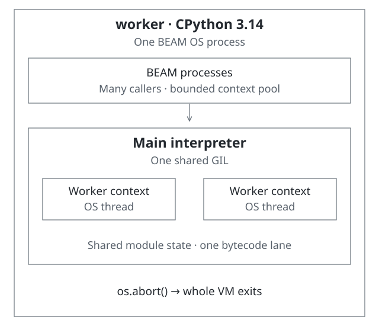
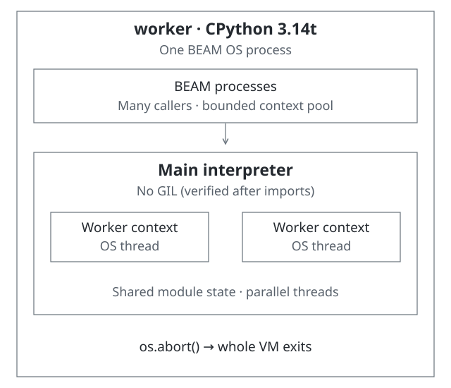
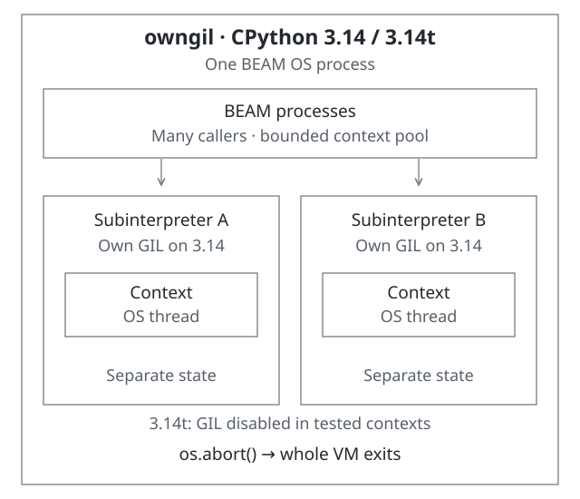
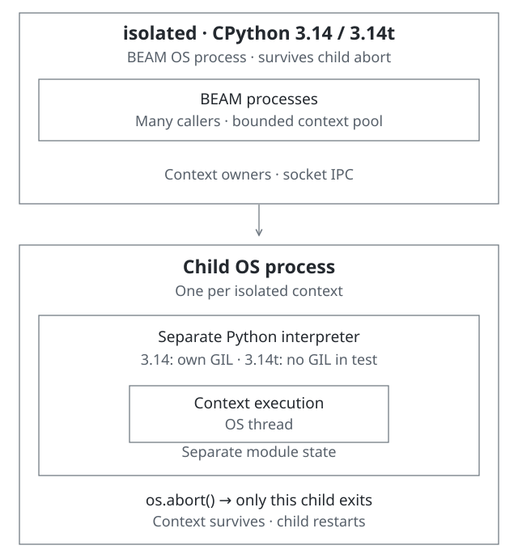

# Execution modes: measured development builds

These are single trials on one Linux x86-64 VM with eight CPUs, not compatibility certification or production limits. The measurements below are historical; the supported default is free-threaded CPython 3.14t workers, with isolated OS processes for code that might crash the interpreter. See the [execution model](execution-model.md) for ownership, cancellation and durability boundaries.

## Choosing a mode

Import `ExecutionMode` and `TaskFunction` from `pybeam.tasks`. Select a task boundary with the keyword-only `TaskFunction(..., execution=ExecutionMode.WORKER, dedicated_loop=False)`. Worker is the default; isolated accepts importable byte entries with caller-side codecs. Own-GIL mode remains in code but is unsupported.

| Mode / build | How to select in PyBeam | Tasks / actors today | Parallel CPU | Native-crash containment | Extension compatibility | Cost |
|---|---|---|---|---|---|---|
| worker / 3.14 | `execution=ExecutionMode.WORKER` (default) | Yes / yes | No Python bytecode parallelism under the GIL | None; VM dies | Main-interpreter extensions | ~15 KiB/context; ~17 µs raw calls |
| worker / 3.14t | Same setting, free-threaded build | Development / development; acceptance incomplete | Threads can parallelize, but shared-loop task bodies do not | None; VM dies | Requires free-threading compatibility for GIL-free execution | ~21 KiB/context; ~29 µs raw calls |
| worker + dedicated loop / 3.14t | Also `dedicated_loop=True` | Development tasks / no actor loop option | Measured across task loops | None; VM dies | Same as worker / 3.14t | Context-owned loop; ~1 s unexplained task completion overhead |
| owngil | Unsupported; retained in code only | Unsupported / no | Historical measurements below | None; VM dies | Common native extensions reject subinterpreters | Not a supported option |
| isolated | `TaskFunction(entry, request, result, execution=ExecutionMode.ISOLATED)` | Yes, byte entries / no | Across task child processes | Contains `os.abort()`; not a sandbox | Entry-module imports of pybeam/pydantic/pydantic_core verified; NumPy imported in earlier raw probes | ~24–40 MiB/context; ~76–81 µs raw calls; child startup per task |

Costs are single-trial raw-context measurements below, not task guarantees. PR #13's owngil measurements used `py_context` directly, not `py_task`. Named owngil and isolated tasks use erlang-python's importable-entry path. `dedicated_loop` is worker-only: both named modes already own their interpreter loop. Actors remain worker-only because their local objects belong to the main interpreter.

### Unsupported own-GIL subinterpreters

Own-GIL subinterpreter mode is unsupported because common native extensions refuse to load in it. In the [PR #48 mode grid](https://github.com/h0rv/pybeam/pull/48), measured 2026-11-17 on both regular CPython 3.14 and free-threaded 3.14t, 15 of 17 common packages raised `ImportError: ... does not support loading in subinterpreters`. Failures included pydantic-core, uvloop, numpy, SQLAlchemy, orjson, httptools, cryptography, lxml, msgspec, grpcio, greenlet, ujson, PyYAML, and pandas. Only asyncpg and MarkupSafe loaded. Free-threading support does not imply subinterpreter support.

The following contract and measurements describe the historical implementation, not a supported execution option.

Define a plain module-level `async def entry(payload: bytes) -> bytes`; no decorator or `erlang` import is needed. Keep that module independent of incompatible native extensions, including its transitive imports. Import `Json` from `pybeam.codec`, then import the entry function inside your managed async main and pass it to `TaskFunction(entry, Json(Request), Json(Reply), execution=ExecutionMode.OWNGIL)`. Modules beside the user's entry script are available to new contexts. Nested functions, lambdas, synchronous functions, bound methods and callable objects are rejected.

The caller encodes the request and decodes the result through the `Codec` protocol's `encode` and `decode` methods. With the stdlib-only `Json` codec, entries receive and return JSON bytes. An empty string or byte value is valid encoded JSON; a zero-length result is not valid JSON and raises caller-side `CodecError`. Other codecs can define a different byte format. Worker callables still receive and return typed Python values; named entries receive and return bytes, not the caller's request/result objects.

Entry modules cannot import unsupported native extensions such as `pydantic_core` or NumPy (including single-phase-init extensions). Nested PyBeam supervisors are unsupported inside named entries. Python failures surface as `RemoteTaskError(type_name, message)`; original exception identity and remote traceback objects do not cross interpreters. Module import and attribute-resolution failures are terminal errors too: the optional extension-import regression produces a remote `ImportError`, releases the ticket, and permits clean shutdown. A context that dies without a terminal reply remains uncertain.

Cancellation and shutdown are cooperative: CPU/native-blocked entry loops delay cancellation until they yield. Owngil provides CPU parallelism and separate interpreter state, **not native-crash containment**; a crashing extension still kills the VM.

### Isolated byte-entry contract

Use a plain module-level `async def entry(payload: bytes) -> bytes` with `execution=ExecutionMode.ISOLATED` and caller-side `Codec` encoding/decoding. `Json` supports standard types and dataclasses without optional dependencies. Each task owns a fresh child process and loop; `dedicated_loop=True` is rejected. Child startup and separate interpreter/module memory make this more expensive than shared workers. PyBeam selects the caller's Python executable through the runtime's `isolated_python` option rather than discovering it through an occupied managed worker.

Isolated entry modules **can import PyBeam**. The native task probe uses stdlib dataclasses and `Json` in the caller, and imports `pybeam` and `pybeam.codec.Json` in a different OS process. Pydantic remains a development/test dependency, not a PyBeam core dependency, so the probe also checks module-level imports of Pydantic **2.14.3** and `pydantic_core` **2.50.4** as optional-extension coverage; neither supplies the task codecs. These imports do not certify every extension's compatibility. Isolated entries must not import `erlang.tasks` or submit nested tasks: the child has no actor-gate/native task hooks.

Python exceptions and module import/lookup failures remain terminal `RemoteTaskError` outcomes. A confirmed child exit instead raises **`pybeam.tasks.TaskCrashed`**, also returned by `ref.exception()`, with `.reason`, for example `('signal', 6)` after `os.abort()`. The process exited and execution stopped, but **external effects are unknown**. The task is **never restarted or retried**. Confirmed death releases its native admission ticket and leaves the supervisor open for a following task; as with other completed tasks, observe the outcome to release the Python handle's slot. A timeout or context death without child-exit acknowledgement remains `UncertainInflight`, not proof of stopped execution. A terminal result already received wins over a later child exit.

Cancellation and shutdown use the existing cooperative cancel path. An acknowledged terminal cancellation yields `asyncio.CancelledError`; if interruption escalates to child termination without that acknowledgement, it yields `TaskCrashed`. Child crashes are contained, but isolated processes are **not a sandbox**, and neither cancellation nor crash containment rolls back effects.

Choose the Python build when installing the interpreter: conventional **3.14** or free-threaded **3.14t**, with `PYBEAM_ALLOW_FREE_THREADED=1` to opt into the development build. This is not a runtime setting on `TaskFunction`; packaged wheels remain conventional. Check live GIL state with `sys._is_gil_enabled()` after imports: extensions can re-enable it. The GIL is a property of the chosen build and its live configuration, not an inherent PyBeam limit. Free-threaded 3.14t and newer releases such as 3.15 are in scope, subject to actual runtime/dependency validation.

## Mapping work to execution resources

### Worker: conventional Python



### Worker: free-threaded Python



### Own-GIL subinterpreters



### Isolated children



The isolated diagram describes generic raw contexts measured below, which can restart their child. Named isolated tasks use `restart => false`: losing a child never restarts or retries its task. The current runtime includes the merged PR #5 bootstrap fix.

A million BEAM processes do not imply a million interpreters. The [generic router][router] reuses a bounded context pool. Each embedded context currently costs one pthread; isolated contexts instead cost a child process. This is **not actor pooling**: actors allocate worker contexts per native child and tasks allocate contexts in their selected mode, so a million Python actors would still imply roughly a million context pthreads plus other overhead.

## Raw context matrix

CPython **3.14.10 / 3.14.10t**; `erl +S 8:8`. Creation is the cumulative mean at **256 contexts**. RSS is the baseline-subtracted VM plus child RSS, divided by context count; it is summed RSS, not PSS. Calls are 10,000 sequential `operator.add(1, 2)` calls after warm-up. CPU work is a calibrated ~200 ms pure-Python sum of squares. Speedup is `N × wall1 / wallN`; both scaling columns below use **N=8**. No affinity pinning or repeated-trial confidence intervals.

| Mode / build | Works? / capacity reached | Create ms | RSS/context KiB | Call p50/p99 µs | CPU across 8 contexts | 8 threads in one context | Module state | pydantic / numpy | `os.abort()` |
|---|---|---:|---:|---:|---:|---:|---|---|---|
| worker / 3.14 | Yes; 1000 | 1.335 | 15.05 | 17 / 31 | 0.96× | 0.97× | Shared | Both import | VM dies, exit 134 |
| worker / 3.14t | Yes; 1000 | 1.536 | 21.22 | 29 / 51 | 4.71× | 5.03× | Shared | Both import | VM dies, exit 134 |
| owngil / 3.14 | Raw contexts only; 1000 | 78.560 | 10,800.31 | 14 / 23 | 5.27× | 0.96× | Separate | Both rejected | VM dies, exit 134 |
| owngil / 3.14t | Raw contexts only; 288 in 100 s | 345.199 | 28,525.98 | 14 / 21 | 4.14× | 4.28× | Separate | Both rejected | VM dies, exit 134 |
| isolated / 3.14 | With PR #5 fix; 1000 | 90.065 | 24,402.20 | 76 / 146 | 4.73× | 1.23× | Separate | Both import | VM survives; child restarts |
| isolated / 3.14t | With PR #5 fix; 314 in 100 s | 320.468 | 40,167.00 | 81 / 138 | 4.51× | 7.44× | Separate | Both import | VM survives; child restarts |

Creation checkpoints were 1, 8, 64, 256 and 1000, with a 100 s deadline. The two time-capped runs did not reach the 1000 checkpoint; neither reached an allocation limit. Reaching 1000 is a requested ceiling, not a discovered maximum. A Python `ValueError` returned an error in every mode/build and the next call returned `{ok,3}`. In isolated mode the abort caller received `{error,{child_exited,{signal,6}}}`; the context survived and both same-context and fresh-context calls returned `{ok,3}`.

`sys._is_gil_enabled()` stayed false in all tested 3.14t contexts, including after successful pydantic and numpy imports. Both imports failed in owngil without enabling the GIL. Conventional contexts reported true. Import versions: pydantic **2.14.3**, pydantic-core **2.50.4**, numpy **2.5.5**, installed from wheels into separate environments. CPU probes preceded optional-library imports. Ratios near one, including conventional isolated threads at 1.23×, do not establish parallel bytecode execution.

## PyBeam task probe

The public `TaskSupervisor` / `TaskFunction` probe ran the same calibrated sum-of-squares workload in N tasks, after importing PyBeam and pydantic. Creation was outside timing. Timing began at a shared start gate and ended when every `TaskRef.result()` completed. The launcher retained `+S 1:1`.

| Build / task loop | Wall ms, N=1 / 2 / 4 / 8 | Speedup, N=1 / 2 / 4 / 8 | GIL inside tasks |
|---|---|---|---|
| 3.14 / shared (default) | 200 / 395 / 768 / 1502 | 1.00 / 1.01 / 1.04 / 1.07× | Enabled |
| 3.14t / shared (default) | 229 / 430 / 878 / 1719 | 1.00 / 1.07 / 1.04 / 1.07× | Disabled |
| 3.14 / `dedicated_loop=True` | 1187 / 1368 / 1759 / 2525 | 1.00 / 1.74 / 2.70 / 3.76× | Enabled |
| 3.14t / `dedicated_loop=True` | 1223 / 1244 / 1231 / 1242 | 1.00 / 1.97 / 3.97 / 7.88× | Disabled |

Dedicated tasks had **~1 s extra completion latency per batch on both builds; its source is untraced**. This inflates the conventional end-to-end ratio: 3.76× is not CPU parallelism. Elapsed work span, from the first task's work start to the last task's work end, was **178 → 1517 ms** at N=1 → 8 on 3.14 (**0.94×** throughput), versus **215 → 232 ms** on 3.14t (**7.43× for this sum-of-squares workload**). Previously called “CPU span”, this was measured with `perf_counter()`, not thread CPU time. Dedicated tasks used eight distinct threads at N=8; shared-loop tasks used one thread and did not parallelize on either build.

### Free-threaded shared-object contention

Code loading matters on 3.14t. The [managed entry loader][managed-loader] uses [`runpy.run_path()`][run-path], which compiles source in-process. [Explicit `compile()` suppresses constant immortalization][constant-compilation], leaving large integer constants such as `0xFFFFFFFF` mortal; marshal/pyc-loaded code [interns and immortalizes those constants][constant-interning]. Threads repeatedly referencing the same mortal object contend on [atomic shared-refcount updates][ft-refcounts]; immortal objects bypass them. This affects plain threads too, not just PyBeam tasks.

A standalone checksum loop, `value = (value * 31 + index) & 0xFFFFFFFF`, showed the difference with ordinary Python threads, without PyBeam or Erlang:

| Loading | Mask immortal? | Completion wall ms, N=1 / 4 / 8 |
|---|---|---|
| Direct file execution | Yes | 276 / 310 / 446 |
| Source via `runpy.run_path()` | No | 335 / 1659 / 3450 |

On PyBeam `d4f6374` with erlang-python `c007eb5` and CPython 3.14.10t, the same checksum at 3,000,000 iterations per dedicated-loop task gave:

| Checksum code | Per-task thread CPU ms, N=4 | Per-task thread CPU ms, N=8 |
|---|---:|---:|
| Source-compiled, shared mortal mask | 1268–1610 | 2298–3369 |
| Diagnostic marshal round-trip, immortal mask | 332–355 | 324–345 |

The round-trip preserved bytecode and changed constant immortality. The managed loader now loads the entry file through marshal, so its constants are immortal as with direct file execution; modules imported from cold source can still contend until their pyc is cached. The GIL remained disabled. A worker-local object, constructed with `int("4294967295")` inside each worker, also avoided the contention; a plain local assignment `mask = 0xFFFFFFFF` still shares the constant. Importing a module is not sufficient on its own: a cold source import and a cached pyc import can differ. These are workload/loading effects, not evidence of a task-path lock or a regression in `c007eb5`.

Future measurements should record thread CPU (`time.thread_time()`), elapsed work span, completion wall time, and code-loading/bytecode-cache state separately.

## Constraints and evidence

- **owngil extensions:** [the interpreter configuration][own-gil] sets `check_multi_interp_extensions = 1`. Actual imports returned `module pydantic_core._pydantic_core does not support loading in subinterpreters` and `module numpy._core._multiarray_umath does not support loading in subinterpreters` (the latter wrapped by NumPy). Free-threading does not remove subinterpreter compatibility requirements.
- **Actors require the main interpreter:** [local-object retention/unwrapping][local-object] rejects other interpreters with `Actors require the main interpreter`; [context validation][local-context] rejects subinterpreters with `local_objects_require_worker`.
- **Historical worker-only task path:** the matrix revision's [py_data_actor.erl][data-actor], [py_object_actor.erl][object-actor] and [py_task.erl][task] hard-code `mode => worker`. Current actors remain worker-only; current tasks retain named owngil entries in code (unsupported) and support isolated entries. `dedicated_loop=True` selects a worker loop, not a different interpreter or process.
- **Isolated bootstrap:** [package initialization][bootstrap-import] eagerly imported [_supervision, which imports erlang][bootstrap-supervision], before [the child installed its synthetic erlang module][bootstrap-child]. This produced `ModuleNotFoundError: No module named 'erlang'` and `{handshake_failed,closed}`. The isolated results above used [PR #5](https://github.com/h0rv/erlang-python/pull/5)'s `249a970` fix, now merged and included in the current runtime.
- **owngil is not a crash boundary:** its subinterpreter runs inside the BEAM address space. The separate crash probes terminated the whole VM on both builds. Only isolated contained `os.abort()` in these trials.

## Decisions and open questions

- Setting: `TaskFunction(..., execution=ExecutionMode.WORKER)`; supported modes are `worker` and `isolated`. Use free-threaded **3.14t workers** by default; packaged wheels remain conventional. The `owngil` value remains in code but is unsupported.
- Recommended development path for CPU parallelism: **3.14t with dedicated-loop tasks**, opt in with `PYBEAM_ALLOW_FREE_THREADED=1`. Free-threaded packaged wheels have not been built. Shared-loop tasks do not parallelize on either build.
- Actors stay worker-only: local objects require the main interpreter. Supported isolated tasks accept plain top-level async byte functions, keep `Codec` encoding/decoding in the caller, and run in child processes. The runtime is pinned to erlang-python main merge `d60392c` ([PR #11](https://github.com/h0rv/erlang-python/pull/11)), including its pre-start cancellation fix; raw-context measurements remain historical, not task benchmarks.
- Isolated tasks contain confirmed child crashes as `TaskCrashed`, release admission, and never restart or retry the task. They do not provide durable jobs or a sandbox.
- 3.14t task slowdown, resolved: the entry file's mortal `0xFFFFFFFF` constant, shared by every task, made four `dedicated_loop=True` tasks take 1.2-1.6 s each against 0.35 s alone. With the entry loaded through marshal, `examples/docs/execution.py`'s checksum took 318 / 425 / 433 ms elapsed work span at N=1 / 4 / 8 tasks (311-425 ms per task), and sum-of-squares 186 / 198 / 208 ms. Four plain threads inside one task took 390 ms against 321 ms for one.
- Open: complete 3.14t integration acceptance, including the hang and `ws_session:send_sync/3` `undef`; the 3.14t owngil/isolated creation slowdown; the untraced ~1 s dedicated-loop completion latency.

The prototype passed lint/format/strict typing. Core units: conventional **612 passed, 11 skipped**; 3.14t **608 passed, 4 failed, 11 skipped** (conventional-only wheel-manifest fixtures). Full 3.14t integration was interrupted after 740 s: **29 failed, 26 passed, 5 skipped, 7 errors**, including source-layout/asset setup issues, so this is not a controlled comparison to the earlier two-WebSocket-failure baseline. After private sibling-path setup, focused task/supervision/actor suites passed **32 tests**. An actor argument-retention assertion also failed on conventional Python. None of this establishes full free-threaded runtime compatibility.

## Reproduce

Toolchain: Linux x86-64, eight CPUs, CPython **3.14.10** (conventional and free-threaded), Erlang/OTP **29.1.2**, rebar3 **3.28.0**, CMake **4.5.0**, uv **0.13.8**. PyBeam prototype: `98a72e2`; raw free-threaded and fixed isolated runtime: erlang-python `249a97016479c44ef5cf4a51ebe70a06176e32ec`. Earlier conventional worker/owngil measurements reused the existing PyBeam native build; its revision was not recorded in the original measurement records. Later combined records label the revision used for the extra probes. Do not treat the rows as a controlled same-revision experiment. Subsequent PyBeam rebuild against fork main `54ccee8367341eb83acab1280b4316ba034e3bf4` also detected free-threaded Python.

Use a private PyBeam worktree with private sibling runtime sources. Link `_checkouts/erlang_python`, `hornbeam`, `ws`, `h1` to those sources, as setup does; do not reuse another checkout's mutable native build. Hornbeam was `d1ccbbe`, ws `4a1d356`, h1 `e1a01f3`. Some tests also assume sibling paths and a `_build/default` profile; the prototype supplied private sibling links and a `default` alias to `hornbeam`. Root-run examples need explicit development-runtime configuration; no free-threaded packaged assets were staged.

```bash
# In the prepared private PyBeam worktree, with mise on PATH:
mise trust
mise install
export UV_PYTHON="$(mise exec -- uv python find 3.14t)"
export PYBEAM_ALLOW_FREE_THREADED=1
mise exec -- uv sync --locked --all-extras
mise run build
mise run check
mise run test
mise run integration
mise exec -- uv run --locked --all-extras pytest \
  tests/test_tasks_native.py tests/supervision/test_runtime.py \
  tests/test_actors_native.py --run-runtime -q
```

For conventional builds, select `UV_PYTHON` with `mise exec -- uv python find 3.14.10`, unset `PYBEAM_ALLOW_FREE_THREADED`, and use a separate environment and native build tree. `pyproject.toml`, `uv.lock` and the default mise Python pin were unchanged.

The external raw harness is an Erlang module (`modes_bench`) plus a Python helper (`mode_helper`). It creates contexts directly with `py_context:new(#{mode => M})`, calibrates `sum(i*i for i in range(K))`, checks a module global, raises `ValueError`, and calls `os.abort()` in a separate VM. An extra probe starts 1/2/4/8 `threading.Thread`s inside one context, then checks live GIL state before/after pydantic and numpy imports. Its runner unsets `PYTHONHOME`, `PYTHONPATH`, `PYTHON_GIL`, disables core dumps/bytecode writes, uses separate measurement/capacity/crash/extra VMs with a 125 s external timeout, and kills remaining process-group members. It records JSON, errors and VM exit status.

With those external files restored, `HARNESS` pointing to their directory, `BUILD` to the chosen rebar profile, and `PACKAGE_PATH` to that build's dependency site-packages, the VM invocation is:

```bash
eval "$(mise env -s bash)"
unset PYTHONHOME PYTHONPATH PYTHON_GIL
export PYTHONDONTWRITEBYTECODE=1 PACKAGE_PATH
ulimit -c 0
erlc -o "$HARNESS" "$HARNESS/modes_bench.erl"
# Repeat for worker/owngil/isolated and measure/capacity/crash/extra.
export MODE=worker PROBE=measure RESULT_FILE="$HARNESS/worker-measure.json"
setsid timeout --foreground -k 3 125 erl +S 8:8 +Bi -noshell -noinput \
  -pa "$HARNESS" "$BUILD"/lib/*/ebin "$BUILD"/checkouts/*/ebin \
  -s modes_bench main &
pid=$!
status=0
wait "$pid" || status=$?
kill -KILL -- "-$pid" 2>/dev/null || true
printf 'VM exit: %s\n' "$status"
```

The separate raw 3.14t tree was configured explicitly before `rebar3 compile`:

```bash
cmake -S c_src -B _build/cmake \
  -DPython3_EXECUTABLE="$UV_PYTHON" \
  -DPython3_ROOT_DIR="$("$UV_PYTHON" -c 'import sys; print(sys.base_prefix)')" \
  -DPython3_FIND_ABI='ANY;ANY;ANY;ON'
CMAKE_BUILD_PARALLEL_LEVEL=2 rebar3 compile
```

The external PyBeam script uses only public task APIs, a bounded `TaskSupervisor`, `TaskFunction(..., dedicated_loop=...)`, a cross-thread start gate, and per-task elapsed-work timestamps/thread IDs/GIL status. Run the same script with each matching Python environment and a working-directory configuration containing `[tool.pybeam] development_runtime = "/absolute/path/to/profile"`. It calls `pybeam.run(main)`; no custom Erlang launcher or scheduler change is needed.

With `PYBEAM` naming the SDK source worktree, `PYBEAM_ENV` its matching dependency environment, and `PROBE_PROJECT` the configured working directory, the command is:

```bash
cd "$PROBE_PROJECT"
PYTHONPATH="$PYBEAM/src:$PYBEAM" PROBE_OUTPUT="$RESULTS" \
  "$PYBEAM_ENV/bin/python" "$HARNESS/pybeam_tasks_probe.py"
```

A reviewed, parameterized version of these harnesses belongs in `benchmarks/` before they become a repeatable gate. They are not included here; this document and commands alone cannot reconstruct the missing external source files.

[router]: https://github.com/h0rv/erlang-python/blob/54ccee8367341eb83acab1280b4316ba034e3bf4/src/py_context_router.erl#L524-L531
[own-gil]: https://github.com/h0rv/erlang-python/blob/54ccee8367341eb83acab1280b4316ba034e3bf4/c_src/py_nif.c#L3044-L3062
[local-object]: https://github.com/h0rv/erlang-python/blob/54ccee8367341eb83acab1280b4316ba034e3bf4/c_src/py_local_object.c#L32-L57
[local-context]: https://github.com/h0rv/erlang-python/blob/54ccee8367341eb83acab1280b4316ba034e3bf4/c_src/py_local_object.c#L377-L382
[data-actor]: https://github.com/h0rv/erlang-python/blob/54ccee8367341eb83acab1280b4316ba034e3bf4/src/py_data_actor.erl#L8-L20
[object-actor]: https://github.com/h0rv/erlang-python/blob/54ccee8367341eb83acab1280b4316ba034e3bf4/src/py_object_actor.erl#L40-L44
[task]: https://github.com/h0rv/erlang-python/blob/54ccee8367341eb83acab1280b4316ba034e3bf4/src/py_task.erl#L8-L42
[bootstrap-import]: https://github.com/h0rv/erlang-python/blob/54ccee8367341eb83acab1280b4316ba034e3bf4/priv/_erlang_impl/__init__.py#L69
[bootstrap-supervision]: https://github.com/h0rv/erlang-python/blob/54ccee8367341eb83acab1280b4316ba034e3bf4/priv/_erlang_impl/_supervision.py#L4
[bootstrap-child]: https://github.com/h0rv/erlang-python/blob/54ccee8367341eb83acab1280b4316ba034e3bf4/priv/py_isolated_child.py#L185-L190
[managed-loader]: https://github.com/h0rv/pybeam/blob/d4f63740bc773b09ac7ce7aea5c2004f2fc227d8/src/pybeam/runtime/loader.py#L93-L96
[run-path]: https://github.com/python/cpython/blob/3.14/Lib/runpy.py#L257-L266
[constant-compilation]: https://github.com/python/cpython/blob/3.14/Python/bltinmodule.c#L875-L887
[constant-interning]: https://github.com/python/cpython/blob/3.14/Objects/codeobject.c#L291-L309
[ft-refcounts]: https://github.com/python/cpython/blob/3.14/Include/refcount.h#L267-L279
