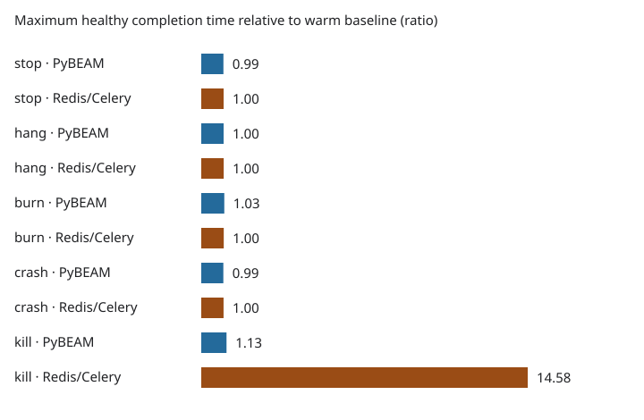
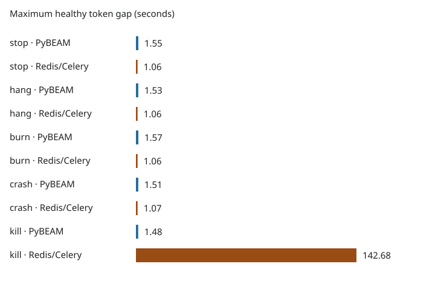
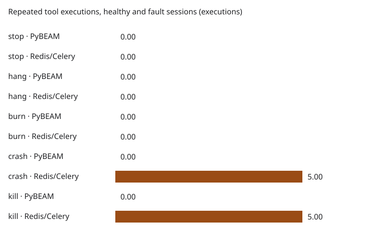

# Agent sessions

Run the same deterministic Pydantic AI agent on PyBEAM and on FastAPI,
Redis and Celery. The model streams text without an API key and calls tools
with measurable side effects. Each session shows its owner, transcript, tool
ledger and execution counters.

## Run both apps

From a development checkout with the [development prerequisites](../../docs/development.md)
and Docker available:

```sh
mise run example:agents
```

Open [PyBEAM](http://127.0.0.1:8811/) and
[Redis/Celery](http://127.0.0.1:8813/). Ctrl+C stops both stacks and removes
the conventional stack's demo data.

## Try a failure

Start a fault session and a batch of 12 **Normal** sessions. Open their links
in separate tabs to inspect the transcript and owner:

| Action | PyBEAM | Redis/Celery |
| --- | --- | --- |
| **Hang**, then **Stop session** | Terminates the isolated tool process. | Revokes the Celery task with process termination. |
| **Hang** | Occupies its own session until stopped. | Holds one of eight worker slots; later sessions queue when the slots are full. |
| **Burn** | Runs CPU work in an isolated process for about 30 seconds. | Runs CPU work inside a worker slot for about 30 seconds. |
| **Crash** | Fails that session after its tool process segfaults. | Loses a worker process and redelivers the turn; tools repeat until the session is stopped. |

Each fault follows a normal lookup. The JSON link on a session page shows
execution counts per tool-call ID. Stop hanging or repeatedly crashing sessions
when you finish inspecting them.

To kill a PyBEAM node, start a **Burn** session owned by node **a**. View its
session page on node **b** or **c**, then open node a's index page on port 8810
and use **Node failure → SIGKILL node a**. The surviving session page shows
the interrupted tool and its new owner.

To kill a Celery worker, start a **Burn** session and run the command on its
session page from the repository root:

```sh
mise exec -- uv run python -m examples.agents.usual.launch kill SESSION_ID
```

The owning worker container stops. Unacknowledged turns become eligible for
redelivery after the 60-second visibility timeout; delivery can take longer.
Turns start from the beginning and repeat tools. Restart the demo before
trying another node failure.

## Reproduce the comparison

Stop the interactive demo, then run:

```sh
mise run example:agents-compare
```

The runner starts both stacks itself and replaces the JSON and SVG files in
[`results/`](results/). Each case uses fresh stacks. On each stack, 12 normal
sessions warm the workers, followed by a 12-session no-fault baseline and
12 healthy sessions beside one fault. Both baseline and fault batches are warm.
Stacks are measured sequentially on the same host, with the other stack idle.
The kill case interrupts a burn after its first lookup.
Its completion deadline is 600 seconds. Redis visibility is an eligibility
threshold, not a delivery timer: this Celery transport checks every 10 seconds
and scans expired deliveries every tenth check, about 100 seconds apart.
Queueing and the restarted 30-second burn add to recovery time.







[`comparison.json`](results/comparison.json) contains individual completion
times, median and maximum baseline ratios, separate healthy/fault repeat
counts, fault states, Stop and recovery timings, execution counts and resource
samples. Fault states are recorded before cleanup; the runner then stops
sessions that remain active.

Completion, Stop and recovery timings use HTTP observations with a target
50 ms polling interval. Token gaps use server timestamps, include intentional
lookup pauses and exclude waiting for the first token. Memory is a sampled
sum of process RSS initiated after healthy-batch submission, not a peak;
shared pages are counted more than once.
Docker's memory samples are also retained. These are local observations, not
capacity or production-latency guarantees.

PyBEAM starts a fresh isolated process for each tool call; token gaps include
process startup, imports and replicated state writes. Celery runs tools inline
in existing prefork workers. The comparison retains these isolation semantics.

## Boundaries

- PyBEAM uses three replica nodes. A completed tool result is reused on takeover.
  A started tool without a committed result is reported as interrupted and is
  **not re-run**. This is at-most-once execution, not a guarantee that an
  interrupted tool produced no external side effect.
- Each PyBEAM node budgets 1 MiB of pending data for the cluster-wide full-snapshot
  subscription. The default 64 KiB is too small for concurrent token updates
  from these batches. On overflow, the node logs a warning and resubscribes;
  the next snapshot for a session resynchronizes its view. Each browser stream
  also logs and resubscribes on overflow, sending a fresh transcript without
  interrupting other streams or agent turns.
- Recovery here covers same-host SIGKILL only, not network partitions,
  whole-cluster restart or loss of the machine. PyBEAM's session directory is
  in memory; execution audit files share the host filesystem.
- Redis/Celery uses two prefork workers with four slots each and two web
  processes. Redis stores snapshots and counters; pub/sub streams snapshots
  to browsers. A task that outlives the visibility timeout can be redelivered
  even without a worker failure. Crash redelivery has no retry limit here.
- Both stacks retain only demo-sized session sets. Start a fresh run when the
  session limit is reached. Neither app is an authenticated public service.
